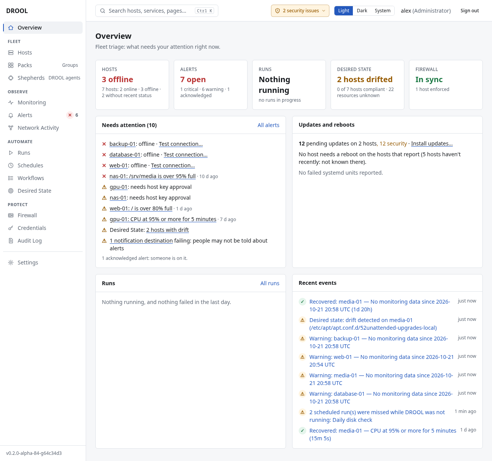

<p align="center">
  
</p>

<h1 align="center">DROOL</h1>

<p align="center">
  <strong>Distributed Remote Operations &amp; Observability Layer</strong>
</p>

<p align="center">
  A web-first platform for managing, monitoring, automating and safely firewalling Linux machines,
  over SSH or with optional Shepherd agents.
</p>

<!-- release-status: pre-1.0. At the first stable release, this line and the "Current status" section
say which release this is (RELEASING.md's checklist has the step). -->
<p align="center">
  <em>In development (pre-1.0), preparing for the first stable release.</em>
</p>

<p align="center">
  <a href="https://github.com/irnutsmurt/drool/wiki"><strong>User Guide</strong></a> ·
  <a href="#quick-start">Quick start</a> ·
  <a href="#what-drool-does">What it does</a> ·
  <a href="#supported-platforms">Platforms</a> ·
  <a href="#documentation">Documentation</a>
</p>

DROOL looks after your Linux machines from one web page: what they are, how they're doing, and what
changes on them, with a record of who did what. It's made for **self-hosters, advanced homelabs,
enthusiasts and small organizations**: people who want real fleet management without assembling it
from playbooks, dashboards and cron jobs. It's built for that scale, but not deliberately limited to it.

**Simple by default. Powerful by choice.** Add a host over SSH and within minutes it's inventoried,
monitored and ready for work. Everything stronger, such as Shepherd agents, short-lived SSH
certificates, two-factor sign-in and firewall enforcement, is there when you want it, not demanded up
front.

A few principles run through all of it:

- **Web first:** everyday administration happens in the browser, not in configuration files or
  playbooks.
- **SSH and Shepherds are both first class:** start with plain SSH, and add DROOL's agent where it helps.
- **Identity, not addresses:** DROOL trusts a machine by its cryptographic key, never by its IP address.
- **Show before changing, and never guess:** changes are previewed or simulated first, and an outcome
  DROOL can't know is reported as unknown, never as success.
- **Never strand the administrator:** a firewall change that would cut DROOL off undoes itself.

## How it works

DROOL is one program, the **controller**, that runs on one Linux machine (a small VM or a mini PC is
plenty) with its own database. You use it from its web interface, or its REST API. It reaches the
machines it manages, the **hosts**, in one of two ways, chosen per host:

- **Over SSH**, the way you log in yourself. Nothing is installed on the host: DROOL logs in as an
  account you choose and uses `sudo` when something needs root.
- **Through a Shepherd**, DROOL's small agent. It connects out to the controller over mutually
  authenticated TLS, and does only what the host's own settings allow.

Either way, DROOL runs typed operations (install this package, restart that service, apply this firewall
policy), checks the result, and records who did what in its audit log.

## Current status

<!-- release-status: see the note at the top. -->
**DROOL is in development (pre-1.0) and preparing for its first stable release, 1.0.** The features
described below exist, and DROOL's automated tests cover its supported platforms and core workflows,
but expect changes before 1.0: run it where a mistake is recoverable, and keep backups (and the master
key apart from them).

- **Linux is what DROOL manages today.** A Windows agent is a future goal; the controller's operations
  are kept platform-neutral so that it can be added later.
- **There is no stable release yet.** The `main` branch and its container image,
  `ghcr.io/irnutsmurt/drool:main`, are development builds. They're tested automatically but change with
  every commit and aren't signed with a release key, and `drool version` calls them *development*.
- **Still to come before 1.0:** the project's license, its release-signing key, and the first signed,
  tagged release ([RELEASING.md](RELEASING.md) describes how releases are made).

## What DROOL does

- **Fleet management.** Add Linux hosts over SSH in a few minutes, and DROOL inventories each one: OS,
  hardware, disks, network, services and listening ports. It never connects to a host whose SSH key you
  haven't approved. **Packs** group hosts, so "all media servers" is one click.
  ([Your First Host](https://github.com/irnutsmurt/drool/wiki/Your-First-Host))
- **Monitoring without building dashboards.** CPU, memory, disks and their health, temperatures, GPUs,
  services and network, with history and plain-English health issues, out of the box: no Grafana, no
  exporters. ([Fleet Monitoring](https://github.com/irnutsmurt/drool/wiki/Fleet-Monitoring))
- **Alerts that don't nag.** One message when a problem starts and one when it's fixed, by email,
  Discord, Slack or webhook, plus acknowledgements and maintenance mode.
  ([Understanding Alerts](https://github.com/irnutsmurt/drool/wiki/Understanding-Alerts))
- **Runs on many hosts at once.** Commands, scripts, packages, system updates, services and reboots,
  with each host's output live, package changes simulated first, and careful rollouts: one host first,
  then batches, pausing when something fails.
  ([Running a Command](https://github.com/irnutsmurt/drool/wiki/Running-a-Command))
- **Automation without cron or playbooks.** Schedules ("every Sunday at 03:00"), reusable workflows
  ("update, reboot if needed, check the services are running") and maintenance windows, set up in the
  browser. ([Schedules](https://github.com/irnutsmurt/drool/wiki/Schedules))
- **Files.** Browse and edit a host's files in the browser, or deploy one file to many hosts with a
  preview, a diff, a validation command and one-click rollback.
  ([Deploying a File to Multiple Hosts](https://github.com/irnutsmurt/drool/wiki/Deploying-a-File-to-Multiple-Hosts))
- **Desired State.** Say which services, packages and files a machine should have. DROOL shows what
  drifted and exactly how, and puts it back when you ask, or automatically if you choose.
  ([What Desired State Is](https://github.com/irnutsmurt/drool/wiki/What-Desired-State-Is))
- **Safe firewall management.** Describe who may reach whom ("web-servers may reach database-01 on
  PostgreSQL"), see what that means on each host, ask "can A reach B?", and apply it as nftables rules
  with automatic rollback protection: if a change cuts DROOL off from a host, the host undoes it by
  itself. ([What DROOL's Firewall Does](https://github.com/irnutsmurt/drool/wiki/What-DROOLs-Firewall-Does))
- **Network Activity.** What each host actually talks to, and what your firewall policy says about each
  connection. ([What DROOL Can See](https://github.com/irnutsmurt/drool/wiki/What-DROOL-Can-See))
- **Shepherds, optional agents.** A Shepherd connects *out* to DROOL, so a host behind NAT needs no open
  port. It monitors continuously, works within limits set on the host itself that DROOL can narrow but
  never widen, and updates itself only to releases signed with a key you hold.
  ([SSH vs Shepherds](https://github.com/irnutsmurt/drool/wiki/SSH-vs-Shepherds))
- **Security.** SSH host-key pinning, optional short-lived SSH certificates, two-factor sign-in,
  re-authentication before high-impact actions, roles, encrypted credentials, and a tamper-evident audit
  log with an optional remote copy.
  ([Secure Your Installation](https://github.com/irnutsmurt/drool/wiki/Secure-Your-Installation))
- **Backup and recovery.** Backups you can verify without restoring them, a restore that can't leave a
  half-restored controller, and hosts compared with the restored state before DROOL manages them again.
  ([Backup and Recovery](https://github.com/irnutsmurt/drool/wiki/Backup-and-Recovery))
- **Honest results.** Every run says what happened on every host: *succeeded*, *failed*, *timed out*,
  or *outcome unknown* when DROOL can't know. It's never a guess.
  ([Failed, Interrupted and Unknown Outcomes](https://github.com/irnutsmurt/drool/wiki/Failed-Interrupted-and-Unknown-Outcomes))

Three words are DROOL's own: a **Pack** is a group of hosts, a **Shepherd** is the DROOL agent
(`drool-agent`), and a **Run** is a job, anything DROOL does on hosts. The API calls them groups,
agents and jobs.



## Quick start

There is no stable release yet, so the quickest way to try DROOL is its development image with
Docker Compose. You need a 64-bit Linux machine (amd64 or arm64) with Docker and its Compose plugin.

```sh
mkdir -p ~/drool
cd ~/drool
curl -fsSLO https://raw.githubusercontent.com/irnutsmurt/drool/main/compose.yaml
echo 'DROOL_IMAGE=ghcr.io/irnutsmurt/drool:main' > .env
docker compose pull
docker compose up -d
docker compose logs drool
```

This makes a folder for DROOL, downloads the repository's `compose.yaml` into it, chooses the
development image, downloads it, starts DROOL in the background and shows its log. The end of the log
is DROOL's startup message, with two things you need:

- **The address to open**, printed as `https://<this-host's-address>:8080/setup`. Put in the address of
  the machine you ran this on, for example `https://10.10.0.10:8080/setup`. Your browser warns about
  DROOL's self-signed certificate the first time; that's expected.
- **A one-time administrator setup code**, six digits. Enter it on that page to create the first
  administrator account. It works once, for 60 minutes; `docker compose exec drool drool setup code`
  makes a new one.

`:main` is a **development image, not a stable release**: it's rebuilt from the newest code that passed
DROOL's tests, so `docker compose pull` always gets whatever is newest. Keep backups.

**[Full installation guide →](https://github.com/irnutsmurt/drool/wiki/Installing-DROOL)** Every way to
install DROOL (Docker Compose, Podman, `.deb` and `.rpm` packages, the release archive), each step
explained, from nothing installed to the setup screen. Then continue with
[First Login](https://github.com/irnutsmurt/drool/wiki/First-Login) and
[Your First Host](https://github.com/irnutsmurt/drool/wiki/Your-First-Host).

## Supported platforms

- **The controller** (DROOL itself) runs from its container image (Docker, also rootless, or rootless
  Podman), from `.deb` and `.rpm` packages, or as a static binary, on **amd64 and arm64**. It needs no
  root and no special privileges.
- **Managed hosts:** tested on **Debian 12 and 13, Ubuntu 22.04, 24.04 and 26.04, Rocky Linux 9 and 10,
  AlmaLinux 9 and 10, and Fedora 44**. RHEL and other Debian- or RHEL-based distributions are expected
  to work. A host needs SSH (or a Shepherd), and systemd for services, reboots and the firewall: no agent
  and no Python.
- **Shepherds** run on amd64 and arm64 Linux; other architectures are managed over SSH.

What's tested and what's only expected to work, in detail:
[Supported Platforms](https://github.com/irnutsmurt/drool/wiki/Supported-Platforms).

## Major limitations

- **Pre-1.0:** no stable release yet; expect changes before 1.0.
- **Linux only** today. Windows support is future work.
- **One controller** with one database (SQLite) and no high availability; tested with tens of hosts.
- **Firewall enforcement** only on hosts with plain nftables: hosts that run Docker, firewalld, UFW or
  Tailscale are detected and refused.
- **Local accounts only:** no single sign-on yet.
- **No package repository and no self-update** for the controller: you install new versions yourself.
  (Shepherds do update themselves, to releases signed with a key you hold.)
- **Backups are made from the command line**, and DROOL doesn't schedule them for you.
- **The web interface is functional, not polished** yet.

Everything DROOL doesn't do (yet):
[What DROOL Does](https://github.com/irnutsmurt/drool/wiki/What-DROOL-Does#what-drool-doesnt-do-yet).
Each page of the user guide mentions the limits that matter for that task.

## Documentation

**For anything step by step, go to the [User Guide](https://github.com/irnutsmurt/drool/wiki).**

| Document | What's in it |
|---|---|
| **[User Guide (wiki)](https://github.com/irnutsmurt/drool/wiki)** | Installation, getting started, everyday use and troubleshooting, with screenshots. Its source is [`docs/wiki/`](docs/wiki/Home.md) |
| **[DESIGN.md](DESIGN.md)** | Design: the product and trust architecture, and future plans |
| **[ARCHITECTURE-ALPHA.md](ARCHITECTURE-ALPHA.md)** | Implementation record: what DROOL actually implements, and why (it keeps its historical name) |
| **[RELEASING.md](RELEASING.md)** | Releasing: versions, building, qualification, signing and publishing |

Often needed:
[Troubleshooting](https://github.com/irnutsmurt/drool/wiki/Troubleshooting) ·
[Configuration](https://github.com/irnutsmurt/drool/wiki/Configuration) ·
[Backup and restore commands for each kind of installation](https://github.com/irnutsmurt/drool/wiki/Backup-and-Recovery) ·
[Updating DROOL](https://github.com/irnutsmurt/drool/wiki/Updating-DROOL) ·
[Command line](https://github.com/irnutsmurt/drool/wiki/Command-Line) ·
receiver formats for [webhooks](https://github.com/irnutsmurt/drool/wiki/Webhook-Reference) and the
[remote audit copy](https://github.com/irnutsmurt/drool/wiki/Remote-Audit-Copy-Reference).

## Development

Requirements: Go 1.27+, Node 22+ and npm. [sqlc](https://sqlc.dev) only to regenerate query code
(`go install github.com/sqlc-dev/sqlc/cmd/sqlc@v1.31.1`). Container images and releases need Docker with
BuildKit: the `docker buildx` plugin, or the pinned standalone buildx that `packaging/release/buildx`
uses (nothing is installed).

### Build and run from source

```sh
make build      # web UI + static binary at bin/drool, Shepherd binaries for amd64 and arm64
make run        # serves https://127.0.0.1:8080 and prints the setup code
make dev        # with make run in another terminal: the web UI with hot reload, proxying /api
make image      # container image for this machine: drool:local (what compose.yaml runs by default)
make release    # every release artifact from a clean clone of HEAD: dist/<version>/ (RELEASING.md)
```

A build from source reports itself as a *development build* (`drool version`, *Settings → System*),
and as *modified* when the source had uncommitted changes. Only the release pipeline, at a release tag,
makes a stable or prerelease build.

### Tests

```sh
make test               # Go tests, frontend typecheck and frontend unit tests
make test-race          # Go tests with the race detector
make vet fmt-check
make generate           # regenerate sqlc code and the TypeScript API types
make check-generated    # fail if generated code is stale (CI)
make test-integration   # real distributions in unprivileged containers (Docker, about 30 minutes)
```

- **VM tests** (real systemd, reboots and nftables; slow software emulation, no special privileges):
  `go test -tags integration ./test/integration -run TestVM -vm debian-12 -v -timeout 4h`.
  `TestVMPlatform` covers the whole support matrix (`-vm debian-13,ubuntu-22.04,…,debian-12-arm64`).
- **Browser tests** (`web/e2e`): `go test -tags integration ./test/integration -run TestBrowser -v`.
  They need Chromium (`CHROME=/path/to/chromium`, default `/usr/bin/chromium`) and `npm ci` in `web/`;
  `DROOL_E2E_FILES=automation,contrast` runs only those files.
- **Release qualification** runs the integration tests against a release's own artifacts:
  `go test -tags integration ./test/integration -release dist/<version> -v`
  ([RELEASING.md](RELEASING.md) lists the whole matrix).

The REST contract is [`api/openapi.yaml`](api/openapi.yaml): a Go test fails if the routes and the spec
drift apart, and the UI's TypeScript client types are generated from it. The UI uses semantic design
tokens (`web/src/styles/index.css`), each with a light and a dark value that the browser tests check
against WCAG AA contrast, and primitives in `web/src/components/ui/`: restyling means changing those,
not pages. Implementation decisions are
logged in [ARCHITECTURE-ALPHA.md](ARCHITECTURE-ALPHA.md).
