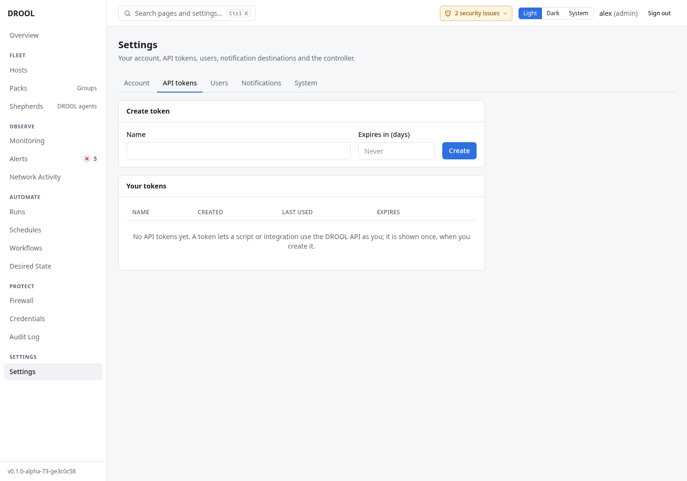

# API tokens

An **API token** lets a script or another program use DROOL's API **as you**, without your password:
for example a backup script that checks the controller, or a dashboard that reads alert counts.

## Before you start

- Any user can create tokens for themselves. A token has exactly your permissions, and loses them when
  you do (a changed role, a disabled account).
- Creating a token asks you to [confirm it's you](Re-authentication.md).
- **Tokens can never do the actions that ask you to confirm it's you** (managing users and tokens,
  certificate authorities, firewall overrides, and the rest), whatever your role.

## Create a token

1. Open **Settings → API tokens**.
2. Under **Create token**, enter a **Name** that says what uses it, for example `backup-script`, and
   optionally **Expires in (days)** (empty: never).
3. Click **Create**.
4. **Copy this token now. It will not be shown again.** Store it where the script can read it, for
   example a file only that script's user can read.



## Use it

Send the token in the `Authorization` header. For example, to read the open alerts:

```sh
curl -s -H "Authorization: Bearer $(cat ~/.config/drool/token)" \
  https://drool.example.net:8080/api/v1/alerts/summary
```

The token is read from a file, so it doesn't appear in your shell history or in the process list. If
DROOL uses its own self-signed certificate, add `--cacert` with a copy of that certificate rather
than `-k`, so the connection is still verified.

## Revoke a token

**Settings → API tokens → Your tokens →** the token's **Revoke** button. It stops working immediately.
Revoke tokens you no longer use, and any token that may have leaked. **Your tokens** shows when each one
was last used.

## Related

[Users and Roles](Users-and-Roles.md) · [Re-authentication](Re-authentication.md)
