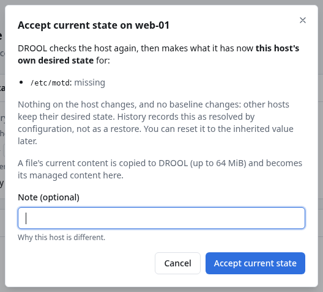

# Accept current state

**Accept current state** makes what a host has **now** its own desired state, for that resource, on
**that host only**. Use it when a host is different on purpose: `web-01` legitimately needs a
different `/etc/motd`, or one machine really needs `telnet`.

Nothing changes on the host, and no baseline changes: every other host keeps its desired state.

## Before you start

- You need **desired.manage** (administrators).
- The resource must be one DROOL can verify right now, and that differs. (An **Unknown** resource
  can't be accepted: DROOL has to see what it would be accepting.)
- [Review the difference](Review-Difference.md) first, so you know what you're accepting.

## Steps

1. Open the host's **Desired State** page and click the resource, for example `/etc/motd` on `web-01`.
2. Click **Accept current state**.
3. Read what DROOL will accept, for example *`/etc/motd`: missing*, and optionally enter a **Note**
   (*Why this host is different*).
4. Click **Accept current state**.

DROOL checks the host once more, then records the host's own value (shown as *Host override*) and
*Current state accepted* in the history. The resource is **Compliant** again.

## What gets stored

- For a **file**, DROOL copies the file's current content (up to 64 MiB) into its file store; it
  becomes the managed content **for this host**. A file that doesn't exist on the host becomes *not
  managed on this host*.
- For a **package** or **service**, the current state becomes the desired state for this host.

## Undo it

Open the resource and click **Reset to inherited**. DROOL asks *Reset /etc/motd to its inherited
desired state?*: *This host's own setting is removed; the value it inherits (from its Packs or every
host) applies again. If the host differs from that value, it then shows drift.* Click **Reset to
inherited** again. The host then follows its baselines again, and may show drift right away.

## Related

[Drift](Drift.md) · [Review Difference](Review-Difference.md) · [Restore Managed State](Restore-Managed-State.md) ·
[Conflicts](Conflicts.md)
