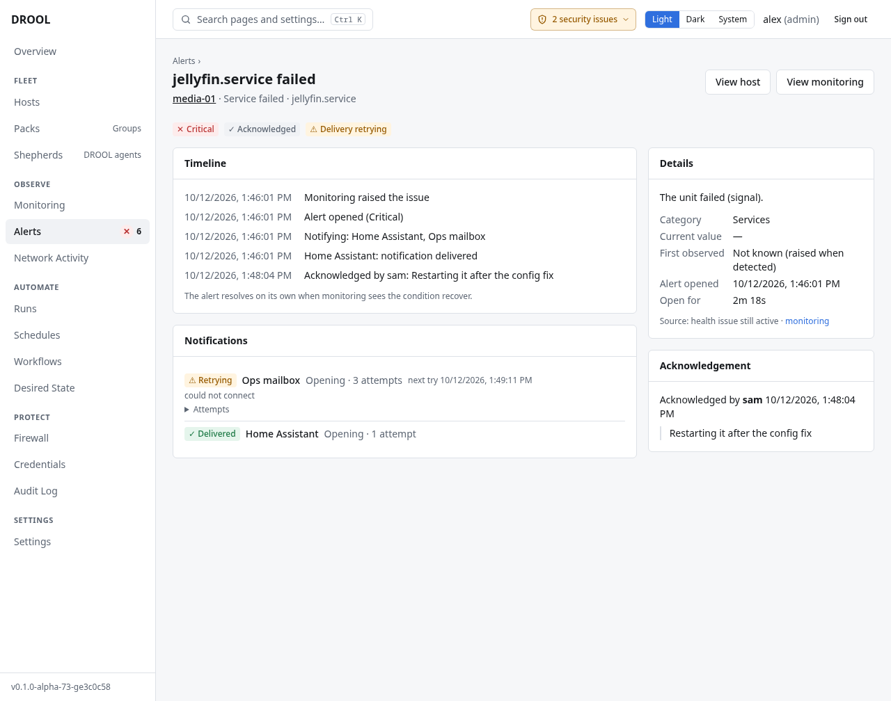

# Acknowledging an alert

**Acknowledging** an alert tells everyone else "someone is on it". It's how a team avoids two people
fixing the same disk, and how you stop reminders while you work.

Acknowledging does **not** close the alert and doesn't change anything on the host. The alert stays
open until monitoring sees the condition go away ([Understanding Alerts](Understanding-Alerts.md#nobody-can-close-an-alert)).

## Before you start

- You need **alerts.acknowledge** (administrators and operators).
- Only an **Active** alert can be acknowledged. A resolved alert has nothing left to acknowledge.

## Steps

1. Open **Alerts** and click the problem, for example *sdb: kernel reports IO errors* on `nas-01`.
2. In the **Acknowledge** box on the right, optionally write a **Note** for the others (up to 500
   characters), for example *Replacing the failed disk this evening*.
3. Click **Acknowledge**.

The alert moves to the **Acknowledged** tab, with your name. The note and your name appear on the
alert's page and in its timeline, for example *Acknowledged by sam: Restarting it after the config fix*.

## What changes, and what doesn't

| | After acknowledging |
|---|---|
| The alert | Stays open, on the **Acknowledged** tab |
| Reminders | Stop (any reminder not sent yet is cancelled) |
| If it gets worse (Warning → Critical) | You're still told: an *escalated* message is sent as usual |
| When it's fixed | The recovery message is sent as usual, and says who acknowledged it and their note |
| If maintenance ends while it's still open | No new message is sent (it has an owner) |
| The host, the health issue, monitoring | Nothing changes |

An acknowledgement can't be taken back or edited. If you acknowledged the wrong alert, tell your team;
the alert still closes on its own when the condition recovers.

Every acknowledgement is recorded in the [audit log](Audit-Log.md).

## Related

[Understanding Alerts](Understanding-Alerts.md) · [Maintenance Mode](Maintenance-Mode.md) ·
[Notification Routing](Notification-Routing.md#reminders)
