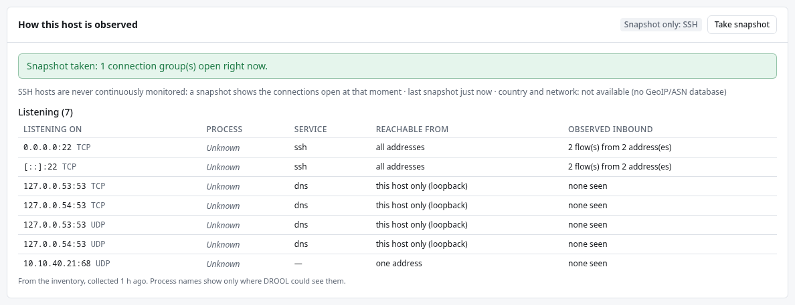

# What Shepherd and SSH hosts can see

How much of a host's network activity DROOL sees depends on how it reaches the host. Each host's
**Network** section says which applies, under **How this host is observed**.

| | Shepherd hosts | SSH hosts |
|---|---|---|
| **How** | **Continuous**. *Continuous: conntrack* when the kernel tracks connections (any firewall that uses connection tracking, for example once DROOL's firewall is enforced): every new connection, however short. Otherwise *Continuous: socket sampling (every 30 s)*, which misses connections that open and close in between | **Snapshot only: SSH**. **Take snapshot** shows what is open at that moment |
| **Processes** | From the owner of the socket: the listening program for inbound connections; for outbound ones, if the connection still exists when DROOL looks | The same, at the moment of the snapshot |
| **Never** | Packet contents, DNS queries, byte counts | The same |

DROOL never installs packages, loads kernel modules or changes kernel settings to see more. When
conntrack isn't used, the page says why, for example *connection tracking is not active on this host
(no nf_conntrack); DROOL does not load kernel modules*.

## Take a snapshot of an SSH host

1. Open the host's **Network** section.
2. Click **Take snapshot**. DROOL logs in over SSH and lists the open connections:
   *Snapshot taken: 1 connection group(s) open right now.*

You need **network.snapshot** (administrators and operators).

A snapshot shows **only what is open at that moment**: a backup that ran at 03:00 won't be in a
snapshot taken at noon. For a host you want to understand well, a [Shepherd](SSH-vs-Shepherds.md) is
better.

## Listening sockets

Every host shows what it **listens on**, from its inventory: the address and port, the program, the
service, **Accepts on** — which of the host's own addresses the socket accepts connections on (*all of
the host's addresses*, *one of the host's addresses*, or *loopback only (this host)*); who can actually
reach the port is up to the firewalls — and **Observed inbound** (how many connections from how many
addresses DROOL saw). *Process names show only
where DROOL could see them*: an SSH host without passwordless sudo, for example, shows *Unknown*.

## Turn continuous collection on or off

**Network Activity → Collection and enrichment → Continuous collection on hosts with a Shepherd**:
**Every host with a Shepherd** (the default), **Only hosts whose firewall mode isn't Off**, or **Off**.
*SSH-only hosts are never collected continuously.* You need **network.settings** (administrators);
changes are recorded in the [audit log](Audit-Log.md).

## Related

[What DROOL Can See](What-DROOL-Can-See.md) · [SSH vs Shepherds](SSH-vs-Shepherds.md) ·
[Monitoring Through SSH vs Shepherd](Monitoring-Through-SSH-vs-Shepherd.md)
