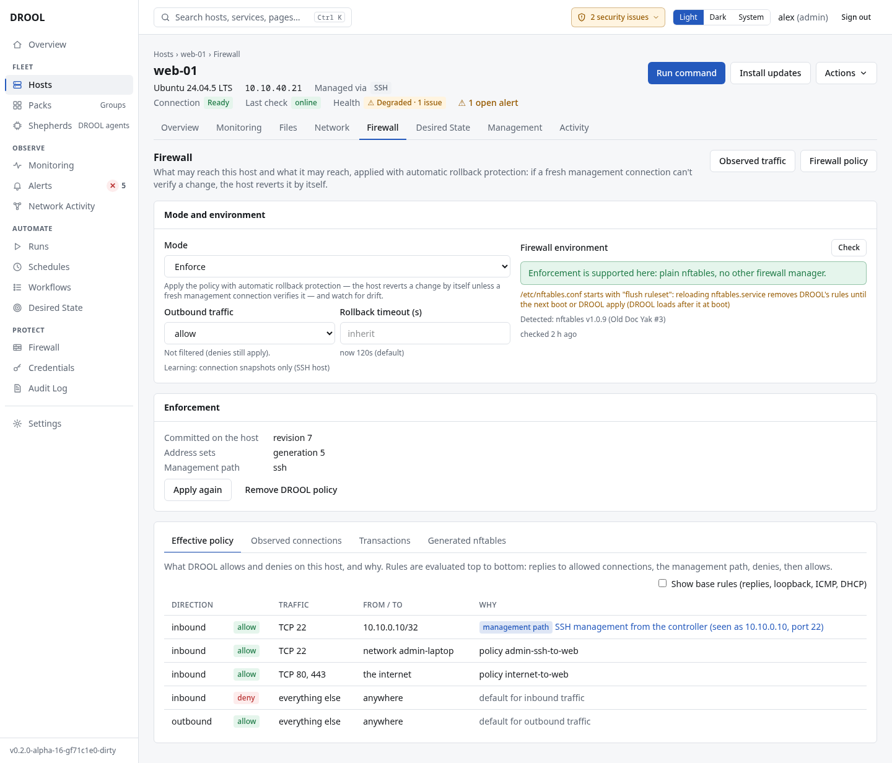
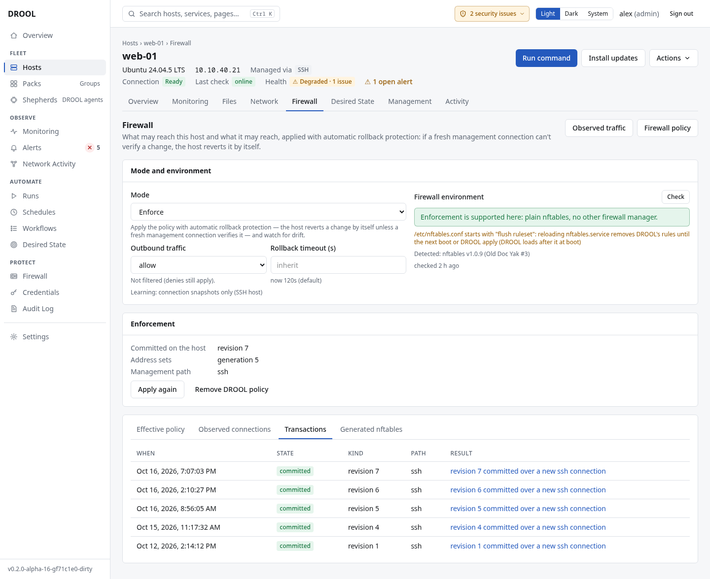

# Applying the firewall policy

Saving the [firewall policy](Firewall-Policy.md) changes no host. **Applying** puts it on a host,
one host at a time, each protected by [automatic rollback protection](Automatic-Rollback-Protection.md).
Each host's **Firewall** section keeps three things apart:

| | What it is |
|---|---|
| **Saved policy** | The rules you saved that apply to this host, and what they would do there |
| **Applied on the host** | What DROOL has committed to the host (a revision), or nothing |
| **Observed traffic** | Connections DROOL saw. Seeing one isn't proof that the firewall allowed it |

A saved rule is never shown as enforced until the host runs it. In the examples, Alex applies the
policy to `web-01`.

## Before you start

- You need **firewall.write** (administrators).
- The host's firewall environment must be **supported** ([Before Enabling Enforcement](Before-Enabling-Enforcement.md)).
  Where it isn't, the host's page says *Applying isn't possible right now: DROOL can't enforce on this
  host: …* and offers nothing to apply.
- No other firewall transaction may be pending on the host.
- The policy must not cut DROOL's management path ([Management Path Protection](Management-Path-Protection.md)).

The host doesn't have to be in **Enforce** mode yet: the review asks which mode it should have, and
only **Enforce**, chosen there, applies the policy ([below](#a-host-that-isnt-in-enforce-mode)).

## Right after saving the policy

In **Firewall → Policy**, a draft that changes some host's firewall can be saved two ways:

- **Save and review application…** saves it and opens the [review](#review-and-apply) for the hosts it
  affects that DROOL can apply to now, so you can finish in one place.
- **Save policy** only saves it. DROOL lists the hosts the change affects and where each one stands,
  then asks *Would you like to review and apply these changes now?* Click **Review and apply to
  web-01…** (or **Review and apply to 3 hosts…**), or **Not now**. You can review and apply later
  from each host's firewall page, or **Firewall → Hosts**.

Where each host stands, for example:

- *Policy saved — not yet enforced (mode Monitor: the review asks whether to switch it to Enforce).*
- *Policy saved — not yet enforced (firewall management is off on this host: the review asks how to
  configure it).*
- *↻ Not applied yet: the host runs revision 1.*
- *Policy saved — not yet enforced (Monitor mode…). DROOL can't enforce on this host: …* (nothing to
  apply there; the reason says why).

If a rule you saved is on no host's firewall, the summary says so too (*Rule ssh-internal applies to
no host…*): see [What a rule's destination means](Firewall-Policy.md#the-destination-says-which-hosts-get-the-rule).

![Firewall → Policy right after Alex saved a rule letting the admin laptop ping four hosts: "Saved. Nothing has changed on any host yet." backup-01: Policy saved — not yet enforced (mode Monitor: the review asks whether to switch it to Enforce); gpu-01: firewall management is off on this host: the review asks how to configure it; nas-01: Enforce is set, nothing applied yet; web-01: Not applied yet, the host runs revision 10. Then "Would you like to review and apply these changes now?" with Review and apply to 4 hosts… and Not now](images/firewall-saved-hosts.png)

## On the host's firewall page

Open the host's **Firewall** section. **Policy on this host** says first where it stands, and offers
the one next step:

| It says | Meaning | Next step |
|---|---|---|
| **Policy saved — not yet enforced.** | The saved policy has rules for this host; DROOL doesn't filter it yet | **Review and apply policy…** |
| **No firewall rules for this host yet** | Applied as it is, the policy would drop every inbound connection except DROOL's own management | **Add a rule in the Firewall Designer** |
| **Saved changes not applied yet** | The host runs an earlier revision | **Review and apply changes…** |
| **In force: revision 2** | The host runs what the saved policy says | Nothing. **Apply again…** only re-verifies it |
| **In force: revision 2, addresses updating** | New addresses of a Pack's hosts are being sent to it automatically | Nothing |
| **DROOL's rules are missing from this host**, **Changed outside DROOL: what this host enforces isn't known** | [Drift](Firewall-Drift.md) | **Review and apply again…**, replacing what was changed |
| **A firewall change is in progress** | A transaction waits for its commit or rollback | Wait for it |

Below it, **Policy preview** shows what the saved policy would do on this host once applied (*Nothing
of it is enforced now*). Once it is applied, the same card is **Applied policy**: what the host runs.
Both list, inbound and outbound, the default (*Everything not allowed below is dropped.*), each rule
with its service, port and peers (*http, https · TCP 80, 443 from the internet, rule internet-to-web*),
and DROOL's protected management path. When the saved policy and the host's revision differ, switch
between **Saved policy (not applied)** and **In force now (revision 9)**: lines marked **↻** are the
difference.

## Review and apply

1. Click **Review and apply policy…** (or the button the page offers).
2. For a host that isn't in **Enforce** mode, choose its mode first
   ([below](#a-host-that-isnt-in-enforce-mode)): the review starts with **Keep current mode**, which
   applies nothing there.
3. Read the review. For each host it applies to, it shows:
   - **Mode**: *Enforce (already set)*, or **Monitor → Enforce** (when you chose Enforce): *This apply
     switches the host to Enforce: from then on DROOL's rules decide which connections it accepts.*
   - **What changes**: a first application (*DROOL starts filtering this host's traffic with the saved
     policy's rules: …*), or the rules added (+) and removed (−) since the revision the host runs.
   - **Could affect connectivity**: inbound connections no rule allows are dropped, new denies,
     warnings, and DROOL's management path, which stays open ahead of every rule. *Automatic rollback
     protects only DROOL's own connection*: a change that blocks your own SSH or anything else but
     leaves DROOL's connection working stays in force
     ([What it doesn't protect](Automatic-Rollback-Protection.md#what-it-doesnt-protect)). On a Shepherd
     host, DROOL's connection isn't SSH. Check **Observed connections** first: what is marked *would be
     denied* is what the policy would drop.
   - **The rules in force after applying**, when you open it.
   - A rule that names this host's address but not the host (*Rule ssh-internal isn't part of this
     host's policy…*), when there is one.

   *This is the review: nothing changes until you choose Switch to Enforce and apply.*
4. Click the button, which says exactly what it starts: **Switch to Enforce and apply**, **Apply
   policy**, **Apply to 3 hosts**, **Change web-01's mode to Guided**, or for example **Switch to
   Enforce and apply to 2 hosts and change media-02's mode to Monitor**.

For each host, DROOL then checks its firewall environment and measures a brand-new management
connection. Only when those checks pass does it switch the host to Enforce (if the review said so),
just before the rules change; a host refused before that keeps its mode. If the policy changed after
you reviewed it, the host is refused (*the policy for web-01 changed since it was reviewed*): review
it again.

*Started: applying the saved policy to web-01, one host at a time.* Applying is an ordinary
[run](Understanding-Run-Results.md), listed under **Runs**.

Choosing **Enforce** under **Mode and environment** doesn't apply anything either: *Selecting Enforce
doesn't change anything on the host by itself*. DROOL offers **Review and apply policy…** right there
(the review opens with Enforce chosen), and **Save mode only** to set the mode now and apply later.

## A host that isn't in Enforce mode

The review asks how such a host should handle the policy, and shows its mode now:

- **Off**: *Firewall management isn't enabled on this host. Would you like to configure it?*
- **Monitor** or **Guided**: *DROOL observes this host but doesn't enforce the policy on it. Would you
  like to configure it?*

Choose under **Mode for web-01**:

| Choice | What happens when you confirm |
|---|---|
| **Keep current mode (Monitor)** | Chosen at first. Nothing changes on the host: the saved policy isn't applied there |
| **Off** — *No firewall monitoring or enforcement.* | Only the mode changes; DROOL stops observing it |
| **Monitor** — *Observe traffic without enforcing rules.* | Only the mode changes. Nothing is applied or enforced |
| **Guided** — *Observe traffic and provide policy guidance.* | Only the mode changes. Nothing is applied or enforced |
| **Enforce** — *Apply firewall rules with rollback protection.* | The review shows what applying changes; confirming switches the host to Enforce and applies the policy |

DROOL never picks **Enforce** for you. Where applying would be refused (*a rule would cut DROOL's
management path*, an environment DROOL can't enforce on, a transaction in progress), **Enforce** says
*(not possible now)* and can't be chosen; Off, Monitor and Guided still can. A host already in
**Enforce** isn't asked: the review goes straight to what changes.

Changing the mode doesn't remove DROOL's rules: on a host that still runs an earlier revision, the
review says *DROOL's revision 3 stays in force on it*. Every mode change is recorded in the audit log.

## Apply to several hosts

- Right after saving the policy: **Save and review application…**, or **Review and apply to 3
  hosts…** (above).
- Or **Firewall → Hosts**: tick the hosts (hosts in Enforce mode have a checkbox), then **Apply to 2
  host(s)…**.

The review lists each host with a one-line summary (*switches from Monitor to Enforce · 2 rules,
applied for the first time*, *stays Monitor, not applied*, *mode changes to Guided, nothing applied*)
and, for each host not in Enforce mode, its own **Mode for …** choice. A host DROOL would refuse (no
supported environment, a transaction in progress, a rule cutting its management path, drift) is left
out, with the reason. Mode changes are made first; then the hosts being applied to are done **one at a
time, stopping at the first failure**, so a problem stops on one host.

## What you see afterwards

- In the review: *Started: applying the saved policy to web-01, one host at a time.*, and for a mode
  you changed, *Mode changed: media-02: Off → Monitor. Nothing was applied to that host: Off, Monitor
  and Guided don't enforce.*
- **Policy on this host**: *In force: revision 10*; **Applied on the host**: *Revision 10, the same as
  the saved policy*, and when DROOL last read the host's firewall state. The card below it is now
  **Applied policy**: what the host runs.

  

- **Firewall → Hosts**: the status becomes **in sync**.
- The host's **Transactions** tab, and **Firewall → Transactions**: each apply with its result, for
  example *revision 1 committed over a new ssh connection*.

| Status on Firewall → Hosts | Meaning |
|---|---|
| **not enforced** | DROOL doesn't filter this host |
| **in sync** | The host has the current policy |
| **changes not applied** | The policy changed since the last apply: review and apply it |
| **addresses propagating** | Only address sets are being updated ([Packs in Firewall Rules](Packs-in-Firewall-Rules.md#when-addresses-change)) |
| **transaction pending** | An apply is waiting for its commit |
| **drift** | DROOL's rules were changed outside DROOL ([Firewall Drift](Firewall-Drift.md)) |
| **blocked: management path** | The policy would cut DROOL off, so applying is refused ([Management Path Protection](Management-Path-Protection.md)) |

## While a transaction is pending

DROOL refuses reboots, system updates and restarts of network services on that host until the
transaction is committed or rolled back (*Reboots and network restarts wait for it.*).

## If it was rolled back

The transaction shows **rolled back** with the reason, and the host still has its previous policy. If
the review switched the host to Enforce, it stays in Enforce. See
[Firewall Apply Rolled Back](Firewall-Apply-Rolled-Back.md).

## Related

[Automatic Rollback Protection](Automatic-Rollback-Protection.md) · [Firewall Modes](Firewall-Modes.md) ·
[Creating a Policy From Observed Traffic](Creating-a-Policy-From-Observed-Traffic.md) ·
[Recovering From a Firewall Problem](Recovering-From-a-Firewall-Problem.md)
