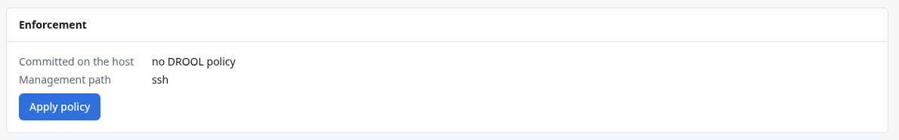
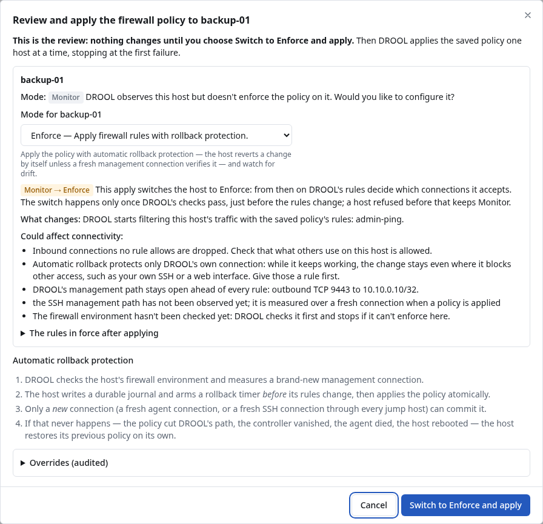

# Applying the firewall policy

Saving the [firewall policy](Firewall-Policy.md) changes no host. **Applying** puts it on hosts in
**Enforce** mode, one host at a time, each protected by
[automatic rollback protection](Automatic-Rollback-Protection.md). In the examples, Alex applies the
policy to `web-01`.

## Before you start

- You need **firewall.write** (administrators).
- The host must be in **Enforce** mode with a **supported** environment
  ([Firewall Modes](Firewall-Modes.md), [Before Enabling Enforcement](Before-Enabling-Enforcement.md)).
- No other firewall transaction may be pending on the host.
- The policy must not cut DROOL's management path ([Management Path Protection](Management-Path-Protection.md)).

## Apply to one host

1. Open the host's **Firewall** section.
2. Look at the **Effective policy** tab: what will be allowed and denied, and why.
3. In the **Enforcement** card, click **Apply policy** (the first time), **Apply changes** (when the
   policy changed since the last apply), or **Apply again** (to re-verify an unchanged policy).

   

4. Read the dialog: what changes, and how automatic rollback protection works.
5. Click **Apply**.

*Started. Follow it on its run page; each host's transaction timeline is on its firewall page.* Applying
is an ordinary [run](Understanding-Run-Results.md), listed under **Runs**.

## Apply to several hosts

- **Firewall → Hosts**: tick the hosts (only enforced hosts have a checkbox), then **Apply to 2
  host(s)…**. The dialog lists what changes on each host (rules added and removed, a first apply, or
  *refused* when a policy would cut DROOL's management path) before anything is applied; **Apply to 2
  hosts** starts it.
- Or, in **Firewall → Policy**, after saving: the **Preview** offers **Apply to 3 enforced host(s)…**
  for the hosts the change affects.

Hosts are done **one at a time, stopping at the first failure**, so a problem stops on one host.

## What you see afterwards

- The host's **Enforcement** card: *Committed on the host: revision 1*, its address sets, and the
  management path DROOL used (*ssh* or *agent*).
- **Firewall → Hosts**: the status becomes **in sync**.
- The host's **Transactions** tab, and **Firewall → Transactions**: each apply with its result, for
  example *revision 1 committed over a new ssh connection*.

| Status on Firewall → Hosts | Meaning |
|---|---|
| **not enforced** | DROOL doesn't filter this host |
| **in sync** | The host has the current policy |
| **changes not applied** | The policy changed since the last apply: apply again |
| **addresses propagating** | Only address sets are being updated ([Packs in Firewall Rules](Packs-in-Firewall-Rules.md#when-addresses-change)) |
| **transaction pending** | An apply is waiting for its commit |
| **drift** | DROOL's rules were changed outside DROOL ([Firewall Drift](Firewall-Drift.md)) |
| **blocked: management path** | The policy would cut DROOL off, so applying is refused ([Management Path Protection](Management-Path-Protection.md)) |

## While a transaction is pending

DROOL refuses reboots, system updates and restarts of network services on that host until the
transaction is committed or rolled back (*Reboots and network restarts wait for it.*).

## If it was rolled back

The transaction shows **rolled back** with the reason, and the host still has its previous policy. See
[Firewall Apply Rolled Back](Firewall-Apply-Rolled-Back.md).

## Related

[Automatic Rollback Protection](Automatic-Rollback-Protection.md) · [Firewall Modes](Firewall-Modes.md) ·
[Recovering From a Firewall Problem](Recovering-From-a-Firewall-Problem.md)
