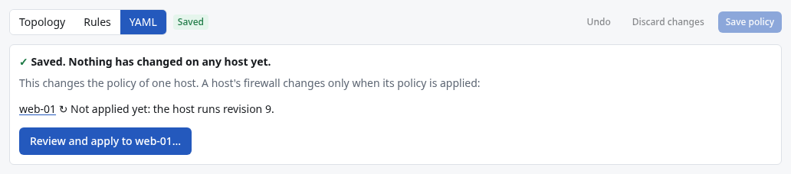

# Applying the firewall policy

Saving the [firewall policy](Firewall-Policy.md) changes no host. **Applying** puts it on a host,
one host at a time, each protected by [automatic rollback protection](Automatic-Rollback-Protection.md).
Each host's **Firewall** section keeps three things apart:

| | What it is |
|---|---|
| **Saved policy** | The rules you saved that apply to this host, and what they would do there |
| **Applied on the host** | What DROOL has committed to the host (a revision), or nothing |
| **Observed traffic** | Connections DROOL saw. Seeing one isn't proof that the firewall allowed it |

A saved rule is never shown as enforced until the host runs it. In the examples, Alex applies the
policy to `web-01`.

## Before you start

- You need **firewall.write** (administrators).
- The host's firewall environment must be **supported** ([Before Enabling Enforcement](Before-Enabling-Enforcement.md)).
  Where it isn't, the host's page says *Applying isn't possible right now: DROOL can't enforce on this
  host: …* and offers nothing to apply.
- No other firewall transaction may be pending on the host.
- The policy must not cut DROOL's management path ([Management Path Protection](Management-Path-Protection.md)).

The host doesn't have to be in **Enforce** mode yet: when it isn't, the review switches it, and says so.

## Right after saving the policy

When you click **Save policy** in **Firewall → Policy**, DROOL lists the hosts the change affects and
where each one stands, for example:

- *Policy saved — not yet enforced (mode Monitor: applying switches it to Enforce).*
- *↻ Not applied yet: the host runs revision 1.*
- *Policy saved — not yet enforced (Monitor mode…). DROOL can't enforce on this host: …* (nothing to
  apply there; the reason says why).

Click **Review and apply to web-01…** (or **Review and apply to 3 hosts…**) to [review](#review-and-apply)
those DROOL can apply to now.

## On the host's firewall page

Open the host's **Firewall** section. **Policy on this host** says first where it stands, and offers
the one next step:

| It says | Meaning | Next step |
|---|---|---|
| **Policy saved — not yet enforced.** | The saved policy has rules for this host; DROOL doesn't filter it yet | **Review and apply policy…** |
| **No firewall rules for this host yet** | Applied as it is, the policy would drop every inbound connection except DROOL's own management | **Add a rule in the Firewall Designer** |
| **Saved changes not applied yet** | The host runs an earlier revision | **Review and apply changes…** |
| **In force: revision 2** | The host runs what the saved policy says | Nothing. **Apply again…** only re-verifies it |
| **In force: revision 2, addresses updating** | New addresses of a Pack's hosts are being sent to it automatically | Nothing |
| **DROOL's rules are missing from this host**, **Changed outside DROOL: what this host enforces isn't known** | [Drift](Firewall-Drift.md) | **Review and apply again…**, replacing what was changed |
| **A firewall change is in progress** | A transaction waits for its commit or rollback | Wait for it |

Below it, **Policy preview** shows what the saved policy would do on this host once applied (*Nothing
of it is enforced now*). Once it is applied, the same card is **Applied policy**: what the host runs.
Both list, inbound and outbound, the default (*Everything not allowed below is dropped.*), each rule
with its service, port and peers (*http, https · TCP 80, 443 from the internet, rule internet-to-web*),
and DROOL's protected management path. When the saved policy and the host's revision differ, switch
between **Saved policy (not applied)** and **In force now (revision 9)**: lines marked **↻** are the
difference.

## Review and apply

1. Click **Review and apply policy…** (or the button the page offers).
2. Read the review. For each host it shows:
   - **Mode**: *Enforce (already set)*, or **Monitor → Enforce**: *This apply switches the host to
     Enforce: from then on DROOL's rules decide which connections it accepts.*
   - **What changes**: a first application (*DROOL starts filtering this host's traffic with the saved
     policy's rules: …*), or the rules added (+) and removed (−) since the revision the host runs.
   - **Could affect connectivity**: inbound connections no rule allows are dropped, new denies,
     warnings, and DROOL's management path, which stays open ahead of every rule.
   - **The rules in force after applying**, when you open it.

   *This is the review: nothing changes until you choose Switch to Enforce and apply.*
3. Click **Switch to Enforce and apply** (or **Apply policy**, **Apply to 3 hosts**).

For each host, DROOL then checks its firewall environment and measures a brand-new management
connection. Only when those checks pass does it switch the host to Enforce (if the review said so),
just before the rules change; a host refused before that keeps its mode. If the policy changed after
you reviewed it, the host is refused (*the policy for web-01 changed since it was reviewed*): review
it again.

*Started: applying the saved policy to web-01, one host at a time.* Applying is an ordinary
[run](Understanding-Run-Results.md), listed under **Runs**.

Choosing **Enforce** under **Mode and environment** doesn't apply anything either: *Selecting Enforce
doesn't change anything on the host by itself*. DROOL offers **Review and apply policy…** right there,
and **Save mode only** to set the mode now and apply later.

## Apply to several hosts

- Right after saving the policy: **Review and apply to 3 hosts…** (above).
- Or **Firewall → Hosts**: tick the hosts (hosts in Enforce mode have a checkbox), then **Apply to 2
  host(s)…**.

The review lists each host. A host DROOL would refuse (no supported environment, a transaction in
progress, a rule cutting its management path, drift) is left out, with the reason. The others are done
**one at a time, stopping at the first failure**, so a problem stops on one host.

## What you see afterwards

- **Policy on this host**: *In force: revision 10*; **Applied on the host**: *Revision 10, the same as
  the saved policy*, and when DROOL last read the host's firewall state. The card below it is now
  **Applied policy**: what the host runs.

  

- **Firewall → Hosts**: the status becomes **in sync**.
- The host's **Transactions** tab, and **Firewall → Transactions**: each apply with its result, for
  example *revision 1 committed over a new ssh connection*.

| Status on Firewall → Hosts | Meaning |
|---|---|
| **not enforced** | DROOL doesn't filter this host |
| **in sync** | The host has the current policy |
| **changes not applied** | The policy changed since the last apply: review and apply it |
| **addresses propagating** | Only address sets are being updated ([Packs in Firewall Rules](Packs-in-Firewall-Rules.md#when-addresses-change)) |
| **transaction pending** | An apply is waiting for its commit |
| **drift** | DROOL's rules were changed outside DROOL ([Firewall Drift](Firewall-Drift.md)) |
| **blocked: management path** | The policy would cut DROOL off, so applying is refused ([Management Path Protection](Management-Path-Protection.md)) |

## While a transaction is pending

DROOL refuses reboots, system updates and restarts of network services on that host until the
transaction is committed or rolled back (*Reboots and network restarts wait for it.*).

## If it was rolled back

The transaction shows **rolled back** with the reason, and the host still has its previous policy. If
the review switched the host to Enforce, it stays in Enforce. See
[Firewall Apply Rolled Back](Firewall-Apply-Rolled-Back.md).

## Related

[Automatic Rollback Protection](Automatic-Rollback-Protection.md) · [Firewall Modes](Firewall-Modes.md) ·
[Creating a Policy From Observed Traffic](Creating-a-Policy-From-Observed-Traffic.md) ·
[Recovering From a Firewall Problem](Recovering-From-a-Firewall-Problem.md)
