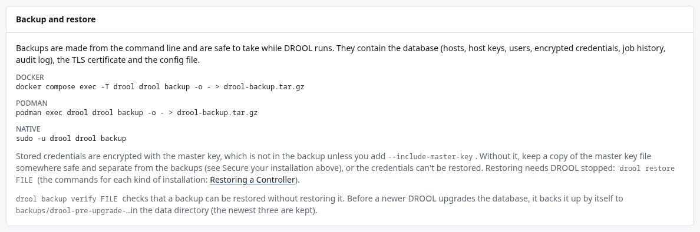

# Backup and recovery

DROOL keeps everything it knows (your hosts, their trusted keys, Packs, users, encrypted
credentials, run history, the audit log, firewall policies, schedules, Desired State, settings) in
one small database in its data folder. A backup is one file containing that database, DROOL's TLS
certificate and its configuration file, if you have one.

Two facts matter more than anything else on this topic:

1. **DROOL doesn't make backups on a schedule or copy them anywhere.** You run `drool backup`
   yourself, or from cron, a systemd timer or your backup tool, and you keep the files somewhere
   other than the controller.
2. **A backup doesn't contain the master key** (`master.key`), which encrypts your stored
   passwords and SSH keys. Without the key, a backup restores everything *except* those secrets.
   Keep a copy of the key, apart from the backups. See [The Master Key](Master-Key.md).

## The pages in this section

| If you want to… | Read |
|---|---|
| Know what is and isn't in a backup | [What a Backup Contains](What-a-Backup-Contains.md) · [What a Backup Does Not Contain](What-a-Backup-Does-Not-Contain.md) |
| Understand the master key | [The Master Key](Master-Key.md) |
| Make a backup | [Docker Backup](Docker-Backup.md) · [Native Installation Backup](Native-Installation-Backup.md) · [Podman Backup](Podman-Backup.md) |
| Check a backup is good, without restoring it | [Verifying a Backup](Verifying-a-Backup.md) |
| Restore after a disaster, or move DROOL to another machine | [Restoring a Controller](Restoring-a-Controller.md) |
| Understand what DROOL does right after a restore | [What Happens After Restore](What-Happens-After-Restore.md) · [Host Reconciliation](Host-Reconciliation.md) |
| Recover when the master key is lost | [Recovering Without Credentials](Recovering-Without-Credentials.md) |

## A sensible routine

1. **Once, now:** copy `master.key` to a password manager or an encrypted USB stick
   ([how](Master-Key.md#keeping-a-copy)).
2. **Every night:** make a backup and copy it off the controller. On a native installation that's one
   line in root's crontab, but only once root can copy to your backup machine over SSH without a
   password and you've tested that copy by hand:
   [Native Installation Backup](Native-Installation-Backup.md#copy-it-off-the-controller) shows all
   three steps. With Docker or Podman: [Docker Backup](Docker-Backup.md#every-night-automatically),
   [Podman Backup](Podman-Backup.md#every-night-automatically). Backups are safe to make while DROOL
   runs. Delete old ones from time to time; DROOL doesn't.
3. **Now and then:** check a backup with `drool backup verify` ([Verifying a Backup](Verifying-a-Backup.md)).
4. **Before every update:** make a backup ([Updating DROOL](Updating-DROOL.md)).

**Settings → System** shows the backup commands for your kind of installation and, in
[Secure Your Installation](Secure-Your-Installation.md), when the newest backup in DROOL's own data
folder was made.

## When something goes wrong

| Situation | What to do |
|---|---|
| The controller machine is gone | Install DROOL on another machine and, before setting it up, restore your latest backup with the master key you kept ([Restoring a Controller](Restoring-a-Controller.md)). Start it, point the name or address Shepherds use at it if it changed, then work through **Settings → System → Restore** ([What Happens After Restore](What-Happens-After-Restore.md)) |
| The master key is lost | DROOL refuses to start with a missing or wrong key. Restore the latest backup without its credentials; everything else comes back ([Recovering Without Credentials](Recovering-Without-Credentials.md)) |
| A restore was interrupted | DROOL refuses to start and says so. `drool restore --recover` puts the previous installation back ([commands](Restoring-a-Controller.md#if-something-goes-wrong)) |
| After a restore, hosts are *Ahead of DROOL*, *Needs attention*, *Update required* or *Blocked* | **Settings → System → Restore** explains each one ([What Happens After Restore](What-Happens-After-Restore.md)) |
| After a restore, Shepherds can't connect, because the Shepherd CA was replaced after the backup was made | Issue a new intermediate CA with the offline root key (**Shepherds → Trust (PKI)**, or `drool agent-ca rotate --root-key FILE`): its trust manifest supersedes the one the Shepherds hold ([Shepherd PKI](Shepherd-PKI.md)) |
| An update went wrong | [Going back](Updating-DROOL.md#if-something-went-wrong-going-back) |
| The audit history failed verification | [If verification fails](Audit-Log.md#if-verification-fails) |
| A Shepherd was compromised | Revoke it (on its host's page, or under **Shepherds**), and enroll it again after reinstalling the host. If you later restore an older backup, revoke it again: Shepherds older than M16 don't report a revocation made after the backup |
| The master key may have leaked | Rotate it ([Key Rotation](Key-Rotation.md)), and keep the saved previous key with the older backups, offline |

These situations need a person on purpose: DROOL won't guess which side of a disagreement is right,
roll a host back to an old backup, or repeat an operation whose outcome it can't know.

## Other things worth keeping

- **The Agent Root CA key**, once you've exported it from the controller (a different secret, for a
  different job): see [Taking the Agent Root CA Offline](Taking-the-Agent-Root-CA-Offline.md).
- **Your release-signing key** for Shepherd updates, if you use one ([Updating Shepherds](Updating-Shepherds.md)).

Both should be kept offline, and separately from the backups.

## Next

**Make your first backup now**, the way your DROOL is installed: [Docker Backup](Docker-Backup.md) · [Native Installation Backup](Native-Installation-Backup.md) · [Podman Backup](Podman-Backup.md).
