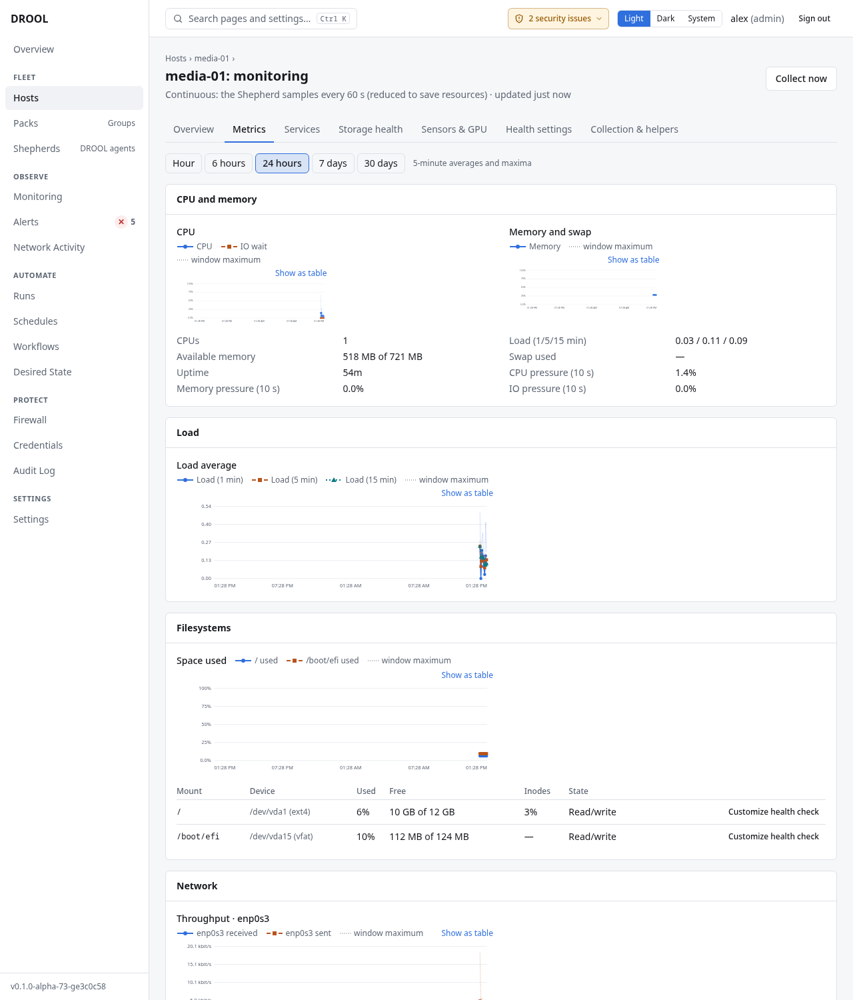

# CPU, memory and load

How busy a host is, and whether it's running out of memory. You'll find the numbers on the host's
monitoring page: the **CPU** and **Memory** tiles on **Overview**, and charts on **Metrics**.

## The Metrics charts

Choose a range: **Hour**, **6 hours**, **24 hours**, **7 days** or **30 days**. Longer ranges show
averages over a few minutes or an hour, with the highest value in each period as a dotted *window
maximum* line, so a short peak never disappears in an average.

- **CPU** — how much of the CPU time was in use, and how much went to waiting for disks (*IO wait*).
- **Memory and swap** — memory in use (not counting cache the kernel can give back), and swap.
- **Load average** — over 1, 5 and 15 minutes: roughly how many processes wanted the CPU or were
  waiting for a disk. Compare it with the number of CPUs (*CPUs* below the chart): a load of 4 on a
  4-CPU host is busy but fine; on a 1-CPU host it's queueing.
- **Pressure** (*CPU pressure*, *Memory pressure*, *IO pressure*, over 10 seconds) — the share of
  time tasks were stalled waiting for that resource. More telling than percentages: a host can be at
  100% CPU and still respond fine (pressure low), or stall at 60% (pressure high).

Lines differ by pattern as well as colour. **Missing data is a gap, never zero.** **Show as table**
gives the same numbers as text.

## When does DROOL call it a problem?

| Check | Recommended setting |
|---|---|
| **High CPU utilization** | Warning when all CPUs are busy above 95% for 5 minutes; momentary spikes never count |
| **Memory pressure** | Warning above 90% and critical above 97% of memory in use (excluding reclaimable cache), for 5 minutes |

**High CPU utilization** is on by default because a saturated CPU slows down everything on a host. On
machines that are *meant* to be busy (a render node, a build server, a gaming PC), turn it off for
that host or Pack ([Health Overrides](Health-Overrides.md)).

## How fresh the numbers are

- **Shepherd hosts:** sampled every 10 seconds, kept as one-minute averages and maxima.
- **SSH hosts:** a snapshot every 5 minutes. A spike between two polls isn't seen.

See [Monitoring Through SSH vs Shepherd](Monitoring-Through-SSH-vs-Shepherd.md).

## History

One-minute values are kept for 26 hours, five-minute values for 8 days and hourly values for 30 days
(adjustable in [Monitoring Settings](Monitoring-Settings.md)). That costs about 1.5 MB of DROOL's
database per host.

## Related

[Filesystems and Disk Space](Filesystems-and-Disk-Space.md) · [Health Overrides](Health-Overrides.md) ·
[Host Monitoring](Host-Monitoring.md)
