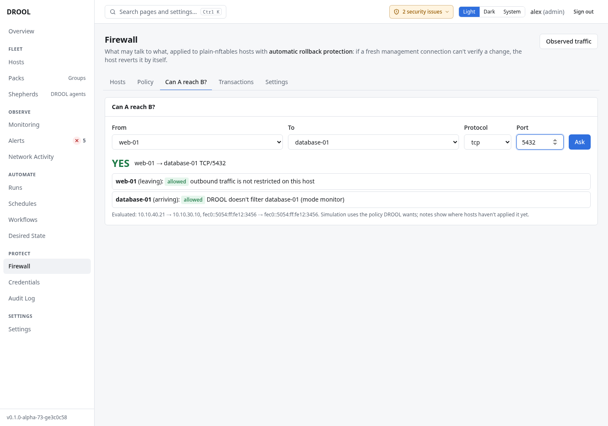

# Can A reach B?

**Can A reach B?** answers a simple question from the policy: *can web-01 reach database-01 on TCP
5432?* It's the quickest way to check a rule before you apply it, or to find out why something can't
connect. Asking never changes anything.

## Before you start

Everyone can ask (**firewall.read**).

## Ask

1. Open **Firewall → Can A reach B?**.
2. **From**: a host, or *an address…* (then type it, for example `10.10.5.25`).
3. **To**: a host, or an address.
4. **Protocol** (`tcp` or `udp`) and **Port** (for example `5432`).
5. Click **Ask**.

## Reading the answer

The answer is **YES**, **NO**, or a warning-coloured answer when it depends on something DROOL can't
decide. Below it, each step of the way:

- **leaving** the source host: allowed or blocked, and why (*outbound traffic is not restricted on
  this host*);
- **arriving** at the destination: allowed or blocked, and why: the **matching rule**, the
  **management path**, or *DROOL doesn't filter database-01 (mode monitor)*.

Notes in orange say where the answer is about the policy DROOL **wants**, but a host hasn't applied it
yet (*Simulation uses the policy DROOL wants; notes show where hosts haven't applied it yet*).
**Evaluated** lists the address pairs that were checked (IPv4 and IPv6).

## While editing the policy

In **Firewall → Policy**, select a box or line on the topology: the **Details** panel has **Can it
reach… (on this draft)**, which answers from your **unsaved** draft, before you save anything.

## Good to know

- The answer is about DROOL's firewall rules only. Something else can still stop a connection: the
  program isn't listening, a router or another firewall in between, or the program's own access list.
- To see connections that **actually** happened, use [Network Activity](What-DROOL-Can-See.md).

## Next

**[Applying the Firewall Policy](Applying-the-Firewall-Policy.md)**, once the answers are what you expect.

## Related

[Firewall Policy](Firewall-Policy.md) · [Applying the Firewall Policy](Applying-the-Firewall-Policy.md) ·
[Policy Classification](Policy-Classification.md)
