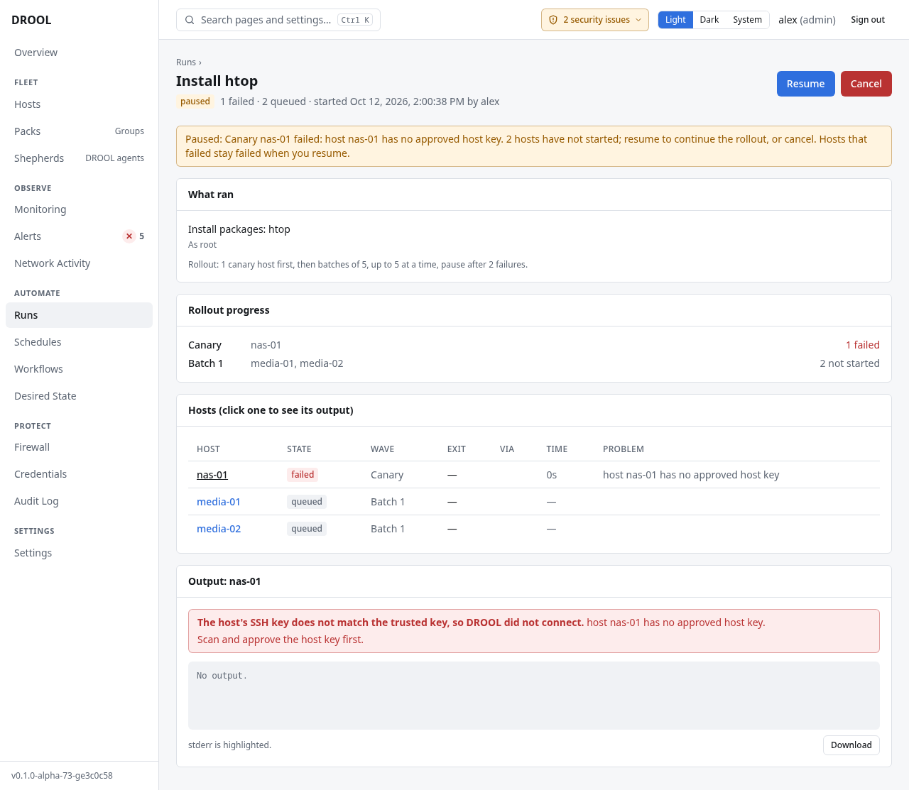

# Canary hosts

A **canary** is a host that tries a change first, on its own. If the canary fails, DROOL **pauses the
run before any other host starts**, so a bad update or a broken command reaches one machine instead of
all of them. The name comes from the canaries miners took underground as an early warning.

You'll find the canary setting in the **Rollout** card of **Runs → New run** and in a
[workflow's](Workflows.md) **Default rollout** (both behind **Change rollout…**), and under
**Advanced** on a [schedule](Schedules.md#advanced-options).

## Choose canary hosts

Under **Canary**:

- **No canary**: every host starts in the first wave (the default for a run that changes nothing,
  such as a read-only command).
- **The first hosts by name**: the first **Number of canary hosts** (1–10) in alphabetical order. On
  the `media-servers` Pack, one canary means `media-01`.
- **Hosts I choose**: tick up to 10 of the run's targets, for example the host you'd least mind
  breaking, or the one most like the others.

For a change to two or more hosts, DROOL starts with its recommended rollout: *Recommended for 3
hosts: 1 canary host first, then batches of 5, up to 5 at a time, pause after 2 failures.* If you
choose a rollout without a canary, batches or a failure limit, DROOL keeps your choice and offers
**Use recommended rollout** beside it: *try one host first, then five at a time, and pause if two
fail.*

**Waves** (in the **Rollout** card of a new run, and when running a workflow) and the schedule's
**Preview** show the exact order: *Canary: media-01*, then *Batch 1: media-02, nas-01*.

## What happens

1. The canaries run, on their own.
2. If they all succeed, the rest of the hosts follow, in [batches](Batches-and-Failure-Thresholds.md)
   if you set a batch size.
3. If a canary **fails or times out**, no other host starts. The run is **paused**, with the reason.
   In the example below, Alex chose `nas-01` as the canary for installing `htop` on the
   `media-servers` Pack, forgetting that its host key wasn't approved yet:

   > Paused: Canary nas-01 failed: host nas-01 has no approved host key. 2 hosts have not started;
   > resume to continue the rollout, or cancel. Hosts that failed stay failed when you resume.

## When a run is paused

Look at the failed host's output (click its name in the **Hosts** list) and decide:

- **Resume**: the rollout continues with the hosts that haven't started. The canary stays failed: a
  resume doesn't retry it. Use this when the failure had nothing to do with the change (the canary
  was rebooting, its disk was full).
- **Cancel**: nothing else starts. Fix the problem, then start a new run (or **Re-run unsuccessful
  hosts**).

A paused run waits for you as long as it takes. **Rollout progress** on the run's page shows each wave
and how it went.

## Good to know

- Canaries are chosen among the hosts the run will start on: a scheduled run leaves hosts in
  maintenance out first.
- If the hosts you chose as canaries aren't among a run's targets any more (for example, they left the
  Pack), DROOL doesn't drop the safety net: the first hosts by name become the canaries instead, and
  the preview says so.
- If every target is a canary (one host, one canary), there's no separate canary wave.
- Read-only commands and checks don't need a canary: DROOL only uses and suggests the recommended
  rollout for steps that change something.

## Related

[Batches and Failure Thresholds](Batches-and-Failure-Thresholds.md) · [Schedules](Schedules.md) ·
[Workflows](Workflows.md) · [Understanding Run Results](Understanding-Run-Results.md)
