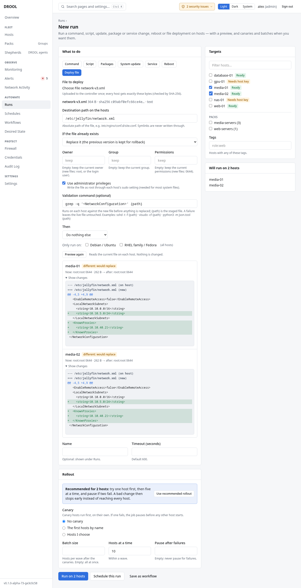

# Deploying a file to multiple hosts

A **file deployment** puts one file on many hosts in one run, safely: you see what would change on
each host before anything happens, the file can be checked on each host before it replaces the old
one, the previous version is kept, and you can roll back with one click.

In the examples, Alex deploys a new `/etc/jellyfin/network.xml` to `media-01` and `media-02`.

## Before you start

- You need **files.deploy** and **jobs.execute**; writing system files also needs **files.elevate**.
  Administrators and operators have all of them.
- The hosts need SFTP (SSH hosts) or the files capability (Shepherd hosts with the **Full** preset, or
  with files allowed for that path).
- **The folder must already exist** on every host: DROOL creates the file, not missing folders
  (otherwise: *directory /etc/jellyfin does not exist*). A one-line [command](Running-a-Command.md)
  such as `mkdir -p /etc/jellyfin`, run as root, creates it. The folder path must also be the real
  path, not one that goes through a symlink.
- The file can be up to 1 GiB. Previous versions are kept for rollback only up to 64 MiB.

## Steps

1. **Runs → New run → Deploy file**.
2. **File to deploy:** choose the file on your computer. DROOL uploads it to the controller once and
   shows its size and SHA-256 checksum; every host gets exactly those bytes.
3. **Destination path on the hosts:** the absolute path, `/etc/jellyfin/network.xml`. DROOL never
   writes through a symlink at that path.
4. **If the file already exists:**
   - **Replace it (the previous version is kept for rollback)**, or
   - **Leave it alone (only create missing files)**, to put the file only where it doesn't exist yet.
5. **Owner**, **Group**, **Permissions:** empty keeps what the existing file has. For a new file,
   empty means `root` (or the login user) and `0644`. Example: `jellyfin`, `jellyfin`, `0640`.
6. **Use administrator privileges** for anything outside the login user's home: write the file as
   root through each host's sudo setting. (Not needed on Shepherd hosts.)
7. Optionally a **Validation command**, run against the new file on each host before it replaces the
   old one: see [Validation Before Deployment](Validation-Before-Deployment.md).
8. Optionally **Then: Reload a service** or **Restart a service**, with the service's name: see
   [Reloading or Restarting a Service](Reloading-or-Restarting-a-Service.md).
9. Choose the **Targets**: hosts, Packs or tags.
10. Click **Preview changes**. DROOL reads the current file on each host (*Nothing is changed.*) and shows its
    state, with a diff for text files under **Show changes**:

    | State | Meaning |
    |---|---|
    | *missing: would create* | No file there yet |
    | *identical* | Already exactly this content: nothing will happen (*no change*) |
    | *different: would replace* | Different content; see the diff |
    | *only owner/permissions change* | Same content, different owner, group or mode |
    | *inaccessible* | DROOL can't read or write there (often: needs administrator privileges, or the folder is missing) |

    

11. Click **Run on 2 hosts**. The confirmation sums it up: *Deploy network-v3.xml to
    /etc/jellyfin/network.xml on 2 hosts as root? Existing files are replaced; their previous
    versions are kept for rollback. The new file is validated first; hosts where validation fails are
    not changed.*

## What DROOL does on each host

1. Uploads the file to a temporary file next to the destination and checks its checksum.
2. Runs the validation command on it, if you gave one. If it fails, the live file is **not touched**.
3. Keeps the previous version (content, owner, group and permissions; up to 64 MiB).
4. Puts the new file in place in one step and sets owner, group and permissions.
5. Checks the result (checksum, owner, mode).
6. Reloads or restarts the service, if you asked and the file actually changed.

Hosts that already had identical content are reported as **no change**. For a change to many hosts,
use a rollout (one host first) like any other run ([Canary Hosts](Canary-Hosts.md)).

## Afterwards

Each host's page lists **Deployed files**, and each deployment has its own page with before and after
checksums, the diff, the validation output and a **Roll back** button
([Rolling Back a File](Rolling-Back-a-File.md)).

## Limits

- One file per deployment; no folder sync and no templating (every host gets the same bytes).
- Rollback restores content, owner, group and permissions, not ACLs, SELinux labels or extended
  attributes (a new file gets the SELinux label its folder's policy assigns).

## Related

[Validation Before Deployment](Validation-Before-Deployment.md) · [Rolling Back a File](Rolling-Back-a-File.md) ·
[Desired State](What-Desired-State-Is.md) (to keep a file the way you deployed it)
