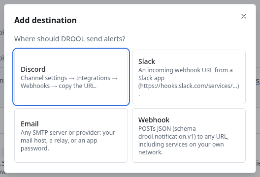

# Discord notifications

DROOL can post alerts to a Discord channel through a **webhook**: a private address Discord gives you
that lets one program post into one channel.

## Before you start

- You need **notifications.manage** in DROOL (administrators).
- In Discord, you need the **Manage Webhooks** permission on the server (server owners and admins
  have it).
- The DROOL controller must be able to reach `discord.com` on the internet (HTTPS, port 443).

## 1. Create the webhook in Discord

1. In Discord, hover over the channel that should receive alerts, for example `#homelab-alerts`, and
   click the gear (**Edit Channel**).
2. Open **Integrations → Webhooks** and click **New Webhook**.
3. Give it a name (for example *DROOL*), and check that the right channel is selected.
4. Click **Copy Webhook URL**. It looks like this (this one is made up):

   ```text
   https://discord.com/api/webhooks/1290000000000000042/Xm3kq9TzExampleOnlyNotARealTokenV8pLw2Rn5Yd7Qs1Hc4Jf6Ga0Kb3Ne
   ```

Treat this URL like a password: anyone who has it can post into your channel. If it leaks, delete
the webhook in Discord and create a new one.

## 2. Add it to DROOL

1. Open **Settings → Notifications** (or **Alerts → Notification settings**).
2. Click **Add destination** and choose **Discord**.
3. **Name**: for example *Homelab Discord* (empty: *Discord*).
4. **Webhook URL**: paste the URL. DROOL accepts only Discord webhook addresses here
   (`https://discord.com/api/webhooks/…`).
5. **Notify for**: *Recommended: Warnings and Critical, plus recoveries*, or *Only what advanced
   routes send here* ([Notification Routing](Notification-Routing.md)).
6. Click **Send test**. A message titled **TEST: DROOL notification test** appears in the channel,
   and the form shows *✓ Test delivered: delivered (HTTP 204)*.
7. Click **Save**.



DROOL stores the URL encrypted with its [master key](Master-Key.md) and never shows it again: the list
shows only `https://discord.com/…•••••••`. To change it, **Edit** the destination and paste the new
URL; leave the field empty to keep the current one.

## What the messages look like

Each alert is one message from **DROOL**, with a coloured bar: red for Critical, amber for Warning,
green when it recovered, grey for tests and for alerts [cleared by configuration](Recovered-vs-Cleared-by-Configuration.md).
The title (for example **CRITICAL: nas-01**) links to the alert in DROOL. The text is the same as an
email's ([example](Email-Notifications.md#what-the-emails-look-like)).

DROOL's messages never mention anyone: even a host or service named `@everyone` pings nobody.

## Good to know

- DROOL sends at most **30 messages a minute** to one Discord destination, below Discord's own
  limit. During a big outage the rest wait their turn rather than being lost. If Discord still
  answers *rate limited*, DROOL waits as long as Discord asks (up to an hour) and tries again.
- To pause a destination without deleting it, **Edit** it and untick **Enabled**.

## If the test fails

| Message | What to do |
|---|---|
| *paste the Discord webhook URL (https://discord.com/api/webhooks/…)* | The address isn't a Discord webhook URL. Copy it again from **Integrations → Webhooks** |
| *the receiver rejected the notification (HTTP 404)* | The webhook was deleted in Discord. Create a new one and paste its URL |
| *the receiver refused the credentials (HTTP 401)* | The URL is incomplete or its token was reset. Copy it again |
| *host name not found* / *could not connect* / *timed out* | The controller can't reach discord.com. Check its internet access, DNS and any proxy |

More: [Notification Failed](Notification-Failed.md).

## Related

[Notification Routing](Notification-Routing.md) · [Understanding Alerts](Understanding-Alerts.md) ·
[Email](Email-Notifications.md) · [Slack](Slack-Notifications.md) · [Webhooks](Webhooks.md)
