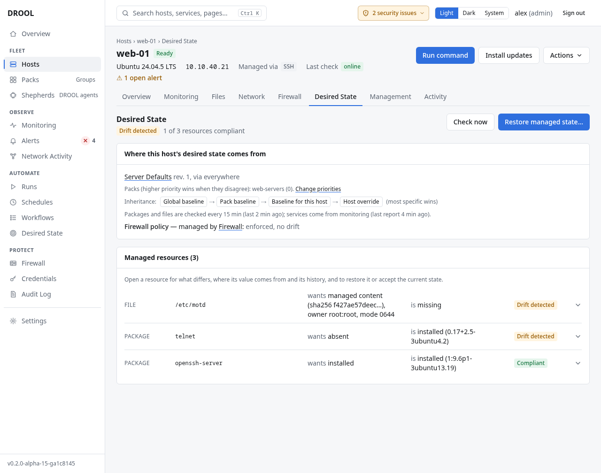

# Drift

**Drift** means a host no longer matches what its baselines say. In the examples, `web-01` has drifted
twice: its `/etc/motd` is missing, and someone installed `telnet`, which *Server Defaults* prohibits.

Drift is a **finding**, not an action: DROOL tells you, and changes nothing until someone decides
what to do about it (unless [automatic restore](Automatic-Restore.md) is on for that baseline).

## Where you see it

- **Desired State → Overview**: *2 hosts with drift (3 resources)*, and the hosts under **Needs
  attention** with **What differs** (*/etc/motd (drift), package telnet (drift)*) and their
  **Baselines**, each a link to the baseline.
- The **Overview** page, among the things that need attention.
- The **Desired State** tile on the host's **Overview**, and the host's **Desired State** section,
  with every resource that differs.

## What a difference looks like

| Resource | Wants | Is |
|---|---|---|
| `/etc/motd` | managed content (sha256 f427ae57deec…), owner root:root, mode 0644 | missing |
| package `telnet` | absent | installed (0.17+2.5-3ubuntu4.2) |
| `jellyfin.service` | running, enabled at boot | failed, enabled at boot |

For a file whose content changed, DROOL shows the two checksums and any owner, group or permission
changes, for example *content: sha256 f427ae57deec… → sha256 a378977155fb…*.

## What to do about it

Open the resource (click it on the host's Desired State page). First find out what happened:

1. **[Review difference](Review-Difference.md)**: see the desired and current state side by side, with
   a line-by-line diff for text files. Reviewing never changes anything.

Then choose one:

| If… | Do this |
|---|---|
| The change was a mistake, or unauthorised | **[Restore managed state](Restore-Managed-State.md)**: DROOL puts it back as an ordinary run, after showing you exactly what it will change |
| The change is right, **for this host only** | **[Accept current state](Accept-Current-State.md)**: what the host has now becomes its own desired state |
| The baseline itself is out of date (every host should change) | **Change baseline**: edit the baseline ([Creating a Baseline](Creating-a-Baseline.md)) |

If someone fixes the host by hand instead, DROOL notices at its next check and records *Compliant
again (changed on the host)*.

## The history

Every managed resource keeps a history of what changed and how it ended:

| Entry | Meaning |
|---|---|
| **Drift detected** / **Drift changed** | The host stopped matching, or matches differently now |
| **Restore requested** | Someone (or automatic restore) started a correction |
| **Restored** | DROOL corrected it **and saw the result** |
| **Restore failed** / **Restore not verified** | The correction didn't work, or DROOL couldn't confirm it |
| **Current state accepted** | Someone accepted the host's state as its own desired state |
| **Resolved by configuration** | The desired state changed (a baseline changed, or the state was accepted) |
| **Compliant again (changed on the host)** | Someone fixed it on the host, not through DROOL |
| **Conflict** / **Conflict resolved** | See [Conflicts](Conflicts.md) |
| **No longer managed** | The resource was removed from the baselines, or its baseline archived |

**Desired State → History** shows these for every host, filterable by *Drift detected*, *Restore
failed*, *Current state accepted* or *Resolved by configuration*. Checks that find nothing new aren't
recorded.

## Good to know

- **Unknown is not drift, and not compliant.** If DROOL can't check (the host is unreachable, its
  data is too old, monitoring is off), the resource is **Unknown** until it can.
- **During maintenance**, DROOL keeps checking and showing drift, but automatic restore does nothing.
  You can still restore by hand (DROOL warns you).
- **New run warns you** when a run would contradict desired state, for example *On media-01:
  jellyfin.service is managed to keep running… Stopping it will create desired-state drift*. If the
  change is intentional, use maintenance, or change the desired state.

## Next

**[Review Difference](Review-Difference.md)**: look at exactly what differs on a drifted host before you decide what to do.

## Related

[Review Difference](Review-Difference.md) · [Restore Managed State](Restore-Managed-State.md) ·
[Accept Current State](Accept-Current-State.md) · [Conflicts](Conflicts.md)
