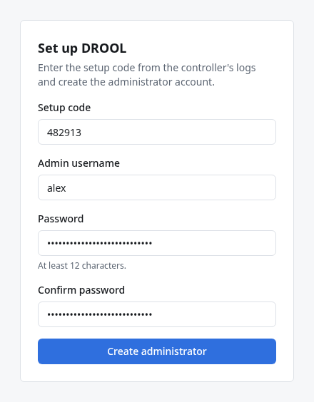
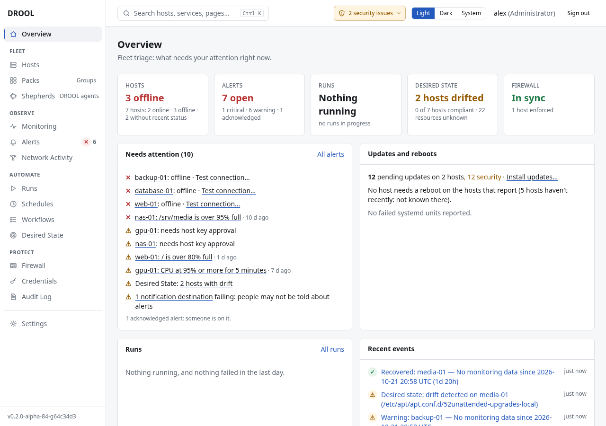

# First login

The first time you open DROOL, you claim it: you prove you're the person who installed it, with the
one-time **setup code** it printed when it started, and you create the first administrator account.
After that, setup is closed for good, and everyone signs in with a username and password.

## Where do I get the setup code?

DROOL prints the setup code, together with the address of its setup page, in a short **startup
message** framed by two rows of `=`. It prints it every time it starts, until the first administrator
exists. Where that message appears depends on how you installed DROOL:

| Installation | Show the startup message | Lost the code, or it expired? Get a new one | Step by step |
|---|---|---|---|
| Docker Compose | `cd ~/drool`, then `docker compose logs drool` (the message is at the end) | `docker compose exec drool drool setup code` (in `~/drool`) | [Install with Docker Compose, step 7](Install-With-Docker-Compose.md#step-7-find-the-address-and-the-setup-code) |
| Podman | `journalctl --user -u drool -n 50` | `podman exec drool drool setup code` | [Install with Podman, step 7](Install-With-Podman.md#step-7-find-the-address-and-the-setup-code) |
| Package (.deb or .rpm) | `sudo journalctl -u drool -n 50` | `sudo -u drool drool setup code` | [Install from a package, step 6](Install-From-a-Package.md#step-6-find-the-address-and-the-setup-code) |
| Release archive | `sudo journalctl -u drool -n 50` | `sudo -u drool /usr/local/bin/drool setup code` | [Install from the release archive, step 5](Install-From-the-Release-Archive.md#step-5-find-the-address-and-the-setup-code) |

Good to know:

- The code is **six digits**. This wiki's examples use `482913`: **that's only an example; use the
  code your own DROOL printed.**
- It works **once**, for **60 minutes**.
- **Every start of DROOL makes a new code, and the previous one stops working**, until the first
  administrator exists. A restart, a reboot or an update all count, and so does running
  `drool setup code`. Always use the newest code.
- DROOL never stores the code itself (only a fingerprint of it), so it can't show you an old code
  again. If you can't find yours, make a new one.
- Once the first administrator exists, DROOL makes no more codes ([after setup](#after-setup)).

Can't find a code, or it doesn't work? [Setup Problems](Setup-Problems.md).

## Before you start

- DROOL is installed and running ([Installing DROOL](Installing-DROOL.md)).
- You have its startup message, with the setup page's address and the setup code (see above).

## 1. Open DROOL in your browser

Go to the address from the startup message. It ends in `:8080/setup`, for example
`https://10.10.0.10:8080/setup`.

- **Docker and Podman** print `https://<this-host's-address>:8080/setup`: replace
  `<this-host's-address>`, including the `<` and `>`, with the address of the machine DROOL runs on
  (`hostname -I` on that machine shows it; [more help](Setup-Problems.md#i-dont-know-what-address-to-open)).
- A **package or archive** installation prints the machine's own address already.

Note the **https**: DROOL always encrypts the connection.

Your browser will warn that the connection isn't private or the certificate isn't trusted. That's
expected the first time: DROOL created its own (*self-signed*) certificate, which your browser
can't check against a public authority. Continue to the site (in Chrome: **Advanced → Proceed to …**;
in Firefox: **Advanced → Accept the Risk and Continue**).

If you want to be sure you're talking to your DROOL and not something in between, compare the
certificate's SHA-256 fingerprint in your browser's certificate viewer with the
`Certificate SHA-256:` line in DROOL's startup message. They must match. You can replace the
self-signed certificate with your own later ([Configuration](Configuration.md#your-own-tls-certificate)).

## 2. Create the administrator

| Field | What to enter |
|---|---|
| **Setup code** | The code from the startup message, e.g. `482913`. Spaces and dashes are ignored. |
| **Admin username** | Your username. It starts as `admin`; you can keep that or use your own name. The examples use `alex`. |
| **Password** / **Confirm password** | At least 12 characters. Use a password manager. |

Click **Create administrator**. DROOL creates the account, signs you in and opens the **Overview**.

If DROOL says **invalid or expired setup code**, the code was mistyped, already used, older than 60
minutes, or replaced by a newer one (DROOL restarted, or someone ran `drool setup code`). Get a new
code ([how](#where-do-i-get-the-setup-code)) and try again. More:
[Setup Problems](Setup-Problems.md#my-setup-code-expired).

## After setup

Setup happens once. As soon as the first administrator exists:

- DROOL deletes every setup code and makes no new ones. Its startup message then shows only the
  address, without `/setup` and without a code.
- Going to `/setup` takes you to **Sign in to DROOL** instead.
- `drool setup code` refuses with *setup is already complete (an administrator exists); use
  `drool user create` to add users*.

Other people get their own accounts under **Settings → Users** ([Users and Roles](Users-and-Roles.md)).
If every administrator is locked out, a new one can be created on the controller
([below](#if-you-forget-your-password)).

## 3. Find your way around

- **The sidebar** lists every area under plain headings: **Overview**; *Fleet* — **Hosts**,
  **Packs** (groups of hosts), **Shepherds** (DROOL agents); *Observe* — **Monitoring**, **Alerts**,
  **Network Activity**; *Automate* — **Runs**, **Schedules**, **Workflows**, **Desired State**;
  *Protect* — **Firewall**, **Credentials**, **Audit Log**; and **Settings**. Hover over Packs or
  Shepherds to see what those names mean.
- **The Overview** answers "does anything need me right now?": how many hosts are online, open
  alerts, runs in progress, desired-state drift, the firewall, and a **Security** card.
- **Search:** press **Ctrl+K** (**⌘K** on a Mac) or **/**, or click *Search pages and settings…* at
  the top, and type what you're after in your own words — "api token", "threshold", "can A reach
  B", "who changed". Search finds pages and settings (not individual hosts or runs), and only those
  your role may open.
- **The security indicator** at the top (for example *2 security issues*) stays visible until the
  things it lists are handled. On a new installation it usually says that two-factor sign-in is off
  and that the *Agent Root CA private key is on this controller*. Neither is urgent; both are
  explained in [Secure Your Installation](Secure-Your-Installation.md).
- **Light, Dark, System** at the top switches the colour theme (saved in this browser).
- **Your name** and **Sign out** are at the top right; your own settings are under
  **Settings → Account**.

## Signing in later

Go to the same address without `/setup`, for example `https://10.10.0.10:8080` (or
`https://drool.example.net:8080`, if your network knows the machine's name); DROOL shows **Sign in
to DROOL**. Enter your username and password. If you've turned on two-factor authentication, DROOL
then asks for the 6-digit code from your authenticator app (or one of your recovery codes).

A session ends after 12 hours without activity, and after 7 days at most; then you sign in again.

## If you forget your password

- **Another administrator can't reset it** in the web interface. They can delete your account and
  create a new one under **Settings → Users** (your history in the audit log stays).
- **If you're the only administrator**, create a new administrator on the controller itself, then
  sign in with it:

  | Installation | Command |
  |---|---|
  | Docker Compose (in `~/drool`) | `docker compose exec drool drool user create --username alex2 --role admin` |
  | Podman | `podman exec -it drool drool user create --username alex2 --role admin` |
  | Package | `sudo -u drool drool user create --username alex2 --role admin` |
  | Release archive | `sudo -u drool /usr/local/bin/drool user create --username alex2 --role admin` |

  It asks for the new account's password. (`alex2` is just an example name; any unused username
  works.)

Lost your authenticator app instead? See [Two-Factor Authentication](Two-Factor-Authentication.md#if-you-lose-your-authenticator).

## Next

**[Your First Host](Your-First-Host.md)**: connect your first machine, run a command on it and see it
in Monitoring. After that, [Secure Your Installation](Secure-Your-Installation.md) (at least turn on
two-factor sign-in).
