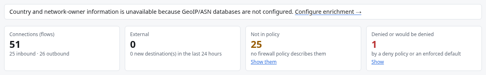

# GeoIP and ASN

DROOL can show the **country** and the **network owner** (the ASN, for example *AS64500 Example
Hosting*) of external addresses in Network Activity. It looks them up **locally**, in database files
you put on the controller. It never sends addresses to an online service, and never looks up private,
loopback, link-local, multicast or documentation addresses.

**It's optional.** Without databases everything works: connections show no country or network owner
(**—**), and Network Activity says why once, at the top ([below](#what-network-activity-shows)).

> Country and network owner are **context, not a verdict**. They can be wrong or out of date, and
> DROOL never blocks, scores or flags traffic because of them.

## Before you start

- You need access to the controller's files (the machine or container DROOL runs on).
- Seeing the enrichment status needs **network.read**; changing the setting needs **network.settings**
  (administrators).

## 1. Get the databases

DROOL reads MaxMind-format `.mmdb` files and recognises them by their content. You need a country
database and an ASN database, or one file with both:

| Source | What you get |
|---|---|
| **MaxMind GeoLite2** Country and ASN | Free account; keep them current with MaxMind's `geoipupdate` tool |
| **DB-IP Lite** country and ASN | Monthly downloads, licensed CC BY 4.0 |
| **IPinfo Lite** | Country and ASN in one file |

For example, with DB-IP Lite (run on the controller; the file names include the month):

```sh
cd /var/lib/drool/geoip
curl -L "https://download.db-ip.com/free/dbip-country-lite-$(date +%Y-%m).mmdb.gz" | gunzip > dbip-country-lite.mmdb
curl -L "https://download.db-ip.com/free/dbip-asn-lite-$(date +%Y-%m).mmdb.gz" | gunzip > dbip-asn-lite.mmdb
```

The quotes around the address matter: `$(date +%Y-%m)` is filled in by your shell (for example
`2026-10`) before `curl` runs.

## 2. Put them in DROOL's GeoIP directory

| Installation | Directory |
|---|---|
| Native package or archive | `/var/lib/drool/geoip` (that is, `<data_dir>/geoip`) |
| Docker Compose | `/data/geoip` inside the container (the `geoip` folder in DROOL's data volume) |
| Podman | `/data/geoip` inside the container |

Create the directory if it doesn't exist (DROOL says *the directory does not exist* when it's
missing). The DROOL service must be able to read the files. To use another directory, set
`network.geoip_dir` in the [configuration](Configuration.md).

If you use `geoipupdate`, point its `DatabaseDirectory` at this directory, and schedule it as its
documentation explains.

## 3. Check

Open **Network Activity → Collection and enrichment**. **GeoIP and ASN enrichment** shows **Country:
✓ available** and **Network (ASN): ✓ available**, with the files it loaded. DROOL notices new or
changed files by itself; **Reload databases** loads them right away. A half-written or broken
replacement is ignored, and the previous copy stays in use.


**Show country and network owner for public addresses (local databases only)**, on the same page, turns
the enrichment off or on.

## What Network Activity shows

DROOL tells three cases apart, for the country and the network owner separately:

| Case | A connection shows | Network Activity says |
|---|---|---|
| Enrichment turned off | **—** (*country lookups are off*) | *Country and network-owner lookups are turned off. Collection and enrichment →* |
| On, but no database of that kind (missing, or unreadable) | **—** (*no country database is configured*, *no ASN database is configured*) | *Country and network-owner information is unavailable because GeoIP/ASN databases are not configured. Configure enrichment →*, or only the side that's missing (*Network-owner information is unavailable because no ASN database is configured; countries are shown.*) |
| A database is loaded, and has no answer for the address | *country unknown*, *network unknown* | nothing: the address is genuinely unknown |

**Unknown** therefore always means the database was asked and had no answer. The reason behind a
**—** is on the connection's details (*Not looked up: no ASN database is configured*) and in its
tooltip. Private, internal and special addresses are never looked up, whatever the setting:
*internal*, or nothing.



## Related

[Internal vs External](Internal-vs-External.md) · [What DROOL Can See](What-DROOL-Can-See.md) ·
[Configuration](Configuration.md)
