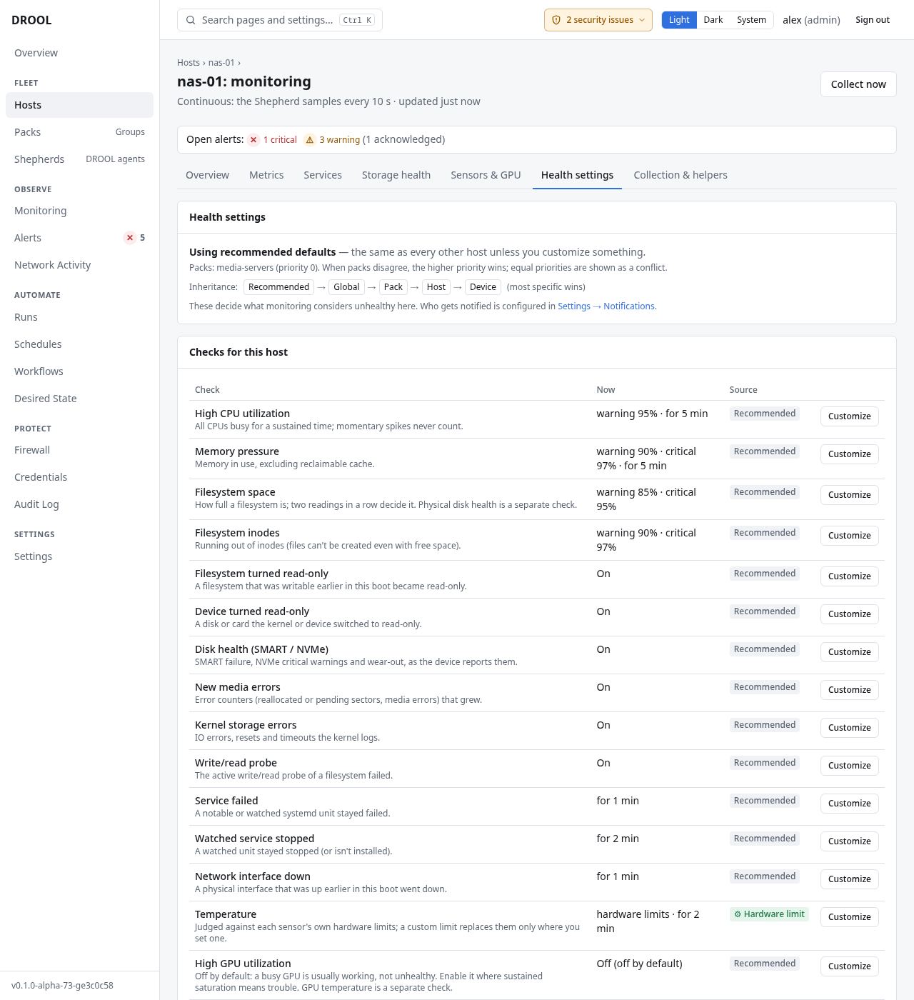

# Health overrides

Out of the box, every host uses the **Recommended** health profile, and most fleets never need more.
But a gaming PC, an AI box, a NAS and a Raspberry Pi can have good reasons to differ: the AI box's GPU
*should* be busy; the NAS's media disk *should* be nearly full. Any single health setting can be
changed exactly where it matters, without copying the rest.

## Where settings come from

Settings inherit through five levels, broadest first. The most specific one wins:

**Recommended → Global → Pack → Host → Device**

| Level | Example | Where to change it |
|---|---|---|
| **Global** (every host) | "Filesystem space: warn at 80%" | **Monitoring → Health checks and settings → Health checks → Customize** |
| **Pack** | `media-servers`: no high-CPU warning while transcoding | **Packs →** the Pack's **Customize monitoring** |
| **Host** | `gpu-01`: high GPU utilization on | The host's monitoring page **→ Health settings → Customize** |
| **Device** | `/srv/media` on `nas-01`: warning 92%, critical 98% (while `/` keeps 85% / 95%) | **Customize health check** next to that filesystem, disk, sensor, GPU or service |

You change only what you need; everything else keeps coming from the level above. Every setting
shows where it comes from: *Recommended*, *Hardware limit*, *Global*, *Pack: media-servers*,
*This host*, *Device: /srv/media*.

## Before you start

- **Administrators** (**monitoring.settings**) can change everything.
- **Operators** (**monitoring.manage**) can change a host's or device's settings only to make detection
  **stricter** (a lower threshold, a shorter wait). Anything that makes detection *less* sensitive
  (turning a check off, raising a threshold, waiting longer) and every global or Pack change needs an
  administrator.

## Change a setting

1. Open the right level (table above) and click **Customize** next to the check, for example
   **High CPU utilization** on `media-servers`.
2. Change only the fields you mean to: on/off, warning and critical levels, how long a condition must
   last, and when it counts as recovered. A yes/no check (like a SMART failure) only has on/off.
3. For fleet-wide and Pack changes, DROOL first shows the **impact**: how many hosts are affected, how
   many are above the old and the new threshold, and which open problems would close. *This turns a
   check off: matching conditions won't be reported for these hosts* appears when that's the case.
4. Click **Save**.

**Reset to inherited** undoes a change for one field; **Reset all to inherited** for the whole check.
Nothing is copied back: the setting simply follows the level above again.

## What happens when you change something

- **Changes apply at once.** A problem that still qualifies stays the same alert.
- A problem that no longer qualifies (its check turned off, or its threshold now above the current
  value) closes as **Cleared by configuration**. Its message says *CLEARED BY CONFIGURATION*, never
  *RECOVERED*, because the machine itself didn't change. See [Recovered vs Cleared by Configuration](Recovered-vs-Cleared-by-Configuration.md).
- A stricter rule starts counting from the change: lowering a threshold never claims a problem
  existed for the past five minutes.

## Useful to know

- **Checks are independent.** Raising `/srv/media`'s space threshold never weakens SMART or kernel
  error detection for the disk under it; turning off high GPU utilization never affects GPU
  temperature.
- **Devices are recognised by their own identity**: a filesystem by its UUID, a disk by its WWN or
  serial number, an NVIDIA GPU by its UUID, a service by its unit name. A setting stays with the
  device when it's renamed, remounted or reordered. If a customised device disappears, its setting
  is kept (shown as *currently unavailable*) and applies again if it returns; it never moves to a
  different device. Network interfaces are identified by name only.
- **Hosts in several Packs:** if two Packs set the same thing differently, the Pack with the higher
  **priority** wins (**Health overrides (advanced) → Pack priorities**). With equal priorities,
  DROOL doesn't choose: it shows a *pack conflict* and uses the fleet-wide value until you set a
  priority or a host setting.
- **Per-device settings belong to one host.** A Pack can't target "/srv/media on every member".

## Health versus notifications

Health settings decide *whether something is a problem*. "Don't warn me about GPU load on gpu-01" is a
health setting; "send gpu-01's critical alerts only to Discord" is a
[notification route](Notification-Routing.md).

## Related

[Monitoring Settings](Monitoring-Settings.md) · [Understanding Alerts](Understanding-Alerts.md) ·
[Packs](Packs.md)
