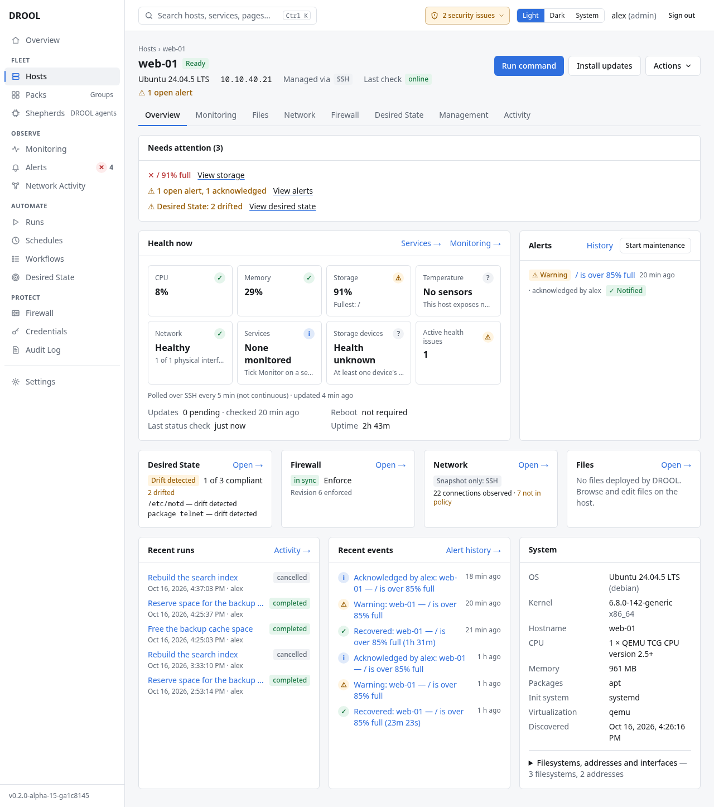

# Host details

Click a host's name anywhere in DROOL to open its page. The page is a summary built to answer three
questions in order: *is this host okay?*, *how does DROOL manage it?*, and *what needs attention?*.
Every card links to the full page for that area.

## The top of the page

- **The name and a status badge**, for example **Ready** — *connection test passed*. Other statuses
  are explained in [Status Meanings](Status-Meanings.md#host-statuses). When something is wrong, a
  coloured note under the header says what it means and what to do.
- **The address and operating system**, for example `10.10.20.15 · Debian GNU/Linux 12 (bookworm)`.
- **Action buttons** (what you see depends on your role):

  | Button | What it does |
  |---|---|
  | **Run command** | Opens a new run with this host already selected ([Running a Command](Running-a-Command.md)) |
  | **Test connection** | The step-by-step connection test ([Testing a Connection](Testing-a-Connection.md)) |
  | **Install updates** | A new run for a system update of this host ([System Updates](System-Updates.md)) |
  | **Reboot** | A new run that reboots this host and waits for it ([Rebooting Hosts](Rebooting-Hosts.md)) |
  | **Files** | The file manager for this host ([Browsing Files](Browsing-Files.md)) |
  | **Refresh** | Collects inventory and status now instead of at the next scheduled check |
  | **Edit** | Change the connection settings, tags or description ([Adding a Host](Adding-a-Host.md#changing-a-host-later)) |

  The buttons that open a new run don't do anything yet: you review the run first and start it there.
- **Needs attention** lists everything about this host that wants a person, most serious first,
  for example *Desired State: 2 drifted*, each with a link. When there's nothing, it says
  *Nothing needs attention on this host right now.*

## The cards

| Card | What it shows | Full page |
|---|---|---|
| **Health** | Tiles for CPU, Memory, Storage, Temperature, Network, Services, Storage devices and Active health issues, how the host is monitored (*Polled over SSH every 5 min* or *Continuous: the Shepherd samples every 10 s*), uptime, whether a reboot is required, and pending updates | **View monitoring →** ([Host Monitoring](Host-Monitoring.md)) |
| **Management** | SSH or Shepherd, the fallback, what DROOL would use right now, the SSH user, credential, sudo setting, jump host, trusted host key, last test, Packs (each links to its page; **Change…** adds the host to Packs or removes it), tags, description; buttons to install or manage a Shepherd | [SSH vs Shepherds](SSH-vs-Shepherds.md) |
| **Alerts** | Open alerts for this host; **History**; **Start maintenance** | [Understanding Alerts](Understanding-Alerts.md), [Maintenance Mode](Maintenance-Mode.md) |
| **Desired State** | Whether the host matches its baselines, and what differs | **View desired state →** ([Drift](Drift.md)) |
| **Firewall** | The firewall mode and whether DROOL filters this host | **View firewall →** ([Firewall Modes](Firewall-Modes.md)) |
| **Network Activity** | How connections are observed, a count of observed connections and how the policy classifies them, what the host listens on | **View network activity →** ([What DROOL Can See](What-DROOL-Can-See.md)) |
| **Recent runs** | The last runs that included this host | **View runs →** |
| **Deployed files** | Files DROOL deployed here, with their state | **Open file manager →** ([Rolling Back a File](Rolling-Back-a-File.md)) |
| **System** | OS, kernel, hostname, CPU, memory, package manager, init system, virtualization, when it was discovered, and (expandable) filesystems, addresses and interfaces | — |
| **Danger zone** | **Remove host** | [Removing a Host](Removing-a-Host.md) |

A Shepherd host's **Management** card also has **Shepherd details**: the Shepherd's version and
compatibility, its certificate, when it was last seen and from where, and **What DROOL may do on this
host** (its capabilities, with **Narrow…** to restrict them further). See
[Shepherd Capability Presets](Shepherd-Capability-Presets.md).

## How fresh is this information?

- **Status** (online, uptime, load, disk, failed services, reboot required): checked every 5 minutes.
- **Monitoring**: every 5 minutes over SSH, or every 10 seconds through a Shepherd. Each card says
  when it was last updated (*updated 2 min ago*).
- **Updates**: checked every 6 hours (*checked 12 min ago*).
- **Inventory** (the System card): when the host was added, and again with **Refresh**.

**Refresh** fetches status and inventory right away.

## Related

[Adding a Host](Adding-a-Host.md) · [Status Meanings](Status-Meanings.md) · [Host Monitoring](Host-Monitoring.md)
