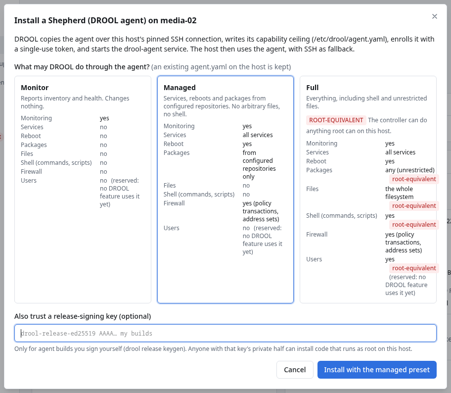
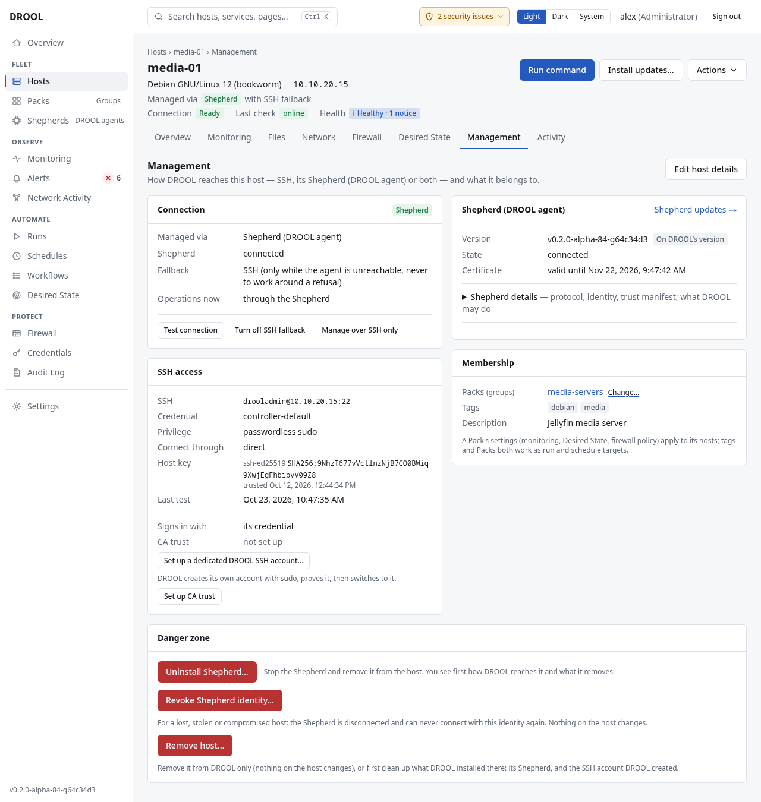

# Installing a Shepherd

A Shepherd is DROOL's optional agent (the program `drool-agent`). Once installed, it connects *out*
to DROOL, reports monitoring data continuously and runs work within limits the host itself sets.
Not sure you need one? Read [Understanding SSH vs Shepherds](SSH-vs-Shepherds.md) first.

There are three ways to install one:

| Way | Use it when | Needs SSH from DROOL |
|---|---|---|
| [From the host's page](#from-the-hosts-page-easiest) | The host is already in DROOL over SSH | Yes, once |
| [With a one-line installer](#a-host-that-drool-cant-reach-over-ssh) | DROOL can't reach the host over SSH at all | No |
| [Convert to Shepherd](#many-ssh-hosts-at-once) on the Monitoring page | Many SSH hosts at once | Yes, once |

## Before you start

- **The host can reach DROOL's Shepherd port.** Shepherds connect to the address DROOL *advertises*,
  on port **9443**. In the examples that's `drool.example.net:9443`. On the host,
  `nc -vz drool.example.net 9443` must succeed.
  - In a container installation, DROOL can't know that address by itself: set
    `DROOL_AGENT_ADVERTISE` first ([Docker Compose](Install-With-Docker-Compose.md#if-youll-use-shepherds),
    [Podman](Install-With-Podman.md#if-youll-use-shepherds)).
  - If the controller's machine has a firewall, port 9443 must be open there.
- **The host is Linux on amd64 or arm64.** (Other architectures stay on SSH.)
- **You're an administrator** (installing needs **agents.enroll**).
- **Choose a preset**: how much DROOL may do through the Shepherd. The host keeps this limit even if
  DROOL asks for more. See [Shepherd Capability Presets](Shepherd-Capability-Presets.md).
- For the first way (from the host's page) additionally: the host is in DROOL, its SSH key is
  trusted, **Test connection** passes, and the SSH account can use sudo, because installing writes
  to `/etc` and creates a system service ([Your First Host](Your-First-Host.md)).

## From the host's page (easiest)

1. Open the host (in the examples, `media-02`) and find the **Management** card.
2. Click **Install Shepherd (DROOL agent)**.

   

3. Choose a preset. **Managed** is selected by default: services, reboots and packages from the
   repositories already configured on the host, but no shell commands and no file access. Pick
   **Full** if you want to run commands and scripts and use the file manager through the Shepherd;
   **Monitor** if it should only report.
4. Leave **Also trust a release-signing key** empty unless you sign your own Shepherd builds
   ([Updating Shepherds](Updating-Shepherds.md)).
5. Click **Install with the managed preset** (the button names the preset you chose). It can take a
   few minutes.

**What DROOL does:**

1. Copies the `drool-agent` program to the host over the SSH connection whose key you trusted.
2. Writes the preset's limits to `/etc/drool/agent.yaml`. If that file already exists, DROOL keeps
   it: the host's own limits always win.
3. Creates a single-use enrollment token and enrolls the Shepherd with it. The Shepherd creates its
   own private key on the host; the key never leaves the host.
4. Starts the `drool-agent` service, which starts again at boot.
5. Switches the host to **Managed via: Shepherd** with **Fallback: SSH**.

The dialog then says **The agent is installed and connected.** with the installer's output; click
**Done**. If it failed, the dialog shows the error and nothing is switched over: the host stays on
SSH.

Afterwards the **Management** card looks like this:



## A host that DROOL can't reach over SSH

For a host behind NAT, in another network, or a laptop that moves around, use the one-line installer.
The host needs only outgoing access to DROOL (ports 8080 to download, 9443 to connect).

1. **Open DROOL by the address your hosts can reach** (for example `https://drool.example.net:8080`,
   not `https://localhost:8080`): the installer command uses the address in your browser.
2. Go to **Shepherds → Add a host with a Shepherd** (or, for a host that's already in DROOL,
   **Manual install…** on its Management card).
3. Choose a preset and click **Create token and installer**.
4. Copy the command. It is shown **only once** and expires after one hour. It looks like this:

   ```sh
   curl -fsSL -k --pinnedpubkey 'sha256//RXhhbXBsZS1vbmx5Lm5vdC1hLXJlYWwta2V5LWhhc2g=' 'https://drool.example.net:8080/agent/install.sh' | sudo sh -s -- --token 'drool-enroll-1.eyJleGFtcGxlIjp0cnVlfQ.ExampleOnly' --preset managed
   ```

5. Run it on the host, as a user who can use `sudo`. Paste it whole, quotes included.

About that command: `-k` tells `curl` not to check DROOL's certificate against public authorities
(it's self-signed), and `--pinnedpubkey` instead requires *exactly* DROOL's key. So the download
can't come from anyone else, which is stricter than normal certificate checking. The token carries
the fingerprint of DROOL's Agent Root CA, so the Shepherd trusts only your DROOL.

A Shepherd enrolled this way becomes a **new host** in DROOL, named after the machine's hostname
(with `-2`, `-3`… added if that name is already taken), unless the
token was created for a host that already exists (**Manual install…** on that host's page). DROOL
never decides that two hosts are the same because their names or addresses match.

**Without `curl | sudo sh`:** under the command's **Details**, DROOL shows the token on its own. Copy
`drool-agent-linux-amd64` (or `-arm64`) to the host and run, as root:

```sh
sudo ./drool-agent-linux-amd64 install --preset managed --token-file -
```

Paste the token, press Enter, then **Ctrl-D**.

Unused tokens are listed under **Shepherds → Enrollment → Enrollment tokens**, where you can
**Revoke** them.

## Many SSH hosts at once

On **Monitoring**, select the hosts and choose **Convert to Shepherd**. DROOL first shows a preview
counting the hosts that can be converted, are already converted, aren't supported or aren't reachable.
The conversion then runs like a careful rollout: one host first, then batches, pausing at the first
failure. A host where anything fails stays exactly as it was, on SSH.

## If installing fails

| What you see | Likely cause | What to do |
|---|---|---|
| The install times out, or the Shepherd never shows as connected | The host can't reach the advertised address on port 9443 | On the host: `nc -vz drool.example.net 9443`. Fix the name (`DROOL_AGENT_ADVERTISE`), DNS, or a firewall in between |
| An error about sudo | The SSH account can't become root | [Sudo Failed](Sudo-Failed.md) |
| *token expired* or *already used* | Tokens last one hour and work once | Create a new one |
| An architecture error | The host isn't amd64 or arm64 | Keep the host on SSH |

See also [Shepherd Offline](Shepherd-Offline.md).

## Related

[Shepherd Capability Presets](Shepherd-Capability-Presets.md) · [SSH Fallback](SSH-Fallback.md) ·
[Updating Shepherds](Updating-Shepherds.md) · [Shepherd PKI](Shepherd-PKI.md) ·
[Removing a Host](Removing-a-Host.md#removing-a-shepherd-from-a-machine)
