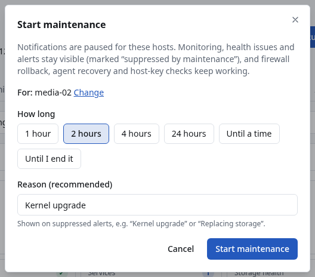
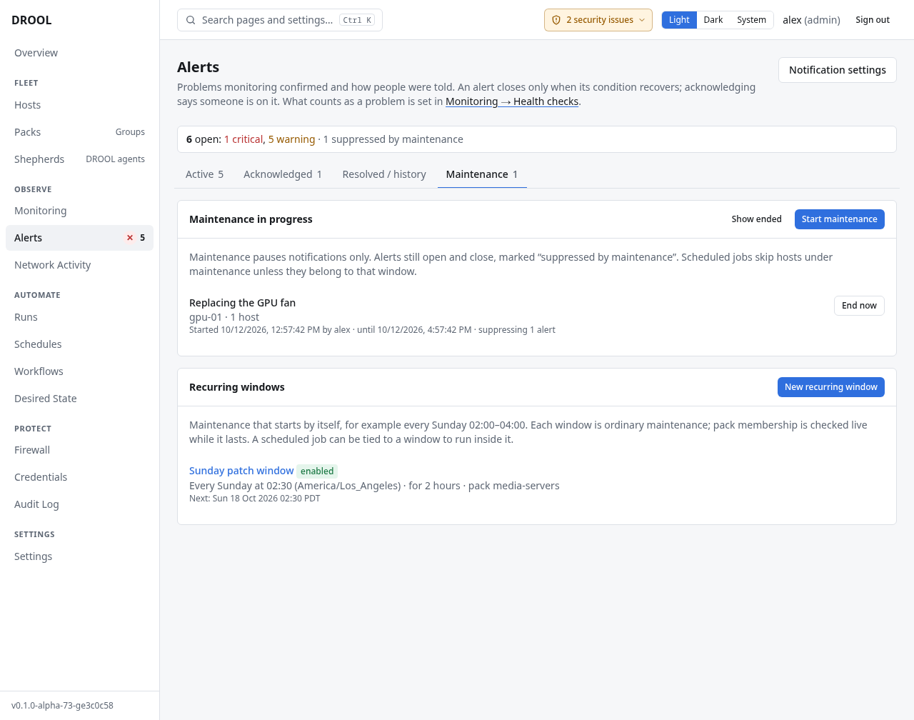

# Maintenance mode

Working on a machine? Put it **in maintenance** first, and DROOL won't message anyone about the
alerts your work causes. In the examples, Alex puts `media-02` in maintenance for two hours for a
*Kernel upgrade*.

## What maintenance does, and what it doesn't

Maintenance **only pauses notifications** for the hosts it covers. Everything else carries on:

- Monitoring keeps collecting, and health issues and alerts still open and close. They are marked
  **⏸ Suppressed by maintenance** and kept in the history.
- Every safety mechanism keeps working: firewall rollback, Shepherd recovery and SSH host-key
  checks are never paused.
- **Scheduled runs skip hosts in maintenance**, unless the run belongs to that maintenance window
  ([Maintenance Windows](Maintenance-Windows.md)). Runs you start yourself are not affected.

## Before you start

You need **maintenance.manage** (administrators and operators). Everyone can see which hosts are in
maintenance.

## Put one host in maintenance

1. Open the host's page, for example `media-02`.
2. Click **Actions → Start maintenance…** (or **Start maintenance** in the **Alerts** card of the
   host's **Overview**).
3. Under **How long**, choose **1 hour**, **2 hours**, **4 hours**, **24 hours**, **Until a time**
   (pick the **End**; at most 30 days ahead), or **Until I end it**.
4. Enter a **Reason** (recommended), for example *Kernel upgrade*. It's shown on every alert the
   maintenance suppresses.
5. Click **Start maintenance**.

The host's **Overview** and its **Monitoring** section now show a banner: *⏸ In maintenance until*
(the end time) *— Kernel upgrade. Notifications are paused; monitoring and alerts continue.* The
host's header says *In maintenance until* … in every section.

## Put several hosts or a Pack in maintenance

1. Open **Alerts → Maintenance** and click **Start maintenance**.
2. Tick Packs (for example **Pack media-servers**) and/or hosts. Use **Filter hosts…** to find a host
   in a long list.
3. Choose how long, enter a reason, and click **Start maintenance**.

A Pack's membership is checked **live**: a host added to `media-servers` while the maintenance lasts
is covered from then on; a host removed from the Pack stops being covered.

**Alerts → Maintenance** lists the maintenance in progress: the reason, the hosts and Packs, who
started it, when it ends, and how many alerts it's suppressing. **Show ended** lists past maintenance.

## End maintenance

Maintenance ends by itself at the time you chose. To end it early, click **End now** on **Alerts →
Maintenance**, or **End maintenance** in the banner on the host's page.

When maintenance ends, DROOL checks the alerts it suppressed:

- An alert that **closed during maintenance** is kept in the history, and nobody is messaged about
  it.
- An alert that is **still open** gets its first message after a **two-minute grace period**, in
  case the problem was just finishing (a service still starting up after a reboot, for example).
  If it recovers within those two minutes, nothing is sent.
- An alert someone **acknowledged** during the maintenance gets no message: it already has an owner.

## Maintenance on a timetable

For maintenance that happens regularly, such as *every Sunday from 02:30 to 04:30*, create a
**recurring window** under **Alerts → Maintenance → Recurring windows → New recurring window**. Each
window is ordinary maintenance that starts and ends by itself, and scheduled runs can be tied to it
so they happen inside it. See [Maintenance Windows](Maintenance-Windows.md).

## Good to know

- If two maintenances cover the same host, the host stays in maintenance until both have ended.
- Starting and ending maintenance is recorded in the [audit log](Audit-Log.md).
- To stop alerts about something that is *permanently* fine for you (a busy GPU, a full media
  disk), don't use maintenance: change the health check instead ([Health Overrides](Health-Overrides.md)).

## Related

[Understanding Alerts](Understanding-Alerts.md) · [Maintenance Windows](Maintenance-Windows.md) ·
[Rebooting Hosts](Rebooting-Hosts.md) · [System Updates](System-Updates.md)
