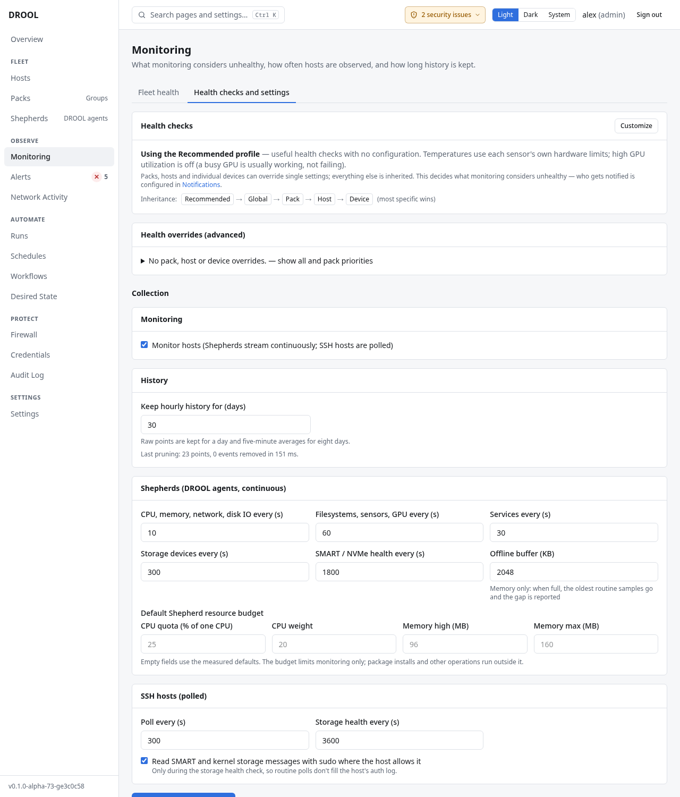

# Monitoring settings

**Monitoring → Health checks and settings** decides what monitoring considers unhealthy, how often
hosts are observed, how long history is kept, and which helper tools DROOL may install. Most
installations never need to change anything here.

## Before you start

Everyone can read these settings. Changing them needs **monitoring.settings** (administrators).
Everything you change is in the audit log.

## Health checks

**Health checks → Customize** changes a check for the whole fleet. Out of the box every host uses the
**Recommended** profile: *useful health checks with no configuration. Temperatures use each sensor's
own hardware limits; high GPU utilization is off.*

Settings inherit **Recommended → Global → Pack → Host → Device**, and the most specific one wins. How
to change any level is explained in [Health Overrides](Health-Overrides.md). **Health overrides
(advanced)** lists every override in the fleet, and the Pack priorities.

This decides what is *unhealthy*. Who gets told about it is separate:
[Notification Routing](Notification-Routing.md).

## Collection

- **Monitor hosts** — switch monitoring on or off for the whole fleet. *Shepherds stream continuously;
  SSH hosts are polled.* Several features depend on it: Desired State reads services from monitoring,
  and workflows' *Verify services* and *Verify health* steps need it.
- **Keep hourly history for (days)** — default 30. One-minute values are kept for about a day and
  five-minute averages for eight days.

**Shepherds (DROOL agents, continuous):**

| Setting | Default |
|---|---|
| CPU, memory, network, disk IO every (s) | 10 |
| Filesystems, sensors, GPU every (s) | 60 |
| Services every (s) | 30 |
| Storage devices every (s) | 300 |
| SMART / NVMe health every (s) | 1800 (30 minutes) |
| Offline buffer (KB) | 2048: what a Shepherd keeps in memory while DROOL is unreachable (about a day for a typical host). When full, the oldest routine samples go and the gap is reported |

Empty fields use the defaults DROOL measured as reasonable.

**Default Shepherd resource budget** — **CPU quota (% of one CPU)** (25), **CPU weight** (20), **Memory
high (MB)** (96), **Memory max (MB)** (160). The budget limits monitoring only; package installs and
other operations run outside it. One host can get its own budget on its **Collection & helpers** tab.

**SSH hosts (polled):**

- **Poll every (s)** — default 300 (5 minutes).
- **Storage health every (s)** — default 3600 (hourly).
- **Read SMART and kernel storage messages with sudo where the host allows it** — only during the
  storage health check, *so routine polls don't fill the host's auth log*.

Click **Save monitoring settings**.

## Monitoring helper approvals

*A standing approval lets DROOL install an allowlisted helper (smartmontools, nvme-cli, lm-sensors)
wherever it would add monitoring detail, as a normal package job on your behalf.* Choose the
**Helper**, **Where** (*Every host* or *A pack*) and click **Approve**. Without an approval, helpers
are installed only when someone clicks **Install**. Removing an approval never uninstalls anything.

## Related

[Health Overrides](Health-Overrides.md) · [Monitoring Through SSH vs Shepherd](Monitoring-Through-SSH-vs-Shepherd.md) ·
[Storage Health](Storage-Health.md#optional-helpers)
