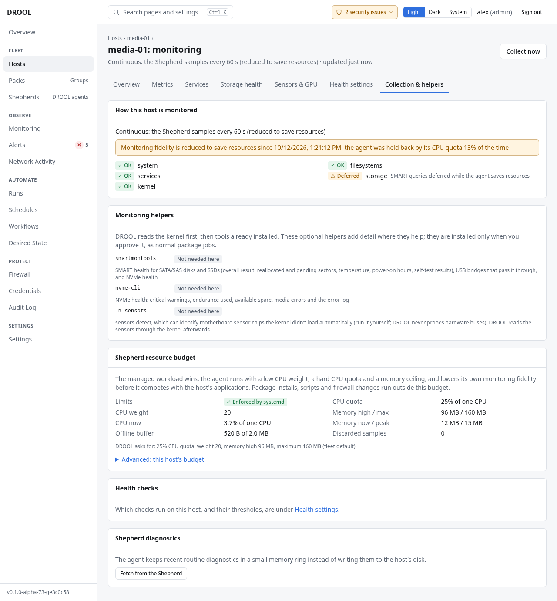

# Monitoring through SSH vs a Shepherd

DROOL monitors every host, but how closely depends on how it reaches the host. Over **SSH** it takes a
snapshot every few minutes; a **Shepherd** watches continuously. Both install nothing just for
monitoring and send nothing anywhere but to your DROOL.

## Side by side

| | Shepherd hosts | SSH hosts |
|---|---|---|
| **How** | **Continuous**: CPU, memory, network and disk IO every 10 seconds (kept as one-minute averages and maxima), filesystems, sensors and GPUs every minute, services every 30 seconds, storage devices every 5 minutes and their SMART/NVMe health every 30 minutes; kernel storage errors as they happen | **Polled** every 5 minutes; storage health and kernel storage errors hourly, and only where sudo works **without a password** |
| **Short spikes** | Caught (a one-minute maximum is kept) | Missed between two polls |
| **While DROOL is unreachable** | Kept in the Shepherd's memory (2 MB, about a day for a typical host) and delivered later; anything older is dropped and shown as a gap | Missed polls are gaps |
| **On the host's disk** | Nothing but the Shepherd's own settings (and the optional write/read probe file) | Nothing |
| **Cost on the host** | Within a small budget: at most a quarter of one CPU core and 160 MB of memory (usually far less: about 0.1% of a CPU and 25 MB on an ordinary PC) | One SSH login every 5 minutes, running a few standard commands |

Every host's monitoring page says which applies, for example *Continuous: the Shepherd samples every
10 s* or *Polled over SSH every 5 min (not continuous)*. The **Monitoring** column on the fleet page
says *Shepherd · continuous* or *SSH · polled*.

## Reduced fidelity: when a Shepherd steps back

A Shepherd never competes with the host's real work. When the host is under pressure, or the
Shepherd nears its own limits, it **samples less often** and postpones storage scans. The host's
pages then say so, for example *Continuous: the Shepherd samples every 60 s (reduced to save
resources)*, and the **Collection & helpers** tab gives the reason, such as *the agent was held back by
its CPU quota 13% of the time*. Full detail returns by itself once things are calm. This shows as an
*Info* health issue (**Reduced monitoring fidelity**), never as an alert.

If a Shepherd's own memory ever kept growing (a bug), it restarts itself rather than lingering at its
limit.

## The Shepherd's resource budget

The budget is enforced by systemd and shown on each host's **Collection & helpers** tab (*Limits:
Enforced by systemd*), with what the Shepherd uses right now. Defaults: CPU quota 25% of one CPU, CPU
weight 20 (low priority when the host is busy), memory reclaimed above 96 MB and never more than
160 MB, at most 256 tasks. Jobs you run through the Shepherd (package updates, scripts) are **not**
limited by it. Administrators can change the default in [Monitoring Settings](Monitoring-Settings.md),
or for one host under **Advanced: this host's budget**.

## Moving SSH hosts to Shepherds

On **Monitoring**, select hosts and choose **Convert to Shepherd** ([Installing a Shepherd](Installing-a-Shepherd.md#many-ssh-hosts-at-once)).

## Related

[SSH vs Shepherds](SSH-vs-Shepherds.md) · [Monitoring Settings](Monitoring-Settings.md) ·
[Monitoring Is Stale](Monitoring-Is-Stale.md)
