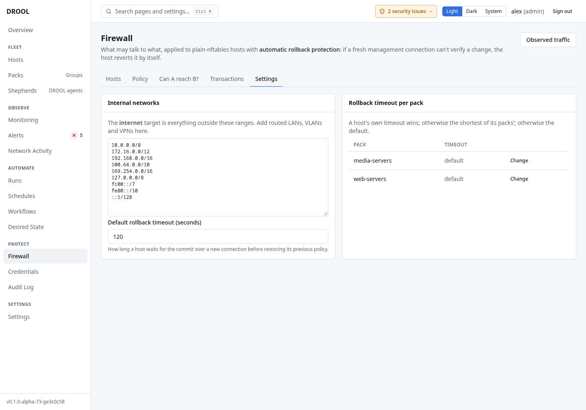

# Networks and CIDRs

Firewall rules often need to name places that aren't DROOL hosts: your laptop, the home LAN, a VPN, a
partner's office. You can write their addresses directly, or give them a name.

## Addresses and ranges (CIDR)

A **CIDR** is an address with the number of fixed bits after a slash:

| Written | Means |
|---|---|
| `10.10.5.25/32` | Exactly one IPv4 address, 10.10.5.25 (the example `admin-laptop`) |
| `10.10.20.0/24` | The 256 addresses 10.10.20.0 to 10.10.20.255 |
| `10.10.0.0/16` | 10.10.0.0 to 10.10.255.255 (the example `home-lan`) |
| `2001:db8::/32` | An IPv6 range |

In a rule, choose **Address range (CIDR)** as the source or destination and type it (*Enter an address
or range such as 192.168.1.0/24 or 2001:db8::/32*), or write it in the [YAML](YAML-View.md).

## Named networks

A **network** gives one or more ranges a name, so rules read like sentences (*admin-laptop may reach
web-servers on ssh*), and changing the address later changes every rule that uses it.

- **Rules view → Networks → New network**: a name, one or more CIDRs (IPv4 and IPv6), and an optional
  description.
- Or in YAML:

  ```yaml
  networks:
    admin-laptop:
      cidr: 10.10.5.25/32
    home-lan:
      cidr: 10.10.0.0/16
  ```

## Internet, internal networks, anywhere

Three built-in targets need no setup:

| Target | YAML | Means |
|---|---|---|
| **Internet** | `internet` | Everything **outside** the internal ranges |
| **Internal networks** | `internal` | The internal ranges |
| **Anywhere** | `any` | Every address |

The **internal ranges** are listed under **Firewall → Settings → Internal networks**: by default the
private IPv4 ranges (10.0.0.0/8, 172.16.0.0/12, 192.168.0.0/16), CGNAT and Tailscale (100.64.0.0/10),
link-local (169.254.0.0/16, fe80::/10), loopback (127.0.0.0/8, ::1/128) and IPv6 unique local
addresses (fc00::/7). *Add routed LANs, VLANs and VPNs here*: an address range you use internally but
that isn't in the list counts as **the internet**.



## Good to know

- **Addresses stand for machines.** On a network where another device can take an authorised address,
  a rule is only as strong as your address assignment. Use static addresses or DHCP reservations for
  important hosts, and for anything you name in rules (like `admin-laptop`).
- DROOL hosts are best referred to by name (or Pack), not by address: when a host's address changes,
  DROOL updates the rules on every host that refers to it ([Packs in Firewall Rules](Packs-in-Firewall-Rules.md#when-addresses-change)).

## Related

[Firewall Policy](Firewall-Policy.md) · [Services and Ports](Services-and-Ports.md) · [YAML View](YAML-View.md)
