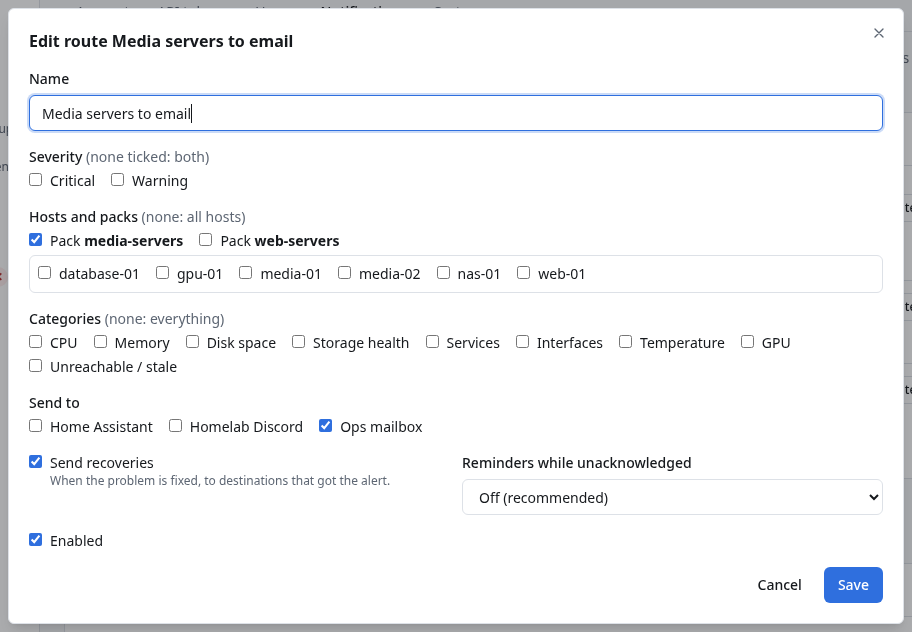

# Notification routing

**Routing** decides which alerts go to which destinations. Most installations never need it: every
destination you add is set to **Recommended** (Warning and Critical alerts, plus a message when
they're fixed), and that's it. Use routing when different people or channels should hear about
different things, for example *only Critical alerts by email*, or *the media servers' problems to
the media team's channel*.

Routing decides *who is told*. Whether something is a problem at all is decided by the health checks
([Health Overrides](Health-Overrides.md)): "don't warn me about GPU load on gpu-01" is a health
setting, "send gpu-01's critical alerts only to Discord" is a route.

## Before you start

- Everyone with **notifications.read** (administrators, operators, auditors) can see routes and the
  delivery history. Changing them needs **notifications.manage** (administrators).
- Add your destinations first ([Email](Email-Notifications.md), [Discord](Discord-Notifications.md),
  [Slack](Slack-Notifications.md), [Telegram](Telegram-Notifications.md), [Webhooks](Webhooks.md)).

## Where to find it

**Settings → Notifications**, then **▸ Advanced: routing, delivery history and settings** below the
list of destinations.

Each route reads as one sentence: *Warning and Critical on pack media-servers → Ops mailbox*, with
*Recoveries on · Reminders off* below it.

## The Recommended route

Every installation has a route called **Recommended** (marked *Default*): Warning and Critical alerts
from every host, with recoveries. A destination whose **Notify for** is *Recommended* is one of its
destinations. A destination set to *Only what advanced routes send here* gets only what other routes
send it.

You can edit or disable the Recommended route, but not delete it.

## Add a route

1. Click **Add route**.
2. Fill in:
   - **Name**: what it's for, for example *Media servers to email*.
   - **Severity**: **Critical**, **Warning**, or neither (*none ticked: both*).
   - **Hosts and packs**: tick Packs and/or hosts (*none: all hosts*).
   - **Categories**: CPU, Memory, Disk space, Storage health, Services, Interfaces, Temperature, GPU,
     Unreachable / stale (*none: everything*).
   - **Send to**: one or more destinations.
   - **Send recoveries**: also send the message when the problem is fixed, *to destinations that got
     the alert*.
   - **Reminders while unacknowledged**: see [below](#reminders).
   - **Enabled**.
3. Click **Save**.

### Examples

| Route | Severity | Hosts and packs | Categories | Send to |
|---|---|---|---|---|
| *All Critical* | Critical | — | — | Ops mailbox, Homelab Discord |
| *Storage problems on the media servers* | — | Pack `media-servers` | Disk space, Storage health | Ops mailbox |
| *Service warnings on the media servers* (without *Send recoveries*) | Warning | Pack `media-servers` | Services | Homelab Discord |

## How routes combine

There is no order to get right:

- **Every route whose filters match an alert sends it to its destinations.** A destination chosen by
  several routes gets the alert **once**.
- **Within a filter, any ticked value matches**; **all filters must match**. *Warning* + Pack
  `media-servers` + *Services* means: a Warning, on a media server, about a service.
- A destination chosen by several routes gets recoveries if **any** of them wants recoveries, and
  reminders at the **shortest** interval among them.
- **Disabled** routes and disabled destinations send nothing.
- If a host or Pack used in a route is deleted, the route keeps it (and matches nothing for it),
  rather than quietly widening to every host. Edit the route to remove it.

Routes look at a host's Packs at the moment a message is sent. A recovery message always goes to
the destinations that got the alert, whatever the routes say by then.

## Reminders

Reminders are a repeat message for an alert **nobody has acknowledged**, for example *STILL ACTIVE —
WARNING: media-01*. They're **off** unless a route turns them on: **Every hour**, **Every 4 hours**,
**Every 12 hours** or **Every day**. Reminders stop as soon as someone
[acknowledges](Acknowledging-an-Alert.md) the alert or it closes, and there are never more than
**12** reminders for one alert.

## Delivery history

The **Delivery history** card lists every message DROOL sent or tried to send, newest first. Filter
by **Destination** and **Status** (*Waiting / retrying*, *Delivered*, *Failed*, *Not sent*). Each line
says the destination, the kind of message (opening, escalation, reminder, recovery), the status, the
host and alert, when, and how many attempts it took, with the last error. *may have arrived twice*:
see [Notification Failed](Notification-Failed.md#may-have-arrived-twice).

## Notification settings

The **Settings** card (administrators can change it; everyone with notifications.read can see it):

| Setting | Default | What it does |
|---|---|---|
| **DROOL address for links** | The address your browser used when the first destination was added | The start of the *Open in DROOL* links, for example `https://drool.example.net:8080`. Change it if that address isn't reachable for the people who get the messages (for example, it was `https://localhost:8080`) |
| **Time zone in notifications** | The controller's | An IANA name such as `America/Los_Angeles` or `Europe/Berlin` |
| **Keep alert history (days)** | 180 | 30 to 730 |
| **Keep delivery details (days)** | 30 | 7 to 365 |

Click **Save settings**.

## Related

[Understanding Alerts](Understanding-Alerts.md) · [Health Overrides](Health-Overrides.md) ·
[Maintenance Mode](Maintenance-Mode.md) · [Notification Failed](Notification-Failed.md)
