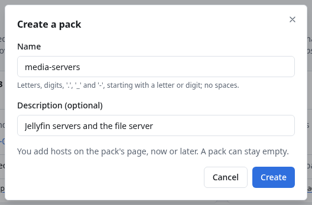
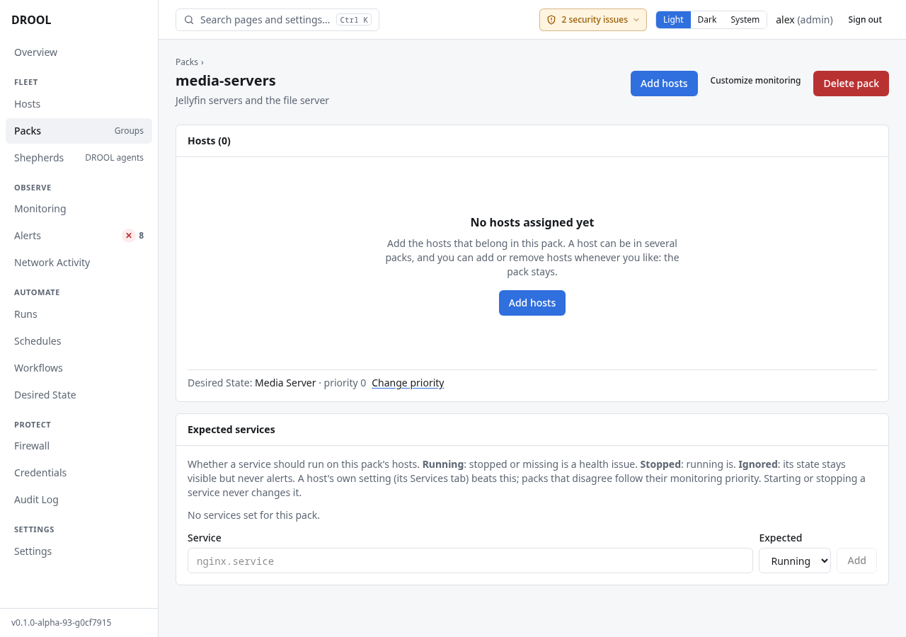
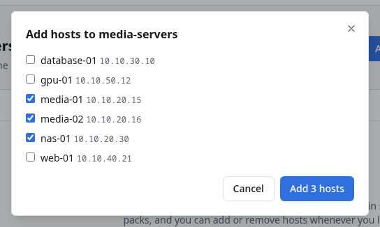
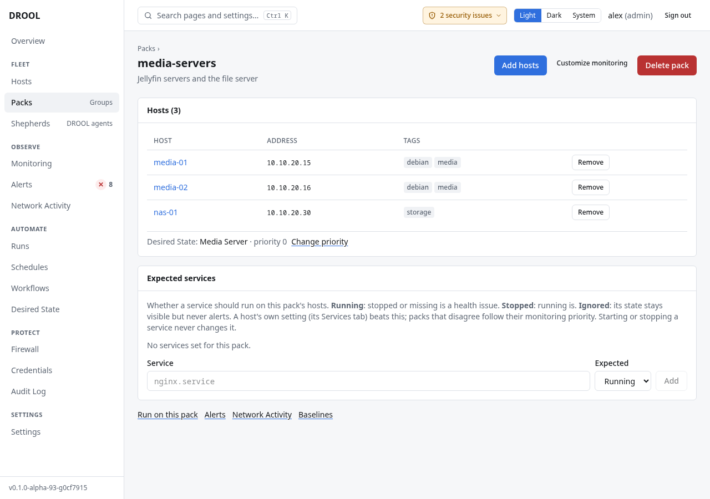

# Packs (host groups)

A **Pack** is a named group of hosts, what other tools call a *host group*. In the examples,
`media-servers` holds `media-01`, `media-02` and `nas-01`, and `web-servers` holds `web-01`.

Packs do two jobs:

1. **Targeting** — run something on "all media servers" instead of picking hosts one by one: runs,
   schedules, maintenance, file deployments, firewall rules.
2. **Shared settings** — everything you configure for a Pack applies to its members: monitoring
   adjustments, Desired State baselines, firewall rollback timeouts, notification routes.

A host can be in several Packs. Membership is looked up when it's used: a host you add to
`media-servers` next month is included in that Pack's weekly update from then on.

## Before you start

- Creating, changing and deleting Packs needs **hosts.write** (administrators).
- A Pack can be created before its hosts exist, and it can stay empty. To add hosts to it, they
  must be in DROOL ([Adding a Host](Adding-a-Host.md)).

## Create a Pack

1. Open **Packs** in the sidebar and click **Create pack**.
2. Type a name, for example `media-servers`, and if you like a description. Click **Create**.

   Names can contain letters, digits, `.`, `_` and `-`, and must start with a letter or digit: no
   spaces. (`media-servers` works, `Media Servers` doesn't.)

   

3. DROOL opens the new Pack's page. It has no hosts yet:

   

An empty Pack is a Pack like any other: schedules, firewall rules and baselines can already name it,
and its hosts are included from the moment you add them. A run started on it while it's empty is
refused (*the selected targets match no hosts*), and a schedule skips that time.

## Add and remove hosts

On the Pack's page:

1. Click **Add hosts**.
2. Tick the hosts that belong in the Pack (`media-01`, `media-02`, `nas-01`) and click **Add 3 hosts**.
   With many hosts, a search box narrows the list by name, address or tag. Hosts already in the Pack
   aren't listed.

   

The Pack's page then lists its hosts:

- **Remove** takes a host out of the Pack after you confirm. The host stays in DROOL, and the Pack
  stays too, even when its last host is gone; the Pack's settings stop applying to that host.
- **From a host's page:** next to **Packs**, **Change…** lists every Pack with a tick for the
  ones the host is in. Ticking adds the host, unticking removes it.
- Each change is saved on its own, so two people adding hosts at the same time both keep theirs.

## What each Pack offers

| Where | What it's for |
|---|---|
| **Customize monitoring** (Packs page and the Pack's page) | Health-check adjustments for this Pack's hosts, e.g. no high-CPU warning for a render farm ([Health Overrides](Health-Overrides.md)) |
| **Expected services** (the Pack's page) | What its hosts' services should be: running, stopped or ignored, e.g. `plexmediaserver.service` stopped on every media server ([Service Monitoring](Service-Monitoring.md#expected-state)) |
| **Manage hosts** (Packs page) | Opens the Pack's page, where you add and remove hosts |
| **Delete** / **Delete pack** | Remove the Pack (see below) |
| **Desired State: … · priority 0 — Change priority** | Which baselines apply to the Pack, and its priority when two Packs disagree ([Conflicts](Conflicts.md)) |
| **Alerts** | Alerts of this Pack's hosts |
| **Run on this pack** | A new run with the Pack as its target ([Running a Command](Running-a-Command.md)) |
| **Network Activity** | Connections of this Pack's hosts |
| **Baselines** | Desired State baselines assigned to the Pack |

## Where Packs are used

- **Runs and schedules** — in the target picker, choose Packs as well as or instead of hosts.
- **Maintenance** — put a whole Pack in maintenance ([Maintenance Mode](Maintenance-Mode.md)).
- **Desired State** — assign a baseline to a Pack ([Applying a Baseline](Applying-a-Baseline.md)).
- **Monitoring** — Pack-level health adjustments, with a priority when Packs disagree.
- **Notifications** — route a Pack's alerts somewhere specific ([Notification Routing](Notification-Routing.md)).
- **Firewall** — a Pack is one box in the topology and one name in rules, e.g. *web-servers may
  reach database-01 on PostgreSQL* ([Packs in Firewall Rules](Packs-in-Firewall-Rules.md)). Changing
  a Pack's members in the firewall designer changes the Pack everywhere.

## Delete a Pack

**Delete pack…** first asks every part of DROOL what still uses the Pack, and shows the answer.

**While anything depends on it, DROOL won't delete it.** The dialog lists each thing, with what to
do and a link to it:

| Uses the Pack | What to do |
|---|---|
| A **firewall policy** that names it | Take the Pack out of the policy (or delete the policy) in **Firewall → Policy** |
| A **schedule** that targets it | Change the schedule's targets, or archive it |
| A **notification route** whose filter names it | Take the Pack out of the route's filter, or delete the route |
| A **maintenance** window that covers it | End the maintenance |
| A **Desired State baseline** assigned to it | Unassign the baseline from the Pack |
| A **monitoring setting** customized for it (expected services included) | Reset it to inherited on the Pack's page |
| A **Shepherd enrollment token** that adds new hosts to it | Revoke the token, or let it expire |
| A **network classification** that matches it | Change it to other hosts, or delete it ([Classifying Traffic](Classifying-Traffic.md)) |

Once nothing depends on it, the dialog says exactly what deleting it removes, and nothing more:

- its memberships: the hosts leave the Pack and **stay in DROOL**, with everything else they have.
  Removing a host from a Pack never deletes the host;
- the Pack's own monitoring and Desired State priorities, its firewall rollback timeout, and a
  standing approval to install monitoring helpers on its hosts, which only ever applied to the Pack;
- the Pack's name on used, revoked or expired enrollment tokens (their history stays).

Click **Delete pack** to confirm. If something started depending on the Pack in the meantime, DROOL
still refuses and shows the new list. The deletion is audited with what it removed.

## Packs and tags

[Tags](Tags.md) are lighter: free-form labels on each host, used for searching and for targeting
runs ("hosts with any of these tags"). Packs carry settings; tags don't. Use a Pack when hosts should
be *managed* together, a tag when you just want to *find* or *pick* them together.

## Related

[Tags](Tags.md) · [Packs in Firewall Rules](Packs-in-Firewall-Rules.md) · [Health Overrides](Health-Overrides.md) ·
[Applying a Baseline](Applying-a-Baseline.md)
