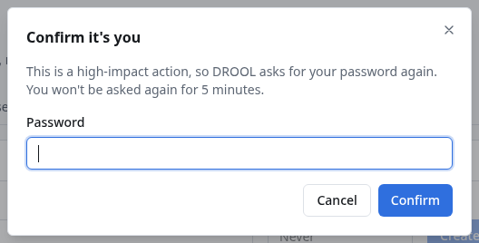

# Confirming it's you (re-authentication)

Some actions change who or what DROOL trusts, or could lock DROOL out of your hosts. Before those, DROOL
asks for your password again (and a code, if you use [two-factor authentication](Two-Factor-Authentication.md)),
unless you already confirmed in the last **5 minutes**. This protects you when someone else gets hold of
a browser where you're signed in.

## When DROOL asks

- Managing users and API tokens
- Turning two-factor authentication on or off, or resetting it for someone
- Creating, rotating or retiring DROOL's SSH certificate authority, and switching a host between a
  credential and certificates
- Setting up [DROOL's own SSH account](Dedicated-SSH-Account.md) on a host and switching to it
- The Shepherd certificate authorities (exporting or removing the root key, rotating), revoking a
  Shepherd, release-signing keys, and changing DROOL's address for Shepherds
- Audit settings (the remote copy), acknowledging an audit history break, and restore decisions
- Replacing a credential that hosts use
- Firewall overrides
- Accepting a changed SSH host key

## What to do

Enter your password (and the 6-digit code from your authenticator, or a recovery code via **Use a
recovery code instead**) and confirm. DROOL then does what you asked. For the next 5 minutes, it won't
ask again.

## Good to know

- The check is made by the server, not just the page.
- **API tokens can never do these actions**, even with every permission: they need a person at a
  browser ([API Tokens](API-Tokens.md)).
- An administrator can change the 5-minute window with the `auth.reauth_window` setting
  ([Configuration](Configuration.md)).

## Related

[Two-Factor Authentication](Two-Factor-Authentication.md) · [Users and Roles](Users-and-Roles.md)
