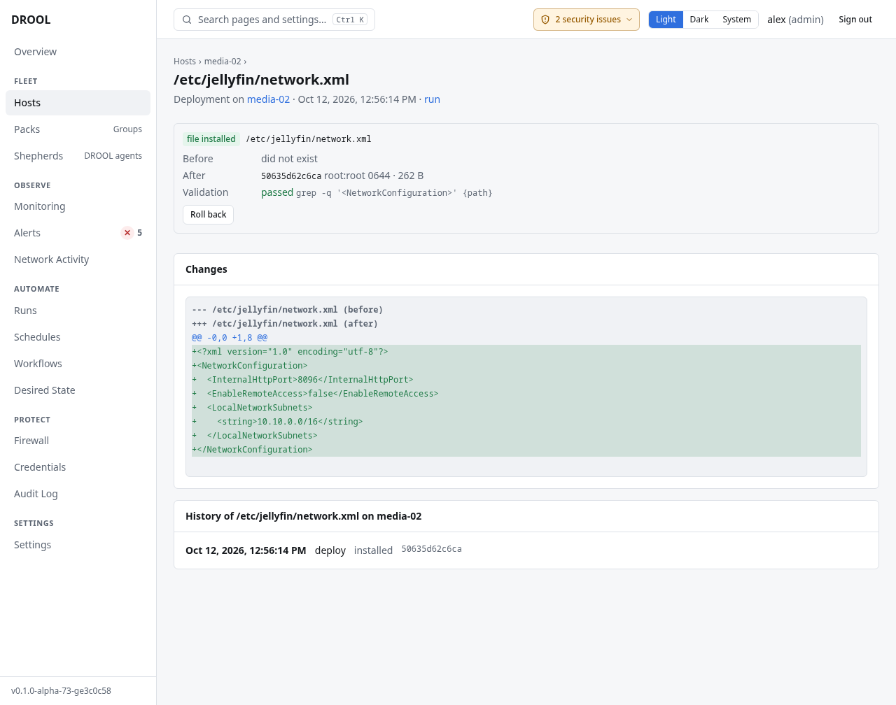

# Rolling back a file

Every time a file deployment replaces a file, DROOL keeps the previous version (its content, owner,
group and permissions). One click puts it back.

## Before you start

- **files.deploy** and **jobs.execute** (administrators and operators), plus **files.elevate** for
  files deployed with administrator privileges.
- The deployment must have **kept** a previous version. It didn't if the file was larger than 64 MiB,
  or if the deployment created the file (then rolling back means removing it).
- **The file must not have changed since that deployment.** If someone edited it afterwards, DROOL
  refuses the rollback rather than throw that edit away.

## Find the deployment

- On the host's page, the **Deployed files** card lists every file DROOL deployed there, with its
  state. Click a path.
- Or open the deployment run from **Runs**.

The page shows:

- **Before** and **After**: checksum, owner and group, permissions and size (or *did not exist*);
- **Validation**: *passed* or *failed*, with the command;
- **Changes**: the diff;
- **History** of this path on this host: every deployment and rollback;
- the **Roll back** button.

## Roll back

Click **Roll back** and confirm. DROOL starts an ordinary, audited run that:

1. checks the file on the host is still exactly what that deployment installed (otherwise: refused);
2. restores the previous content, owner, group and permissions, in one step, after running the
   deployment's validation command on it (if it had one);
3. or, if the deployment had created the file, removes it again;
4. reloads or restarts the service, if the deployment did.

The rollback appears in the file's **History** and in **Runs** like any other run.

## Limits

- Rollback restores content, owner, group and permissions, but not ACLs, SELinux labels or extended
  attributes.
- A rollback uses the deployment's own settings: it validates the restored file with the same
  validation command (except when it removes a file the deployment created), and if the deployment
  reloaded or restarted a service, the rollback does the same afterwards.
- Only deployments keep previous versions. Changes made in the editor or by uploading don't.

## Related

[Deploying a File to Multiple Hosts](Deploying-a-File-to-Multiple-Hosts.md) · [Desired State](What-Desired-State-Is.md)
