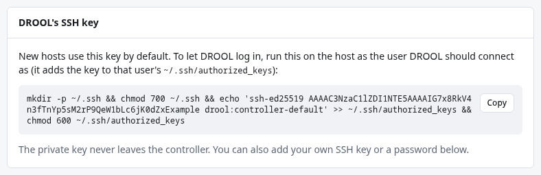

# SSH credentials

A *credential* is how DROOL proves who it is when it logs in to a host (an SSH key or a password),
or what it types when sudo asks for a password. Credentials live under **Credentials** in the
sidebar. Their secret part is encrypted as soon as you save it and is never shown again, not even to
administrators.

## The kinds of credential

| Type (in the form) | What it is | When to use it |
|---|---|---|
| *DROOL's own key* (`controller-default`) | An SSH key DROOL created at installation. Every new host uses it unless you choose another. | Most hosts. DROOL authorizes it itself when it creates its own account on a host ([DROOL's Own SSH Account](Dedicated-SSH-Account.md)); for an account you prepare yourself, you install its public half ([below](#using-an-account-you-set-up-yourself)). |
| **Generate new SSH key** | A new key pair made by DROOL, for example one key per group of machines. Only the public half can be copied out. | When you want separate keys you can revoke independently. |
| **Import existing SSH private key** | A key you already have. Paste the private key; if it's encrypted, give the passphrase once (it's used to decrypt and isn't stored). | When hosts already trust a key of yours. |
| **SSH password** | A login password. | Only where keys aren't possible. |
| **Sudo password** | What DROOL types when sudo asks for a password. Not used to log in. | Hosts where `sudo` isn't passwordless. |
| *For setup only* | A password, key or sudo password typed in **Add host** to set up DROOL's own account, named like `setup-web-01-login`. | Created by Add host, not here ([below](#credentials-for-the-setup-only)). |

Better than any stored key: short-lived **SSH certificates** from DROOL's own certificate authority,
valid for minutes. See [Short-Lived SSH Certificates](Short-Lived-SSH-Certificates.md).

## Before you start

- To **see** credentials (names, types, which hosts use them) and pick them for hosts, you need
  **credentials.use** (administrators and operators).
- To **add** or **delete** them, you need **credentials.manage** (administrators).

## Add a credential

1. Open **Credentials**. Under **Add credential**, choose the **Type**.
2. Give it a **Name** you'll recognise in the host form, for example `media-key` or
   `database-01-sudo`.
3. Depending on the type: nothing more (generate), paste the **Private key** (import), or type the
   **Password**.
4. Click **Add**.

For a generated or imported key, use **Copy public key** in the list and add that line to
`~/.ssh/authorized_keys` of the SSH user on each host that should accept it, the same way as for
DROOL's own key.

Then open each host that should use it, click **Edit**, choose it under **Credential** (or **Sudo
password**), and **Save**. Run **Test connection** to check.

## What DROOL does with secrets

- They're encrypted in DROOL's database with the [master key](Master-Key.md). A backup contains them
  only in that encrypted form.
- Private keys and passwords never appear in the interface, the API, logs or the audit log after you
  save them. The audit log records *that* a credential was added or deleted, and by whom.
- Sudo passwords are sent on sudo's standard input, never as part of a command line (where other
  users of the host could see them in the process list), and are removed from run output.

## Credentials for the setup only

When you add a host with **Create a dedicated DROOL SSH account**, the password, key and sudo password
you type for the existing account are stored as credentials marked **for setup only**, named after
the host (`setup-web-01-login`, `setup-web-01-key`, `setup-web-01-sudo`). They are encrypted like
any other credential.

Once DROOL signs in with its own account, it deletes them, in the same step that switches the host.
A setup credential that another host uses by then (a jump host included) is kept instead, and the
setup's result says which hosts still use it. Stored credentials you chose for the setup are never
deleted by it. Details: [DROOL's Own SSH Account](Dedicated-SSH-Account.md#what-happens-to-the-setup-credentials).

If you don't finish the setup, the host keeps signing in with them, and its page says so. Finish it
there with **Set up a dedicated DROOL SSH account**, or give the host permanent credentials with
**Edit** and delete the setup ones here once nothing uses them.

## Using an account you set up yourself

With **Use this SSH account** in Add host, DROOL signs in with an account you choose, for good. To
prepare one by hand on the host (the examples call it `drooladmin`), logged in as yourself:

```sh
sudo useradd --create-home --shell /bin/bash drooladmin
echo 'drooladmin ALL=(ALL) NOPASSWD:ALL' | sudo tee /etc/sudoers.d/drooladmin
sudo chmod 0440 /etc/sudoers.d/drooladmin
sudo visudo -cf /etc/sudoers.d/drooladmin
```

- The first line creates the account with a home folder (DROOL's key goes there).
- The second and third give it **passwordless sudo**, in a file of its own: root-equivalent, like
  DROOL's own account. The single quotes keep the shell from touching the text inside them.
- The last line checks the sudoers file; it should print `parsed OK`.

Then let DROOL's key log in as that account. Under **Credentials**, the card **DROOL's SSH key**
shows a one-line command; copy it, become the account on the host, and paste it:

```sh
sudo -iu drooladmin
```



The command must run **as that account**, because `~` means the home folder of whoever runs it.
Type `exit` afterwards to become yourself again. In Add host, choose **Use this SSH account**, enter
`drooladmin` as **SSH user** and `controller-default` as **Credential**.

If you'd rather have sudo ask for a password, leave out the sudoers lines, give the account a
password (`sudo passwd drooladmin`), allow it to use sudo the way your distribution does it (the
`sudo` group on Debian and Ubuntu, `wheel` on Rocky, AlmaLinux and Fedora), and store that password
here as a **Sudo password**. DROOL then sends it to sudo on standard input, never on the command line.

## Change or remove a credential

The list shows each credential's **Used by** column. A credential that hosts still use can't be
deleted (its **Delete** button is greyed out), and `controller-default` can't be deleted at all.

There's no "edit" for a credential's secret in the interface. To change a password or key, do it
the safe way, one host at a time:

1. Add the new value as a **new** credential.
2. On one host, **Edit** → choose the new credential → **Save** → **Test connection**.
3. When it works, switch the remaining hosts.
4. When **Used by** is empty, **Delete** the old credential.

That way a typo never locks DROOL out of every host at once.

## Related

[Adding a Host](Adding-a-Host.md) · [Authentication Failed](Authentication-Failed.md) ·
[Sudo Failed](Sudo-Failed.md) · [Short-Lived SSH Certificates](Short-Lived-SSH-Certificates.md) ·
[The Master Key](Master-Key.md)
