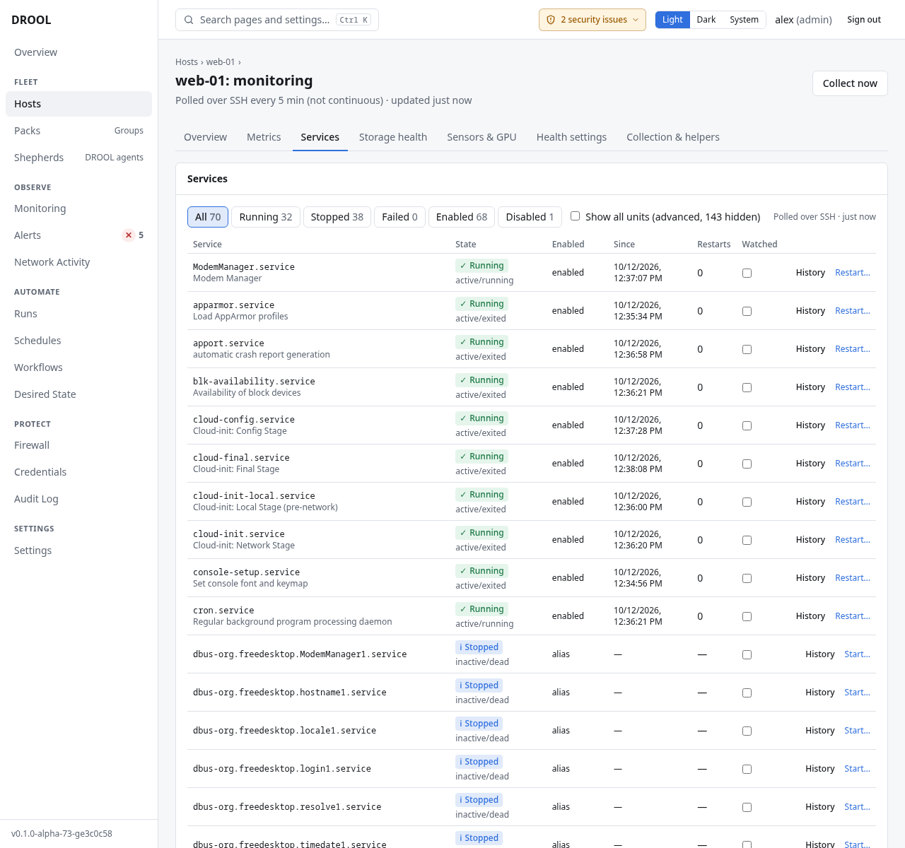

# Service monitoring

DROOL keeps track of every systemd service on every host: whether it's running, stopped or failed,
whether it starts at boot, and when its state changed. A failed service becomes a health issue (and
an alert); a service you **watch** also raises one when it stays stopped.

## Where to look

- **Monitoring** (fleet): the **Services** column (*50 ok*, *1 failed*) and the **Service failures**
  filter.
- A host's **Services** tile on its monitoring Overview (*32/32 healthy*).
- A host's monitoring page, **Services** tab: the full list.

## The Services tab

- **Filters** with counts: **Running**, **Stopped**, **Failed**, **Enabled**, **Disabled**, **All**.
- **Show all units (advanced, N hidden)** — by default DROOL hides the noise (one-shot units, units that
  are meant to come and go); tick it to see everything.
- Next to the filters: where the list comes from (*Polled over SSH* or *Reported by the Shepherd*)
  and how old it is.
- **The table:** **Service**, **State** (*Running*, *Stopped*, *Failed* or *Unknown*, with systemd's
  own words such as `active/running`), **Enabled** (the boot setting, e.g. `enabled`), **Since**,
  **Restarts** (automatic restarts since it was last started by hand), **Watched**.
- **On each row:** **Customize health check** (per-service settings), **History** (every recorded state
  change), and **Restart…** or **Start…**, which opens a new run for that service, ready to review
  ([Managing Services](Managing-Services.md)).

## Failed services and watched services

| Check | When it fires (recommended) |
|---|---|
| **Service failed** | A notable or watched service stayed *failed* for 1 minute |
| **Watched service stopped** | A service you **watch** stayed stopped (or isn't installed) for 2 minutes |

A *failed* service crashed or exited with an error. A *stopped* service was stopped normally, which
is fine for most services. That's why stopped services only count if you **watch** them: tick
**Watched** next to services that must always run on that host (for example `jellyfin` on
`media-01`). Watching needs **monitoring.manage** (administrators and operators).

## How quickly DROOL notices

- **Shepherd hosts:** services are sampled every 30 seconds, and changes reported within about a
  minute.
- **SSH hosts:** every 5 minutes.

## Related

[Managing Services](Managing-Services.md) · [Service Won't Start](Service-Wont-Start.md) ·
[Desired State](What-Desired-State-Is.md) (keep a service running and enabled, and restore it)
