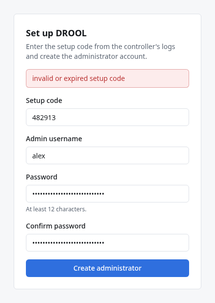
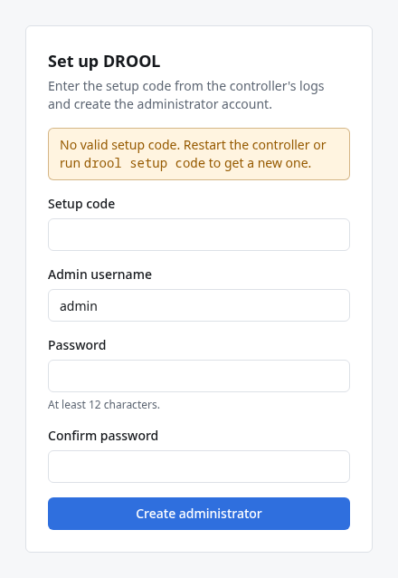

# Problems installing or setting up DROOL

Find what you're seeing, then follow the steps. The install pages explain each command in more
detail: [Docker Compose](Install-With-Docker-Compose.md) · [Podman](Install-With-Podman.md) ·
[package](Install-From-a-Package.md) · [release archive](Install-From-the-Release-Archive.md).

With Docker Compose, run every `docker compose` command in your DROOL folder: `cd ~/drool` first.

| You see | Go to |
|---|---|
| No setup code anywhere | [I don't see a setup code](#i-dont-see-a-setup-code) |
| *invalid or expired setup code*; *No valid setup code*; *too many failed setup attempts* | [My setup code expired](#my-setup-code-expired) |
| *setup is already complete*; `/setup` shows **Sign in to DROOL** | [DROOL says setup is already complete](#drool-says-setup-is-already-complete) |
| `<this-host's-address>`, or no idea what to type in the browser | [I don't know what address to open](#i-dont-know-what-address-to-open) |
| The browser can't reach DROOL; *Client sent an HTTP request to an HTTPS server* | [The browser can't connect](#the-browser-cant-connect) |
| *no configuration file provided: not found* | [docker compose says it can't find a compose file](#docker-compose-says-it-cant-find-a-compose-file) |
| *pull access denied*, *permission denied … docker.sock*, *port is already allocated*, *unknown command* | [Other Docker messages](#other-docker-messages) |
| *Failed to connect to bus*, *Unit drool.service not found* | [Podman messages](#podman-messages) |

## I don't see a setup code

DROOL prints the setup code in its **startup message**, a short block framed by two rows of `=`,
every time it starts until the first administrator exists. Show it with the command for your
installation:

| Installation | Show the startup message |
|---|---|
| Docker Compose | `cd ~/drool`, then `docker compose logs drool`: the message is at the end |
| Podman | `journalctl --user -u drool -n 50` |
| Package or release archive | `sudo journalctl -u drool -n 50` |

If the code isn't there:

- **Rather than search, make a new code.** It's the quickest way out of every case below, as long as
  nobody has finished setup yet:

  | Installation | Command |
  |---|---|
  | Docker Compose | `cd ~/drool`, then `docker compose exec drool drool setup code` |
  | Podman | `podman exec drool drool setup code` |
  | Package | `sudo -u drool drool setup code` |
  | Release archive | `sudo -u drool /usr/local/bin/drool setup code` |

  It prints `Setup code:` followed by six digits, and the code it printed before stops working.
- **DROOL has been running for a while.** More log lines came after the startup message, so it's
  further up: in Docker, `docker compose logs drool | grep -A 1 'Setup code:'` finds it (the last one
  is the current one). Or make a new code.
- **The message has no `Setup code:`, and `Open:` ends in `:8080` without `/setup`.** Setup is already
  complete: see [DROOL says setup is already complete](#drool-says-setup-is-already-complete).
- **It says `Setup code: the setup secret you provided`.** Whoever installed DROOL chose the code in
  advance with `DROOL_SETUP_SECRET` or `DROOL_SETUP_SECRET_FILE` ([Configuration](Configuration.md#your-own-setup-code)).
  The code is that secret, and DROOL never prints it. A code from `drool setup code` works as well.
- **There's no startup message at all.** DROOL didn't start. Check whether it runs
  (`docker compose ps`; `systemctl --user status drool`; `systemctl status drool`). The last lines of
  its log say why it stopped: in Docker the end of `docker compose logs drool`, on a native
  installation a line starting with `drool:` in `sudo journalctl -u drool -n 50`.
- **`journalctl` says `-- No entries --`, or that you're not seeing messages from other users and the
  system.** For a package or archive installation, put `sudo` in front. For Podman, run it as the user
  DROOL runs as, without `sudo`.
- **Docker says `no configuration file provided: not found`.** You're not in the DROOL folder:
  [see below](#docker-compose-says-it-cant-find-a-compose-file).

## My setup code expired



The setup page says **invalid or expired setup code** when the code you entered:

- was mistyped (only the digits matter: spaces and dashes are ignored);
- is more than 60 minutes old;
- was already used;
- or has been replaced. **Every start of DROOL, and every `drool setup code`, makes a new code, and
  the previous one stops working.** DROOL starts again when it's restarted, when the machine reboots,
  after an update, and in Docker also after `docker compose up -d` following a change to
  `compose.yaml` or `.env`.

Before you type anything, the page may already say **No valid setup code. Restart the controller or
run `drool setup code` to get a new one.** That means every code DROOL issued has expired or been
used:



**What to do:** make a new code ([commands](#i-dont-see-a-setup-code)) and use it within 60 minutes.
If the log shows several codes, only the newest one can work.

**Too many failed setup attempts; try again later** means five wrong codes came from your computer (or
20 from anywhere) within 15 minutes. Wait up to 15 minutes, or restart DROOL, which also makes a new
code. If you didn't type five wrong codes yourself, someone else on your network is trying to claim
your DROOL: finish setup quickly with a fresh code.

## DROOL says setup is already complete

You see this when `drool setup code` answers *setup is already complete (an administrator exists);
use `drool user create` to add users*, when the setup page answers *setup is already complete*, or
when `/setup` takes you straight to **Sign in to DROOL** and the startup message has no setup code.

It means an administrator account already exists in this DROOL's data. Setup happens only once. How
that came about decides what to do:

- **You created it**, perhaps in an earlier attempt: sign in at your DROOL's address (without
  `/setup`) with that username and password. Forgot the password?
  [Create a new administrator from the command line](First-Login.md#if-you-forget-your-password).
- **You restored a backup**: the accounts come from the backup. Sign in with one of them.
- **You're reusing an earlier installation's data.** DROOL's data outlives the program on purpose:
  - Docker keeps the volume (`drool_drool-data` for a folder called `drool`) through
    `docker compose down`, and a new installation in a folder with the same name uses it again. Only
    `docker compose down -v` deletes it.
  - Podman keeps the `drool-data` volume until you remove it.
  - Removing the package (even `apt purge`) or the archive's files keeps `/var/lib/drool`.

  Sign in with the old account. Or, if nothing in that data matters to you, delete it and start
  fresh. **This deletes everything DROOL stored there** (hosts, credentials, history):

  | Installation | Start over |
  |---|---|
  | Docker Compose | `cd ~/drool`, then `docker compose down -v`, then `docker compose up -d` |
  | Podman | `systemctl --user stop drool`, `podman volume rm drool-data`, `systemctl --user start drool` |
  | Package or archive | `sudo systemctl stop drool`, `sudo rm -rf /var/lib/drool`, `sudo systemctl start drool` |

  DROOL then starts like new, with a new setup code.
- **You don't know who created it.** Someone else reached the setup page with a valid code first.
  Don't use this installation: start fresh as shown above, and finish setup straight after DROOL
  starts.

## I don't know what address to open

DROOL's web page is `https://`, then the name or IP address of the machine DROOL runs on, then
`:8080`: for example `https://10.10.0.10:8080`. Until setup is done, add `/setup`:
`https://10.10.0.10:8080/setup`.

- **Docker and Podman** print `https://<this-host's-address>:8080/setup`. From inside a container,
  DROOL can't see the address other computers use for the machine, so it prints this placeholder.
  Replace `<this-host's-address>`, including the `<` and `>`, with the machine's address.
- **A package or the archive** prints the machine's own addresses, for example
  `https://10.10.0.10:8080/setup`. If there are several, use the one on the same network as the
  computer your browser runs on.

To find the machine's address, run this on it:

```sh
hostname -I
```

It prints the machine's IP addresses, for example `10.10.0.10 172.17.0.1`. The first is usually the
one. Addresses Docker made for itself (often `172.17.0.1` and other `172.` addresses) don't work from
other computers.

If `hostname` says *invalid option* (some distributions, such as Arch Linux, have a `hostname` without
`-I`), run `ip -brief address` instead. It lists each network interface on a line, with its state and
its addresses:

```text
lo               UNKNOWN        127.0.0.1/8 ::1/128
enp3s0           UP             10.10.0.10/24 fe80::5054:ff:fe12:3456/64
docker0          DOWN           172.17.0.1/16
```

Use the first address of an interface that's `UP`, other than `lo` and Docker's own (`docker0`,
`br-…`), without the part from the `/`: here `10.10.0.10`.

- If your browser runs **on the DROOL machine itself**, `https://localhost:8080/setup` works.
- A **name** such as `https://drool.example.net:8080` works if your network's DNS knows the machine.
- Reaching DROOL on a server from your laptop: it's the same address you'd use to SSH to that server.

## The browser can't connect

| What the browser says | What it means |
|---|---|
| *Client sent an HTTP request to an HTTPS server.* | You typed `http://`. DROOL only speaks `https://` |
| *Your connection is not private*; *Warning: Potential Security Risk Ahead* | Expected the first time: DROOL's own certificate. Continue to the site ([First Login](First-Login.md#1-open-drool-in-your-browser)) |
| *This site can't be reached*, *refused to connect*, *Unable to connect* | Nothing answers at that address and port: DROOL isn't running, or the address or port is wrong |
| *took too long to respond*, *timed out* | Something drops the connection on the way, usually a firewall on the DROOL machine; or the address is wrong |

Check, in this order:

1. **Is DROOL running?** Docker: `docker compose ps` shows `Up … (healthy)` and `0.0.0.0:8080->8080/tcp`.
   Podman: `systemctl --user status drool`. Package or archive: `systemctl status drool`. If not, its
   log says why ([I don't see a setup code](#i-dont-see-a-setup-code), last items).
2. **Does it answer on its own machine?** On the DROOL machine, run:

   ```sh
   curl -k https://localhost:8080/api/v1/setup/status
   ```

   An answer such as `{"setup_required":true,"code_available":true}` means DROOL works, and the
   problem lies between your browser and that machine. (`-k` makes `curl` accept DROOL's own
   certificate. `"setup_required":false` would mean setup is already complete.)
3. **Is the address right?** See [I don't know what address to open](#i-dont-know-what-address-to-open).
4. **Is a firewall in the way?** DROOL never opens ports on its own machine. For a package, archive or
   Podman installation, open port 8080 (and 9443 for Shepherds):
   [how](Install-From-a-Package.md#step-7-open-the-ports-if-the-machine-has-a-firewall). (Docker
   usually opens the ports it publishes by itself.)

## docker compose says it can't find a compose file

`no configuration file provided: not found` means Docker Compose found no `compose.yaml` in the
folder you're in.

1. Go to DROOL's folder and try again: `cd ~/drool`. Every `docker compose` command for DROOL runs
   from there.
2. Run `ls`. It must list `compose.yaml`. If it doesn't:
   - You haven't downloaded it yet, or into another folder: follow
     [step 2](Install-With-Docker-Compose.md#step-2-download-composeyaml) of the install page.
   - You downloaded it with a browser: it's probably in `~/Downloads`. Move it:
     `mv ~/Downloads/compose.yaml ~/drool/`.
   - The name must be exactly `compose.yaml`. A browser may have saved it as `compose.yaml.txt` or
     `compose (1).yaml`; rename it, for example `mv 'compose (1).yaml' compose.yaml`.

An error that mentions **yaml** instead, such as *mapping values are not allowed in this context*,
means the file isn't valid:

- `head -n 1 compose.yaml` should print `# DROOL with Docker Compose. …`. If it shows `<!DOCTYPE html>`
  or something else, a web page was saved instead of the file: download it again with the `curl`
  command from step 2.
- If it broke after you edited the file, check the lines you changed: the spaces at the start of each
  line matter. `docker compose config` checks the file without starting anything.

## Other Docker messages

| Message | What to do |
|---|---|
| `docker: unknown command: docker compose`, or `docker: 'compose' is not a docker command` | Docker's Compose plugin isn't installed. Install it with Docker's instructions for your distribution ([docs.docker.com/engine/install](https://docs.docker.com/engine/install/)); `docker compose version` then prints a version |
| `docker: command not found` | Docker isn't installed: same instructions |
| *permission denied* … `docker.sock` | Your user may not use Docker. Put `sudo` in front of the command, or add yourself to the `docker` group ([how](Install-With-Docker-Compose.md#before-you-start)) |
| *Cannot connect to the Docker daemon … Is the docker daemon running?* | Start Docker: `sudo systemctl start docker`, and `sudo systemctl enable docker` so it starts at boot |
| *pull access denied for drool, repository does not exist or may require 'docker login'* | Compose is looking for `drool:local` because `.env` is missing, or you're in another folder. In `~/drool`, `cat .env` must print `DROOL_IMAGE=ghcr.io/irnutsmurt/drool:main` ([step 3](Install-With-Docker-Compose.md#step-3-choose-the-image)) |
| *port is already allocated*, *address already in use* | Another program uses port 8080 or 9443 on this machine. `sudo ss -ltnp 'sport = :8080'` shows which. Stop it, or give DROOL another port (below) |

**Another port for Docker:** in `compose.yaml`, change only the first number of `"8080:8080"`, for
example to `"8443:8080"`, and run `docker compose up -d`. Then open `https://…:8443`. The startup
message still says `:8080`, because that's the port inside the container.

## Podman messages

| Message | What to do |
|---|---|
| *Failed to connect to bus* (from `systemctl --user`) | You aren't logged in directly as the user who runs DROOL (for example you used `su`). Log in as that user, on the console or over SSH |
| *Unit drool.service not found* (after `systemctl --user daemon-reload`) | Podman found no valid `drool.container`. It must be in `~/.config/containers/systemd/`, be named exactly `drool.container`, and your Podman must be 4.4 or newer (`podman --version`) |
| *Access denied* (from `loginctl enable-linger`) | Run it with `sudo` in front |

## Still stuck?

The startup message and DROOL's log usually say what's wrong. [Troubleshooting](Troubleshooting.md)
covers problems after setup.
