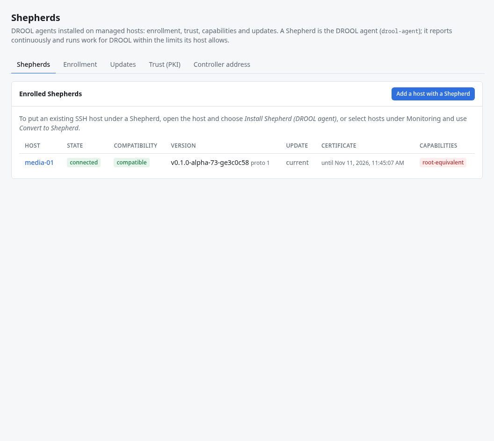

# Shepherd incompatible

The **Shepherds** page and each host's Shepherd card show how well that Shepherd fits this DROOL:

| Compatibility | Means | What to do |
|---|---|---|
| **compatible** | All good | Nothing |
| **update available** | A newer Shepherd is available | [Update it](Updating-Shepherds.md) when convenient |
| **reduced capabilities** | It works, but lacks an optional capability (firewall management, network activity, system monitoring, Desired State checks, removing itself when DROOL asks, …) | Update it to get them. A Shepherd that can't remove itself is removed over SSH, or by hand ([Removing a Host](Removing-a-Host.md#uninstalling-a-shepherd)) |
| **update required** | It lacks something this host's configuration needs, for example firewall management on a host in Enforce mode | Update it |
| **incompatible** | It speaks a protocol version this DROOL doesn't | Update it. Meanwhile DROOL doesn't use it, and hosts with [SSH fallback](SSH-Fallback.md) keep working over SSH |
| **identity / trust problem** | Revoked, in an identity conflict, or its certificate expired too long ago to renew | [Shepherd PKI](Shepherd-PKI.md) |

DROOL never sends a Shepherd an operation it can't do: it uses SSH where that's allowed, or refuses and
says to update the Shepherd.

## Updating

Shepherds update themselves when DROOL is updated: DROOL rolls out the Shepherd it came with, and each
Shepherd installs it only if the DROOL project's signature on it checks out, so a compromised DROOL
can't make Shepherds run code nobody signed. **Shepherds → Updates** shows how far it got, and why a
Shepherd can't update if one can't ([Updating Shepherds](Updating-Shepherds.md)). A Shepherd from before
DROOL had official releases (a development or pre-1.0 build) doesn't know the project's key: update it
once with a custom release, or reinstall it from its host's page.

## After restoring DROOL from a backup

A Shepherd too old to move to the restored controller's epoch waits as **update required** on
**Settings → System → Restore**; once updated, it's compared again when it reconnects
([What Happens After Restore](What-Happens-After-Restore.md)).

## Related

[Updating Shepherds](Updating-Shepherds.md) · [Shepherd Offline](Shepherd-Offline.md) · [Shepherd PKI](Shepherd-PKI.md)
