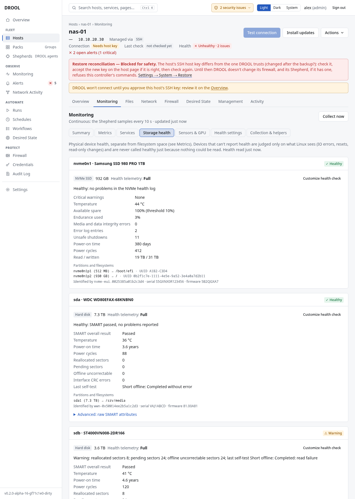

# Storage health

Filesystem *space* is one thing; whether the **disk itself** is failing is another. The **Storage
health** tab on a host's monitoring page shows, for every physical device, what the device can tell
about its own health, and what the Linux kernel has noticed: IO errors, resets, read-only switches.

## Before you start

- **Shepherd hosts:** device health is read every 30 minutes, and kernel storage errors as they
  happen.
- **SSH hosts:** device health and kernel errors are read **hourly**, and only where DROOL may use
  sudo **without a password** (reading SMART data needs root). With a sudo password, this part of
  monitoring is unavailable over SSH.
- **Tools on the host:** SATA and SAS disks need `smartmontools`; NVMe drives `smartmontools` or
  `nvme-cli`. Without them, DROOL can still watch kernel errors, but can't read the disks' own health
  reports (see [Optional helpers](#optional-helpers)).

## How much a device can tell

Each device first says **how much it can report**, and only then gives a verdict:

| Health telemetry | Typical devices |
|---|---|
| **Full** | SATA/SAS disks and NVMe drives with the tools installed |
| **Partial**, **Vendor-specific** | Devices that report some indicators, or report them in their own way |
| **Limited** | **SD cards and USB sticks**: they report nothing about their own health |
| **Unavailable** | Virtual disks, or devices DROOL can't read |

DROOL never calls a device "healthy" just because it couldn't read anything. A USB stick shows
*Limited — No failure indicators detected*, which honestly means "nothing bad seen, nothing known
either". For those, DROOL watches kernel IO errors, USB resets and read-only switches instead.

Each device also shows its partitions, filesystems and mounts, and how DROOL identifies it (WWN or
serial number), so a setting stays with the right disk even if device names change after a reboot.

## When does DROOL call it a problem?

| Check | What it means |
|---|---|
| **Disk health (SMART / NVMe)** | The device's own health assessment failed, or it reports critical warnings or wear-out |
| **New media errors** | Error counters grew: reallocated or pending sectors, media errors |
| **Kernel storage errors** | The kernel logged IO errors, resets or timeouts for the device |
| **Device turned read-only** | The kernel or the device switched a disk or card to read-only |
| **Write/read probe** | The optional write/read probe of a filesystem failed (below) |

In the examples, `nas-01`'s `sdb` has a warning: *reallocated sectors 8; pending sectors 24; offline
uncorrectable sectors 24; last self-test Short offline: Completed: read failure*, and the kernel
reports IO errors for it. Time to order a replacement disk.

## The write/read probe (SD cards and USB sticks)

Since flash cards don't report their own health, a Shepherd host can **probe** a filesystem: once an
hour it writes 512 bytes to a file in a DROOL-owned folder, forces it to the card and reads it back.
Turn it on per filesystem with **Probe /media/usb** on the device's card and choose the **Interval**
(*Every hour (recommended)*). More frequent probes are possible, but they wear the flash, and DROOL
warns you. A passing probe doesn't prove every block is healthy; a failing one is a strong sign.

## What DROOL never does

DROOL never starts SMART self-tests and never wakes a sleeping disk to read it.

## Optional helpers

The **Collection & helpers** tab of a host says which tools would add information there and why:

| Helper | Adds |
|---|---|
| `smartmontools` | SMART health for SATA/SAS disks and SSDs, and USB bridges that pass it through; also NVMe |
| `nvme-cli` | NVMe health: critical warnings, endurance used, available spare, media errors, error log |
| `lm-sensors` | `sensors-detect`, which can find motherboard sensor chips the kernel didn't load (you run it yourself) |

**Install** next to a helper shows exactly what would be installed, then runs an ordinary package run
(audited, in **Runs**). On **Monitoring** you can select several hosts and choose **Install
recommended helpers**. An administrator can also give a *standing approval* under **Monitoring →
Health checks → Advanced → Monitoring helper approvals** (for every host, or one Pack): DROOL then
installs a needed helper once per host by itself. DROOL never uninstalls helpers and never installs
GPU drivers.

## Related

[Filesystems and Disk Space](Filesystems-and-Disk-Space.md) · [Health Overrides](Health-Overrides.md) ·
[Monitoring Settings](Monitoring-Settings.md)
