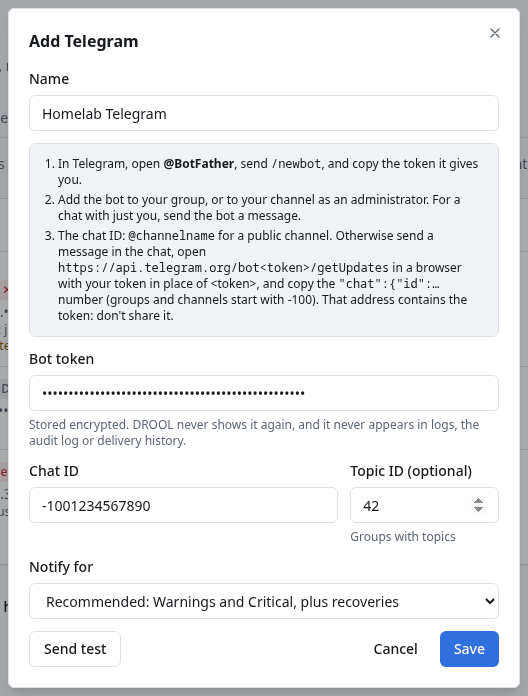

# Telegram notifications

DROOL can post alerts to a Telegram group, channel or private chat through a **bot** you create: a
Telegram account for programs, which DROOL uses to send messages.

## Before you start

- You need **notifications.manage** in DROOL (administrators).
- A Telegram account, in the Telegram app or at web.telegram.org.
- The DROOL controller must be able to reach `api.telegram.org` on the internet (HTTPS, port 443).

## 1. Create a bot

1. In Telegram, search for **@BotFather** and open it (it's Telegram's own bot for making bots, with a
   blue tick).
2. Send `/newbot`. BotFather asks for a display name, for example *DROOL alerts*, and a username that
   ends in `bot`, for example `homelab_drool_bot`.
3. BotFather answers with the bot's **token**: digits, a colon, then a long string of letters, digits,
   `-` and `_`, like `123456789:AAH…`.

Treat the token like a password: anyone who has it can post as your bot. If it leaks, send `/revoke`
to BotFather, choose the bot, and give DROOL the new token.

## 2. Put the bot where the alerts should go

- **A group**: add the bot as a member (the group's info → **Add members** → search for its username).
- **A group with topics**: the same; the alerts can go to one topic (step 3).
- **A channel**: add the bot as an **administrator** with permission to post messages. Bots can't
  post in a channel otherwise.
- **Just you**: open the bot's chat and press **Start**. A bot can't write to anyone who hasn't
  started a chat with it.

## 3. Find the chat ID

- **A public channel**: its username, for example `@homelab_alerts`.
- **Anything else**: send a message in the group (or to the bot), then open this address in a browser,
  with your token in place of `<token>`:

  ```text
  https://api.telegram.org/bot<token>/getUpdates
  ```

  Look for `"chat":{"id":` and copy the number after it, minus sign included: groups and channels
  start with `-100`, for example `-1001234567890`; a private chat is a positive number. That address
  contains your token: don't paste it anywhere else.

  If the page shows `"result":[]`, send another message and reload. In a group, a bot may see only
  messages that mention it: send `@homelab_drool_bot hello` (with your bot's username).
- **A topic** (optional): send a message in the topic and look in the same page for
  `"message_thread_id":` followed by a number, for example `42`. Without a topic, DROOL posts to the
  group's main chat.

## 4. Add it to DROOL

1. Open **Settings → Notifications** (or **Alerts → Notification settings**).
2. Click **Add destination** and choose **Telegram**. The dialog repeats the steps above.
3. **Name**: for example *Homelab Telegram* (empty: *Telegram*).
4. **Bot token**: paste the token from BotFather. DROOL checks only that it looks like one; the test
   below shows whether Telegram accepts it.
5. **Chat ID**: the number, or `@channelname`.
6. **Topic ID (optional)**: the topic's number, or empty.
7. **Notify for**: *Recommended: Warnings and Critical, plus recoveries*, or *Only what advanced
   routes send here* ([Notification Routing](Notification-Routing.md)).
8. Click **Send test**. A message **TEST: DROOL notification test** appears in the chat, and the form
   shows *✓ Test delivered: delivered (Telegram)*.
9. Click **Save**.



DROOL stores the token encrypted with its [master key](Master-Key.md) and never shows it again: the
list shows *Chat -1001234567890, topic 42 · bot token •••••••*. To change it, **Edit** the
destination and paste the new token; leave the field empty to keep the current one.

## What the messages look like

Each alert is one message from your bot. The first line is in bold, for example **CRITICAL: nas-01**;
the rest is the same text as an email ([example](Email-Notifications.md#what-the-emails-look-like)),
ending with a link to the alert in DROOL. Telegram shows no link previews for them.

DROOL's messages never mention anyone: a host or service whose name starts with `@` notifies nobody.

## Good to know

- DROOL sends at most **20 messages a minute** to one Telegram destination, Telegram's limit for a
  group. During a big outage the rest wait their turn rather than being lost. If Telegram still
  answers *Too Many Requests*, DROOL waits as long as Telegram asks (up to an hour) and tries again.
- Telegram puts the bot token in the address DROOL sends each message to. DROOL treats that whole
  address as secret: the token never appears in DROOL's logs, audit log, delivery history, test
  results or error messages, even when Telegram's answer repeats the request.
- DROOL only sends. It never reads your chats (it doesn't use `getUpdates`).
- To pause a destination without deleting it, **Edit** it and untick **Enabled**.

## If the test fails

| Message | What to do |
|---|---|
| *that doesn't look like a bot token* | Copy the whole token again from BotFather (`/mybots` → your bot → **API Token**) |
| *Telegram refused the bot token (HTTP 401 …)* | The token is wrong or was revoked. Copy the current one from BotFather |
| *Telegram doesn't know this chat (HTTP 400: Bad Request: chat not found)* | Check the chat ID (with its minus sign), and that the bot is in the group or channel. For a private chat, press **Start** in the bot's chat first |
| *the bot can't post in this chat (HTTP 403 …)* | The bot was removed from the group, blocked, or isn't an administrator of the channel. Add it again |
| *the group was upgraded to a supergroup: change the chat ID to -100…* | Telegram gave the group a new ID. **Edit** the destination and use the number shown |
| *Telegram doesn't know this topic* | The topic was deleted or the number is wrong. Check it, or leave **Topic ID** empty |
| *host name not found* / *could not connect* / *timed out* | The controller can't reach api.telegram.org. Check its internet access, DNS and any proxy |

More: [Notification Failed](Notification-Failed.md).

## Related

[Notification Routing](Notification-Routing.md) · [Understanding Alerts](Understanding-Alerts.md) ·
[Email](Email-Notifications.md) · [Discord](Discord-Notifications.md) · [Slack](Slack-Notifications.md) ·
[Webhooks](Webhooks.md)
