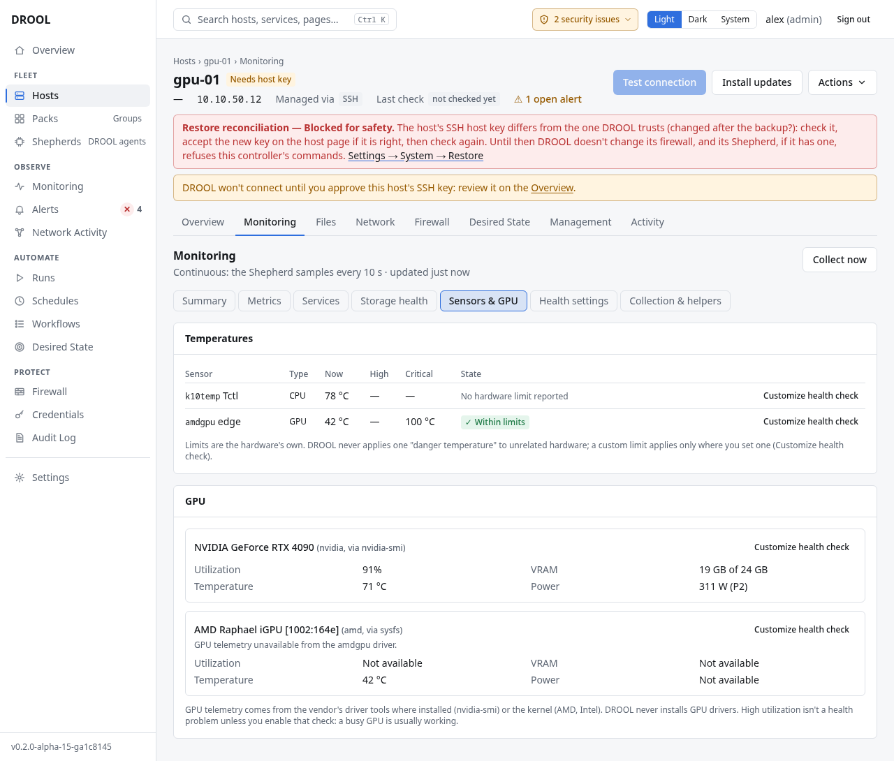

# Temperatures

DROOL shows every temperature sensor a host exposes and judges each one **against the limits its own
hardware reports**. There's no universal "too hot" in DROOL: 70 °C is fine for one chip and alarming
for another.

## Where to look

- The **Temperature** tile on a host's **Overview** and monitoring **Summary** shows the hottest
  sensor.
- The **Sensors & GPU** tab lists every sensor with its type, the temperature **Now**, the hardware's
  **High** and **Critical** limits, and a **State**.
- On **Monitoring**, the **Temp.** column and the **Temperature** filter cover the whole fleet.

## Before you start

- Physical machines usually expose sensors; **virtual machines and containers usually don't**. Those
  show *No sensors — This host exposes no temperature sensors (normal for VMs and containers).* That's
  not an error.
- If a physical machine shows few sensors, the `lm-sensors` helper can help find sensor chips the
  kernel didn't load ([Storage Health](Storage-Health.md#optional-helpers)).

## How DROOL judges a temperature

- The **Temperature** check compares each sensor with the limits the hardware itself reports, and must
  see the condition for 2 minutes before it becomes an issue.
- A sensor that reports **no limit** (*No hardware limit reported*) is shown but never judged: DROOL
  won't invent a limit for it. In the example, gpu-01's CPU at 78 °C has no limit, so it's not a
  problem as far as DROOL can tell.
- NVIDIA GPUs report no temperature limit at all, so their temperature is judged only if you set one.

## Setting your own limit

Click **Customize health check** next to a sensor to turn it off, make DROOL wait longer before calling
it a problem, or set your own warning and critical limits (for example 85 °C and 95 °C). A custom
limit is always marked as yours, never shown as the hardware's. See [Health Overrides](Health-Overrides.md).

## Related

[GPUs](GPUs.md) · [Health Overrides](Health-Overrides.md) · [Host Monitoring](Host-Monitoring.md)
