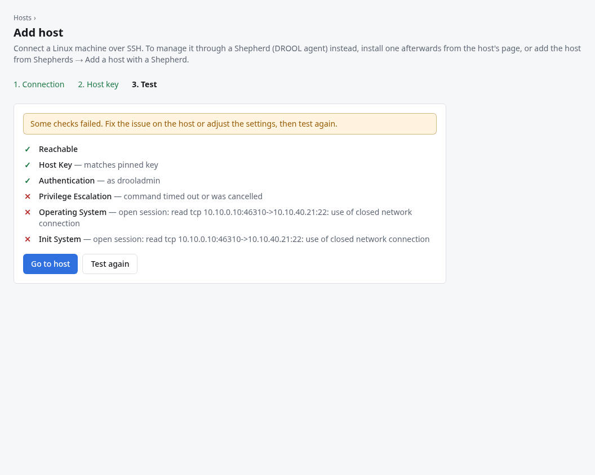

# Testing a connection

The connection test checks, one step at a time, everything DROOL needs to manage a host over SSH,
and explains the first thing that's wrong. It runs automatically when you add a host, and you can
run it any time with **Actions → Test connection** on the host's page (a host that doesn't work yet
shows **Test connection** as its main button).

## Before you start

- The host's SSH key must be trusted ([SSH Host-Key Verification](SSH-Host-Key-Verification.md)).
  DROOL never connects before that.
- Anyone who can see hosts can look at the last result; running the test is part of working with
  hosts.

## What the test does

| Check | What DROOL tries | What a pass looks like |
|---|---|---|
| **Reachable** | Opens a network connection to the SSH port (through the jump host, if any) | ✓ |
| **Host Key** | Compares the key the host presents with the one you trusted | *matches pinned key* |
| **Authentication** | Logs in as the SSH user with the host's credential | *as drooladmin* |
| **Privilege Escalation** | Runs a harmless command through sudo (skipped for root logins) | *passwordless sudo*, or *sudo with password* |
| **Operating System** | Reads the distribution and kernel | The kernel version, e.g. *Linux 6.8.0-142-generic* |
| **Init System** | Looks for systemd | *systemd* |

The test only reads: it changes nothing on the host. Afterwards DROOL updates the host's status and
records the time under **Last test** on the **SSH access** card of the host's **Management** section.

## Reading a failed test

A failed check is marked ✕ with DROOL's explanation next to it, and often a hint below. Later checks
that depend on it fail or are skipped too, so **fix the first failure first**.

In this example the host was so busy right after it started that sudo didn't answer in time. Testing
again a few minutes later passed. Where to go for each failed check:

| First failed check | Usual causes | Guide |
|---|---|---|
| Reachable | Wrong address or port, host down, a firewall in between, DNS name that doesn't resolve on the controller | [Host Won't Connect](Host-Wont-Connect.md) |
| Host Key | The host was reinstalled, or a different machine answers at that address | [SSH Host Key Changed](SSH-Host-Key-Changed.md) |
| Authentication | DROOL's key isn't in the user's `authorized_keys`, wrong user, wrong password | [Authentication Failed](Authentication-Failed.md) |
| Privilege Escalation | The user may not use sudo, sudo wants a password DROOL doesn't have, `requiretty`, a slow host | [Sudo Failed](Sudo-Failed.md) |
| Init System | No systemd (a container) | Commands, scripts and packages still work; service management and reboots don't |

After fixing the cause (on the host, or with **Actions → Edit host details** on the host's page),
click **Test again** (in the Add host wizard, or in the test's own dialog) or **Test connection** (on
the host's page).

## Testing isn't the only check

You don't need to test hosts regularly. DROOL checks every host's status every 5 minutes by itself,
and the host's status changes on its own once a problem is fixed. **Actions → Refresh inventory**
on the host's page collects inventory and status right away instead of waiting.

## Related

[Your First Host](Your-First-Host.md) · [Host Details](Host-Details.md) · [Troubleshooting](Troubleshooting.md)
