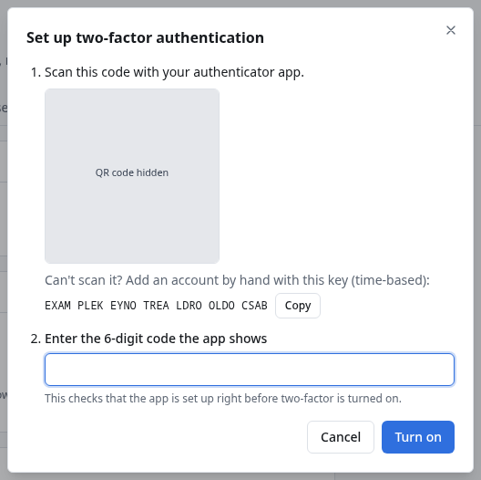

# Two-factor authentication

With two-factor authentication, signing in to DROOL needs your password **and** a 6-digit code from an
authenticator app on your phone (any app for time-based codes, such as Aegis, 2FAS, Google
Authenticator, Microsoft Authenticator or 1Password). Someone who learns your password still can't
sign in.

**Every administrator should turn it on.** DROOL reminds administrators who haven't, in the header
and in [Secure Your Installation](Secure-Your-Installation.md).

## Turn it on

1. Open **Settings → Account**.
2. Under **Two-factor authentication**, click **Set up two-factor authentication**.
3. In your authenticator app, add an account by scanning the **QR code**. *Can't scan it?* Type the
   key shown below the code instead (choose *time-based*).
4. **Enter the 6-digit code the app shows**, and click **Turn on**. (*This checks that the app is set up
   right before two-factor is turned on.*)
5. **Save your recovery codes.** DROOL shows ten codes, **only now**. Click **Download** or copy them
   into your password manager, then click **I've saved them**.



From now on, after your password DROOL asks for the code from your app. Like a password change,
turning it on signs out your other sessions: they sign in again, now with the code.

## Recovery codes

Each recovery code works **once**, in place of an app code: on the sign-in page, choose **Use a
recovery code**. Keep them somewhere other than your phone. **Make new recovery codes** (Settings →
Account) creates ten new ones and invalidates the old ones.

## If you lose your authenticator

Try these in order:

1. **Use a recovery code** to sign in, then turn two-factor off and on again with your new phone
   (**Turn off…**, then **Set up two-factor authentication**).
2. **Ask another administrator**: **Settings → Users →** the user's **Reset two-factor** button. The
   user is signed out and signs in with their password only, until they set it up again.
3. **On the controller**, if you're the only administrator and have no recovery code:

   ```sh
   # Native installation
   sudo -u drool drool user mfa-reset --username alex
   # Docker Compose (in the directory with compose.yaml)
   docker compose exec drool drool user mfa-reset --username alex
   # Podman
   podman exec drool drool user mfa-reset --username alex
   ```

   Replace `alex` with your username. Anyone who can run commands on the controller can do this, which
   is one reason to protect access to that machine.

## Turn it off

**Settings → Account → Two-factor authentication → Turn off…** → **Turn off**. *Signing in will need
only your password again, and your recovery codes stop working. Your other sessions are signed out.*

## Good to know

- Two-factor uses time-based codes (TOTP). Passkeys and security keys (WebAuthn) aren't supported yet.
- Your phone's clock must be right: codes are based on the time.
- Turning two-factor on or off, and resetting it for someone else, asks you to
  [confirm it's you](Re-authentication.md) and is recorded in the [audit log](Audit-Log.md).

## Related

[Re-authentication](Re-authentication.md) · [Users and Roles](Users-and-Roles.md) ·
[Secure Your Installation](Secure-Your-Installation.md)
