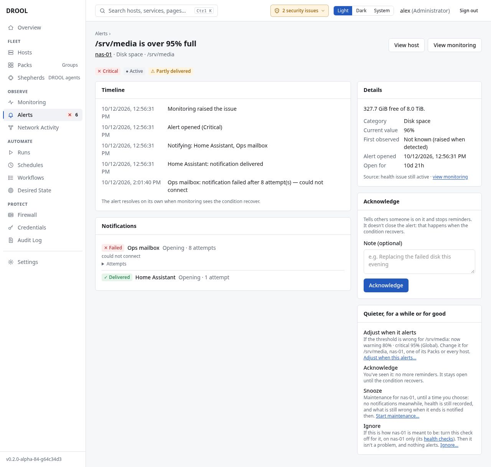

# Understanding alerts

Monitoring decides *what is wrong*. An **alert** is DROOL telling you about it, and keeping a record
of who was told, who is dealing with it, and how long it lasted.

## Where alerts come from

1. Monitoring notices a condition, for example `/srv/media` on `nas-01` is 96% full.
2. When the condition has lasted long enough to count (each check has its own rule, see
   [Health Overrides](Health-Overrides.md)), it becomes a **health issue** on the host's monitoring
   page.
3. If the issue is **Warning** or **Critical**, DROOL opens an **alert** and sends a notification
   to the destinations you set up ([Email](Email-Notifications.md), [Discord](Discord-Notifications.md),
   [Slack](Slack-Notifications.md), [Telegram](Telegram-Notifications.md) or a [webhook](Webhooks.md)).
4. When monitoring sees the condition go away, the alert **resolves** by itself, and DROOL sends one
   more message saying it recovered and how long it lasted.

*Info* issues, such as *Reduced monitoring fidelity*, are shown in monitoring but never become
alerts.

If `jellyfin.service` on `media-01` fails today and again tomorrow, those are two separate alerts.
Each alert's page links to the other **occurrences** of the same problem.

## The Alerts page

**Alerts** in the menu shows the number of open alerts next to it. The page has four tabs:

- **Active**: open alerts nobody has acknowledged yet.
- **Acknowledged**: open alerts someone said they're working on
  ([Acknowledging an Alert](Acknowledging-an-Alert.md)).
- **Resolved / history**: closed alerts, with how long each lasted. Adds **From** and **To** date
  filters.
- **Maintenance**: hosts whose notifications are paused ([Maintenance Mode](Maintenance-Mode.md)).

Above the tabs, one line sums up what's open, for example *6 open: 1 critical, 5 warning · 1
suppressed by maintenance*. It also tells you when *no notification destination* is set up yet, or
when a destination is failing.

Each open alert has **Actions…** on its row. It opens the alert in a panel beside the list (the
list stays in view): what's wrong, where, since when and who was told, then **Acknowledge…** (*I'm
on it*), **Adjust when this alerts…** (the rule that fired and where it comes from, changed for that
device or service, the host, one of its Packs or every host), **Snooze…** (maintenance for its host
until a time you choose) and **Ignore…** (*this is on purpose*: turn the check off, or change what
DROOL expects, for that host only), each a step in the same panel with **Back**
([Acknowledging an Alert](Acknowledging-an-Alert.md)). Links lead on: **View host …**,
**View monitoring** (for a failed service, **View** *the service*: the host's services with that one
found), and **Open the alert** for its full page. Closed alerts have no **Actions…**.

Filter by **Severity**, **Host**, **Pack**, **Category** (CPU, Memory, Disk space, Storage health,
Services, Interfaces, Temperature, GPU, Unreachable / stale) and **Maintenance** (whether the alert
is suppressed by maintenance). A host's page links to its alert **History**, and the **Alerts**
count on the fleet's monitoring page links to that host's open alerts.

Each row shows:

| Column | What it means |
|---|---|
| **Severity** | **Critical** (✕) or **Warning** (⚠), always as a word and an icon, never colour alone |
| **Host** | The host; click it to open the host's page |
| **Problem** | What's wrong, with the category and the current value, for example *Disk space · 96%*. Click it to look at the alert in the panel beside the list; open it in a new tab (Ctrl-click, ⌘-click on a Mac) for its page |
| **Age** | How long the condition has existed (on the history tab: **Duration**, how long it lasted) |
| **State** | **● Active**, **✓ Acknowledged** (with who), **Resolved**, or a *Cleared* state ([Recovered vs Cleared by Configuration](Recovered-vs-Cleared-by-Configuration.md)); *⏸ Suppressed by maintenance* if maintenance covers the host |
| **Notification** | Whether people were told (next table) |

| Notification | What it means |
|---|---|
| **Notified** | Every destination received the message |
| **⧗ Sending** | Messages are queued and about to go out |
| **Delivery retrying** | A destination didn't accept the message yet; DROOL is retrying |
| **Partly delivered** | Some destinations got it, others didn't |
| **Delivery failed** | No destination could be reached, and DROOL has given up retrying |
| **⏸ Suppressed** | Maintenance covered the host: nothing was sent |
| **No destination** | No destination is set up for this kind of alert ([Notification Routing](Notification-Routing.md)) |

## An alert's page

Click a problem, then **Open the alert** in the panel beside the list.

- **The badges** at the top: severity (and *peaked at critical* if it was worse earlier), state,
  notification status, and maintenance.
- **Timeline**: when the condition was first observed, when the alert opened, who was notified,
  who acknowledged it, and when it recovered. *The alert resolves on its own when monitoring sees
  the condition recover.*
- **Notifications**: every message to every destination: **✓ Delivered**, **⚠ Retrying** (with
  the error and the next try), **✕ Failed** or **– Not sent**, and the kind of message (*Opening*,
  *Escalation*, *Reminder*, *Recovery*, *Cleared (not a recovery)*). **Attempts** lists every try.
  *may have arrived twice* means DROOL can't tell whether the destination received an attempt
  (see [Notification Failed](Notification-Failed.md#may-have-arrived-twice)).
- **Details**: the detail monitoring gave (*327.7 GiB free of 8.0 TiB*), the category, the
  current value, when the condition was first observed and the alert opened, and how long it has
  been open. **Source** links to the health issue on the host's monitoring page.
- **Acknowledge**: see [Acknowledging an Alert](Acknowledging-an-Alert.md).
- **Other occurrences**: earlier alerts for the same problem on the same host.
- **View host** and **View monitoring** take you to the host. For a failed service the second reads
  **View** *the service* (for example **View jellyfin.service**) and opens the host's services with
  that one found, where its **Actions…** are; storage and hardware alerts open those tabs.

## How often DROOL messages you

- **One message when a problem starts, one when it's fixed.** A problem that lasts for hours
  doesn't send a message every minute.
- **Getting worse is reported once.** If a Warning becomes Critical, you get one *escalated*
  message. If the value then hovers around the threshold, you aren't told again. If it gets
  better (Critical back to Warning), the alert stays open at the lower severity, without a message.
- **Reminders** for alerts nobody has acknowledged are **off** unless a route turns them on
  ([Notification Routing](Notification-Routing.md#reminders)).
- **During maintenance**, nothing is sent for the hosts it covers ([Maintenance Mode](Maintenance-Mode.md)).

## Nobody can "close" an alert

There is no button to resolve an alert. An alert closes only when **monitoring sees the
condition go away**, or when its check is changed so the condition no longer counts
([Recovered vs Cleared by Configuration](Recovered-vs-Cleared-by-Configuration.md)). This way, a
failing system can never be marked healthy by mistake. To say "I'm on it", acknowledge it.

To stop being alerted about something that isn't a problem for you, **Actions… → Ignore…** on the
alert's row changes the setting behind it for that host (ignore a service, or turn that check off
for that disk or filesystem), and the alert closes as *cleared by configuration*. When the threshold
is wrong rather than the check, **Adjust when this alerts…** changes it where it belongs: for
example warn at 97% for a media archive that's meant to be full, or at 99% CPU on a machine that is
supposed to be busy ([Health Overrides](Health-Overrides.md)). Services alert only when you monitor them
([Service Monitoring](Service-Monitoring.md)).

## Before you start

| What | Who |
|---|---|
| See alerts, history and maintenance | Everyone |
| [Acknowledge](Acknowledging-an-Alert.md) alerts | Administrators and operators (**alerts.acknowledge**) |
| Start and end [maintenance](Maintenance-Mode.md) | Administrators and operators (**maintenance.manage**) |
| See notification destinations (never their secrets) and routes | Administrators, operators and auditors (**notifications.read**) |
| Send a test to an existing destination | Administrators and operators (**notifications.test**) |
| Add, change and delete destinations and routes | Administrators (**notifications.manage**) |

## Good to know

- Alert history is kept for **180 days**, delivery details for **30 days** (an administrator can
  change both under **Settings → Notifications → Advanced → Settings**).
- **Removing a host deletes its alert history** ([Removing a Host](Removing-a-Host.md)).
- A host's **Overview** has an **Alerts** card with its open alerts, a **History** link, and **Start
  maintenance**.

## Next

**Get alerts delivered** to where you'll see them: [Email](Email-Notifications.md) · [Discord](Discord-Notifications.md) · [Slack](Slack-Notifications.md) · [Telegram](Telegram-Notifications.md) · [Webhooks](Webhooks.md).

## Related

[Acknowledging an Alert](Acknowledging-an-Alert.md) · [Maintenance Mode](Maintenance-Mode.md) ·
[Notification Routing](Notification-Routing.md) · [What "Unknown" Means](What-Unknown-Means.md)
