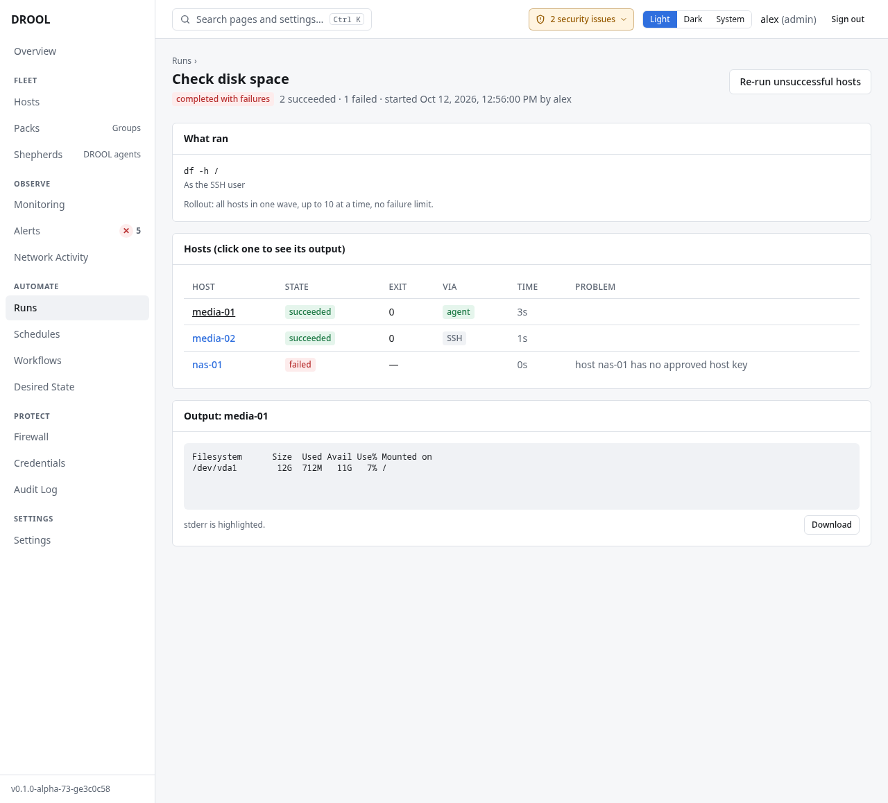

# Understanding run results

Every run, whether you started it, a schedule did, or Desired State corrected something, has a page
under **Runs** with what ran, on which hosts, how, and what happened on each. This page explains how
to read it.

## The Runs list

**Runs** lists every run, newest first: its name (and, for corrections, *Desired State correction*),
its status, a count of host results (*2 succeeded · 1 failed*), who started it (*alex*, or a
schedule's owner) and when. Click one to open it. Run history is kept for 30 days by default
(`retention.jobs_days`).

## The run's status

| Status | Meaning |
|---|---|
| **pending** | Created, waiting to start |
| **running** | Hosts are being worked on; output streams live |
| **paused** | DROOL stopped starting new hosts and is waiting for you: a canary failed, too many hosts failed, or 5 hosts in a row failed the same way on credentials, host keys or sudo (*likely a shared credential problem*). The reason is shown. **Resume** or **Cancel** |
| **completed** | Every host finished, and none failed |
| **completed with failures** | Every host finished, and at least one failed or timed out |
| **cancelled** | Someone cancelled it |
| **interrupted** | DROOL stopped (a restart, or a restore from backup) while the run was in progress. What happened on the hosts that were running is **unknown** |

## Each host's state

| State | Meaning |
|---|---|
| *queued* | Waiting for its turn (batches, *hosts at a time*) |
| *waiting for host* | Another run is busy on this host; DROOL waits for it first |
| *connecting*, *running* | Working |
| *rebooting*, *waiting for host to return*, *verifying* | During a reboot |
| **succeeded** | Done, as asked |
| **failed** | Something went wrong; the **Problem** column says what |
| **timed out** | Didn't finish within the timeout. For changes, what it had already done stays done |
| **skipped** | Not run on purpose: for example a per-OS script without a variant for the host's OS, or a scheduled run on a host in maintenance |
| **cancelled** | The run was cancelled before or while this host ran |
| **interrupted** | DROOL stopped while this host was running; the outcome is unknown |

## The other columns

- **Exit** — the exit code of the command or script (0 means success).
- **Via** — how DROOL reached the host: **agent** (its Shepherd), **SSH**, or **SSH fallback** (the
  Shepherd was unavailable before the step started; hover for the reason). See [SSH Fallback](SSH-Fallback.md).
- **Time** — how long the host took.
- **Problem** — DROOL's explanation of a failure, for example *host nas-01 has no approved host key*.

## What ran

The **What ran** card repeats exactly what the run did: the command or the operation and its options,
whether it ran as root (*As the SSH user*), and the rollout (*all hosts in one wave, up to 10 at a
time, no failure limit*). For scheduled runs and Desired State corrections it also says where the
run came from. A run's definition never changes after it started.

## Output

Click a host's name to see its output. Standard error is highlighted. **Download** saves it as a
file. Output is kept up to 10 MB per host and step; beyond that the rest is dropped and a marker
says so.

## Changed or not

Operations that know whether they changed something report **no change** when the host was already
as requested: installing an installed package, starting a running service, deploying an identical
file. That's a success, not a skipped host.

## Buttons

- **Cancel** (while running) — stops starting new hosts and terminates commands that are running.
  DROOL asks first, *Cancel this run?*: *Commands still running on its hosts are terminated; hosts
  that haven't started won't start. What already changed on a host stays changed.* Click **Cancel
  the run**, or **Keep it running**. For a scheduled run, the schedule stays enabled.
- **Resume** (while paused) — continues with the hosts that haven't started. Failed hosts stay failed.
- **Re-run unsuccessful hosts** (when finished) — a **new** run with the same definition, on every host
  that didn't succeed: failed, timed out, cancelled, skipped or interrupted. The new run says it's a
  *re-run of earlier job*, with a link. Check interrupted hosts (and hosts whose outcome is unknown)
  before you re-run: their first attempt may have done its work
  ([why](Failed-Interrupted-and-Unknown-Outcomes.md)).

## Related

[Failed, Interrupted and Unknown Outcomes](Failed-Interrupted-and-Unknown-Outcomes.md) ·
[Canary Hosts](Canary-Hosts.md) · [Batches and Failure Thresholds](Batches-and-Failure-Thresholds.md)
