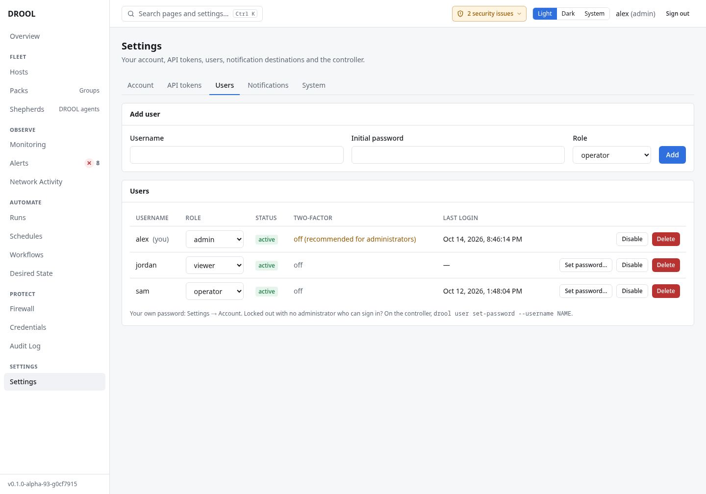

# Users and roles

Everyone who uses DROOL should have their own account, so the [audit log](Audit-Log.md) shows who did
what. Each account has one **role**. In the examples, Alex is an administrator, Sam an operator, and
Jordan a viewer.

| Role | For | Can |
|---|---|---|
| **admin** (administrator) | The people who run DROOL | Everything: hosts and their trust, credentials, users, settings, firewall policy and modes, notification destinations, baselines |
| **operator** | People who look after the machines day to day | Run commands, scripts, packages, updates, services and reboots; files; schedules and workflows; acknowledge alerts and start maintenance; send test notifications; watch services and make health checks stricter; restore desired state; take network snapshots. **Can't** add or remove hosts, approve host keys, manage credentials, users or settings, change the firewall, or change notification destinations |
| **auditor** | Reviewing what happened | Look at everything (including the audit log, settings and network activity), change nothing |
| **viewer** | Keeping an eye on things | Look at hosts, runs, monitoring, alerts, firewall policy, schedules, workflows and desired state. Not the audit log, settings, notification destinations or network activity |

Pages say so when your role can see but not change something (*you can see … ; changing them needs …*).

## Before you start

Managing users needs **users.manage** (administrators), and you'll be asked to
[confirm it's you](Re-authentication.md).

## Add a user

1. Open **Settings → Users**.
2. Under **Add user**, enter a **Username** (for example `sam`), an **Initial password** (at least 12
   characters) and a **Role**.
3. Click **Add**.

Tell them the initial password through a safe channel. They can change it under **Settings → Account →
Change password**, and should turn on [two-factor authentication](Two-Factor-Authentication.md).



## Change someone's account

- **Role**: choose a new one in the **Role** column. It applies right away.
- **Disable** / **Enable**: a disabled user can't sign in; their history stays. Use this when someone
  leaves, rather than deleting them.
- **Reset two-factor**: for someone who lost their authenticator and recovery codes. They are signed
  out and sign in with their password only, until they set it up again.
- **Delete**: removes the account.

**Schedules** run with their owner's permissions: if you disable or delete someone who owns schedules,
or remove a permission the steps need, those schedules stop and are marked *needs attention* until an
administrator gives them a new owner ([Schedules](Schedules.md#who-a-scheduled-run-runs-as)).

## If someone forgets their password

There is no button to set another user's password in this version. An administrator can delete the
account and add it again with a new initial password (reassign any schedules they owned). If the
**only administrator** is locked out, create a new administrator on the controller:

```sh
# Native installation (prompts for the password)
sudo -u drool drool user create --username alex2 --role admin
# Docker Compose (run cd ~/drool first)
docker compose exec drool drool user create --username alex2 --role admin
# Podman
podman exec -it drool drool user create --username alex2 --role admin
```

## Good to know

- Accounts are local to DROOL: there's no single sign-on (LDAP, OIDC) in this version.
- Changing your own password signs out your other sessions.

## Related

[Two-Factor Authentication](Two-Factor-Authentication.md) · [API Tokens](API-Tokens.md) · [Audit Log](Audit-Log.md)
