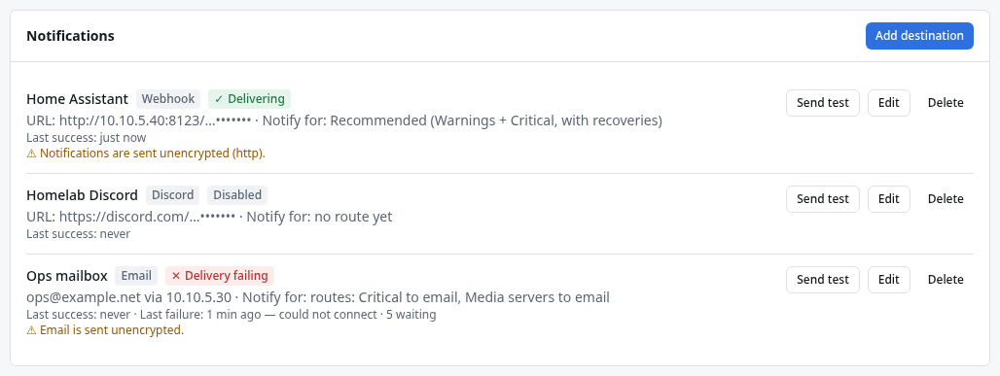

# Webhooks

A **webhook** destination makes DROOL send each alert as a small JSON message (an HTTP `POST`) to any
address you choose. Use it to feed Home Assistant, an automation tool such as n8n or Node-RED, a
chat or push service through a small relay, or your own script. In the examples, Alex sends alerts to
Home Assistant at `http://10.10.5.40:8123/api/webhook/drool-alerts`.

## Before you start

- You need **notifications.manage** in DROOL (administrators).
- Something must be listening at the address and accept a JSON `POST`, answering with a `2xx` status
  (any of 200–299).
- The DROOL controller must be able to reach that address. Addresses on your own network (like
  `10.10.5.40`) are allowed on purpose.

## Add a webhook destination

1. Open **Settings → Notifications** (or **Alerts → Notification settings**).
2. Click **Add destination** and choose **Webhook**.
3. Fill in:
   - **Name**: for example *Home Assistant* (empty: *Webhook*).
   - **URL**: the full address, starting with `https://` or `http://`, for example
     `http://10.10.5.40:8123/api/webhook/drool-alerts`. Don't put a username or password in the URL
     (DROOL refuses it): use the secret header instead.
   - **Secret header (optional)** and **Header value**: a header DROOL adds to every request, for
     receivers that want a password or token, for example `Authorization` with
     `Bearer 7f3c9a2e5d1b8f4e6a0c3d9b2e7f1a5c`. If you enter only a value, the header is called
     `Authorization`. Header names may contain letters, digits and `-`.
   - **Notify for**: *Recommended* or *Only what advanced routes send here*
     ([Notification Routing](Notification-Routing.md)).
4. Click **Send test**. The receiver gets a message with `"event": "test"` and `"test": true`; the
   form shows *✓ Test delivered: delivered (HTTP 204)* (or whichever status your receiver answered).
5. Click **Save**.

The URL and the header value are stored encrypted with DROOL's [master key](Master-Key.md) and never
shown again: the list shows only `http://10.10.5.40:8123/…•••••••`.



**`http://` is unencrypted.** DROOL then shows *⚠ Notifications are sent unencrypted (http)* (or
*Notifications and the authorization header are sent unencrypted*) next to the destination. That's
acceptable on a network you trust; use `https://` anywhere else. For `https://`, the receiver's
certificate must be trusted by the controller's operating system: a self-signed certificate needs its
CA in the controller's system trust store (there is no setting for it per destination).

## The message format

The body is JSON in the format `drool.notification.v1`. This is what Home Assistant received when
`jellyfin.service` failed on `media-01`:

```json
{
  "schema": "drool.notification.v1",
  "event_id": "alr_01m4ry9kzq50dh5sb2x274k24p:opening",
  "delivery_id": "ndel_01m4ry9kzq50dh5sb2x2n88e5n",
  "event": "opened",
  "sent_at": "2026-10-12T20:54:01Z",
  "test": false,
  "summary": "CRITICAL: media-01",
  "text": "jellyfin.service failed\nThe unit failed (signal).\nFirst detected: 2026-10-12 13:54 PDT\nOpen in DROOL: https://drool.example.net:8080/alerts/alr_01m4ry9kzq50dh5sb2x274k24p",
  "alert": {
    "id": "alr_01m4ry9kzq50dh5sb2x274k24p",
    "fingerprint": "host_01m4rtadya6bnnqp9vx2w15w36/service_failed/jellyfin.service",
    "state": "active",
    "severity": "critical",
    "host": { "id": "host_01m4rtadya6bnnqp9vx2w15w36", "name": "media-01" },
    "check": "service_failed",
    "category": "services",
    "subject": "jellyfin.service",
    "title": "jellyfin.service failed",
    "detail": "The unit failed (signal).",
    "observed_at": "2026-10-12T20:54:01.462Z",
    "opened_at": "2026-10-12T20:54:01.462Z",
    "url": "https://drool.example.net:8080/alerts/alr_01m4ry9kzq50dh5sb2x274k24p"
  }
}
```

and when it was fixed (an earlier occurrence, acknowledged by Sam):

```json
{
  "schema": "drool.notification.v1",
  "event_id": "alr_01m4rxtz7vnzhxzcca70m5a6vr:recovery",
  "delivery_id": "ndel_01m4ry3dzb6dy4r5wkg2c9j390",
  "event": "recovered",
  "sent_at": "2026-10-12T20:50:38Z",
  "test": false,
  "summary": "RECOVERED: media-01",
  "text": "Recovered: jellyfin.service failed\nDuration: 4m 37s\nAcknowledged by sam: Restarting it after the config fix",
  "alert": {
    "id": "alr_01m4rxtz7vnzhxzcca70m5a6vr",
    "fingerprint": "host_01m4rtadya6bnnqp9vx2w15w36/service_failed/jellyfin.service",
    "state": "resolved",
    "severity": "critical",
    "host": { "id": "host_01m4rtadya6bnnqp9vx2w15w36", "name": "media-01" },
    "check": "service_failed",
    "category": "services",
    "subject": "jellyfin.service",
    "title": "jellyfin.service failed",
    "detail": "The unit failed (signal).",
    "observed_at": "2026-10-12T20:46:01.467Z",
    "opened_at": "2026-10-12T20:46:01.467Z",
    "resolved_at": "2026-10-12T20:50:38.698Z",
    "duration_s": 277,
    "resolution": "recovered",
    "acknowledgement": { "by": "sam", "at": "2026-10-12T20:48:04.888Z", "note": "Restarting it after the config fix" }
  }
}
```

(The *Open in DROOL* link is missing from the second one because the
[link address](Notification-Routing.md#notification-settings) wasn't set yet at the time.)

| Field | Meaning |
|---|---|
| `event` | `opened`, `escalated` (Warning became Critical), `reminder`, `recovered`, `cleared` (closed by configuration or because the subject disappeared, *not* a recovery) or `test` |
| `summary` | The first line, as in an email subject: *CRITICAL: media-01*, *RECOVERED: media-01* |
| `text` | The rest of the message as plain text, one fact per line |
| `alert.state` | `active`, `acknowledged` or `resolved` |
| `alert.severity` | `warning` or `critical` |
| `alert.check`, `alert.category`, `alert.subject` | What was checked (`service_failed`), its category (`services`) and the thing it's about (`jellyfin.service`, `/srv/media`, `sdb`) |
| `alert.value`, `alert.value_text` | The measured value, when there is one: `96` and `"96%"` |
| `alert.resolution`, `alert.resolution_note` | For `recovered` and `cleared`: `recovered`, or `disabled` (the check was turned off), `reconfigured` (a threshold changed) or `gone` (no longer reported), with an explanation. **Only `recovered` means the system got better** ([Recovered vs Cleared by Configuration](Recovered-vs-Cleared-by-Configuration.md)) |
| `alert.acknowledgement` | Who acknowledged it, when, and their note |
| `event_id` | The same for every destination that gets this event |
| `delivery_id` | One message to one destination; **stays the same when DROOL retries** |
| `fingerprint` | The same for every occurrence of the same problem (host, check, subject) |

Fields without a value are left out. `test` messages have only the top-level fields.

## Headers

Every request has `Content-Type: application/json`, `User-Agent: DROOL/<version>`,
`X-DROOL-Event` (the `event_id`), `X-DROOL-Delivery` and `Idempotency-Key` (both the `delivery_id`),
and your secret header if you set one.

## How DROOL treats the receiver's answer

| Answer | DROOL |
|---|---|
| `2xx` | Delivered |
| `401` or `403` | Stops: *the receiver refused the credentials*. Check the secret header |
| `408`, `425`, `429` or `5xx` | Tries again later (30 seconds, then doubling up to 30 minutes, for about an hour); a `Retry-After` header is respected, up to an hour |
| Another `4xx` | Stops: *the receiver rejected the notification (HTTP 400)*, with the start of the receiver's answer |
| No answer within 10 seconds, or no connection | Tries again later |
| A redirect | Followed, up to 3 times, only to `http(s)`, never from `https` to `http`; the secret header is never sent to a different host |

**A message may arrive twice.** If the receiver got a message but its answer was lost (a timeout, a
restart at the wrong moment), DROOL can't know and sends it again, and the delivery history marks it
*may have arrived twice*. Use `delivery_id` (or the `Idempotency-Key` header) to drop duplicates.

DROOL sends at most 120 messages a minute to one webhook destination; during a big outage the rest
wait their turn.

## Example: Home Assistant

In Home Assistant, create an automation with a **Webhook** trigger and the webhook ID `drool-alerts`;
its address is then `http://<your Home Assistant>:8123/api/webhook/drool-alerts`. The JSON arrives as
`trigger.json`, so a notification action can use `{{ trigger.json.summary }}` as its title and
`{{ trigger.json.text }}` as its message, and a condition can check
`{{ trigger.json.alert.severity == 'critical' }}`. See Home Assistant's own documentation on webhook
triggers for the details of your version.

## Related

[Notification Routing](Notification-Routing.md) · [Understanding Alerts](Understanding-Alerts.md) ·
[Notification Failed](Notification-Failed.md) · [Email](Email-Notifications.md)
