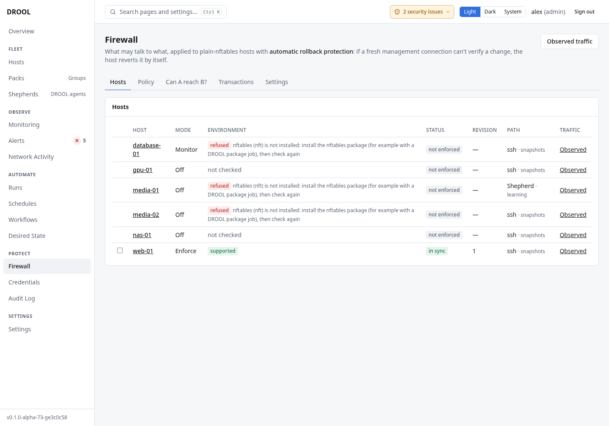

# What DROOL's firewall does

DROOL manages your hosts' firewalls from **what you want to allow**, not from firewall commands. You
write rules such as *"web-servers may reach database-01 on PostgreSQL"* or *"admin-laptop may reach
the media servers over SSH"*, and DROOL turns them into nftables rules for every host they affect,
explains the result in plain words, and applies it so that **a mistake can't lock you out**.

In the examples, Alex's policy says:

| Rule | From | To | Allows |
|---|---|---|---|
| admin-ssh-to-media | admin-laptop (10.10.5.25) | Pack media-servers | ssh (TCP 22) |
| admin-ssh-to-web | admin-laptop | Pack web-servers | ssh |
| admin-ssh-to-database | admin-laptop | database-01 | ssh |
| lan-to-jellyfin | home-lan (10.10.0.0/16) | Pack media-servers | jellyfin (TCP 8096) |
| internet-to-web | the internet | Pack web-servers | http, https |
| web-to-database | Pack web-servers | database-01 | postgres (TCP 5432) |

## The basics

- **Inbound traffic is denied** unless a rule (or DROOL's own management path) allows it.
- **Outbound traffic is allowed**, unless you set a host's outbound traffic to **restrict**
  ([Firewall Modes](Firewall-Modes.md)).
- **Deny rules always win** over allow rules.
- **DROOL's own access is always kept open**: SSH from the controller (or the jump host) to each host,
  and each Shepherd's connection to the controller. You can't edit it, and DROOL refuses to apply a
  policy that would cut it ([Management Path Protection](Management-Path-Protection.md)).
- **Nothing reaches a host until you apply it.** Saving the policy only saves it; the preview shows
  what would change where.
- **Every apply can undo itself.** If DROOL can't confirm a change over a brand-new connection, the
  host restores its previous rules by itself ([Automatic Rollback Protection](Automatic-Rollback-Protection.md)).
  That protects **DROOL's own access only**. Your own SSH and anything else you need must be allowed by
  a rule: a policy that blocks them while DROOL still gets in stays in force.

## Where enforcement works

DROOL only enforces on hosts with **systemd** and **nftables** (`nft`), where no other firewall
manager is in charge:

| Environment | Enforcement |
|---|---|
| Plain nftables, no other firewall manager | **Supported** |
| Docker (either backend), firewalld, UFW (active), Tailscale | Refused |
| Legacy iptables rules, or other nftables rules (iptables-nft, libvirt, Podman, Kubernetes) | Refused |
| No systemd (for example, a container), or `nft` not installed | Refused |

On a refused host, DROOL says why, and you can still observe connections, simulate and use the
explanations. Many minimal cloud images (Debian 12 *genericcloud*, for example) don't include
nftables: install the `nftables` package first ([Installing Packages](Installing-Packages.md)).

## What DROOL touches on a host

Only its own things: its nftables table `inet drool`, its files in `/var/lib/drool/firewall` and
`/usr/libexec/drool-firewall`, and its boot unit `drool-firewall.service`. DROOL never runs
`nft flush ruleset`, and never edits `/etc/nftables.conf`.

## Where to find it

- **Firewall** in the menu: **Hosts** (every host's mode and status), **Policy** (the rules, as a
  drawing, a table or text), **Can A reach B?**, **Transactions** (every apply) and **Settings**.
- A host's **Firewall** section: that host's mode, environment, effective policy, observed
  connections, transactions and generated nftables rules.

## Before you start

| What | Who |
|---|---|
| See the policy, hosts, transactions; simulate | Everyone (**firewall.read**) |
| Change the policy and modes, check hosts, apply | Administrators (**firewall.write**) |
| [Emergency override](Emergency-Override.md), short rollback timeouts, replacing [drift](Firewall-Drift.md) | Administrators (**firewall.override**) |

## The way through

1. [Before Enabling Enforcement](Before-Enabling-Enforcement.md): the checklist.
2. [Firewall Modes](Firewall-Modes.md): start with **Monitor**.
3. [Firewall Policy](Firewall-Policy.md): write the rules.
4. [Can A Reach B?](Can-A-Reach-B.md): check the result.
5. [Applying the Firewall Policy](Applying-the-Firewall-Policy.md).
6. If something goes wrong: [Recovering From a Firewall Problem](Recovering-From-a-Firewall-Problem.md).

## Next

**[Before Enabling Enforcement](Before-Enabling-Enforcement.md)**: the checklist to go through before DROOL changes any host's firewall.

## Related

[Network Activity](What-DROOL-Can-See.md) · [Packs in Firewall Rules](Packs-in-Firewall-Rules.md) ·
[Firewall Drift](Firewall-Drift.md)
