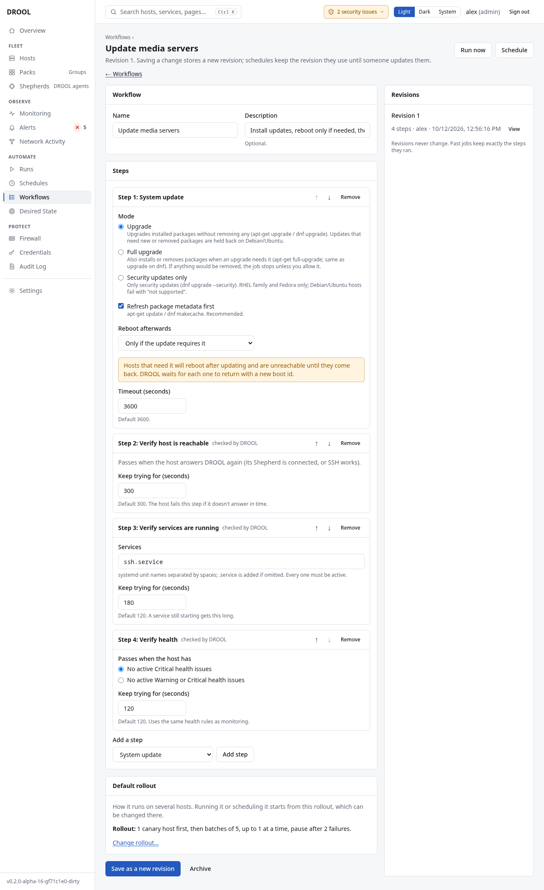

# Workflows

A **workflow** is a named list of steps that runs **in order on each host**. Save it once, then run it
whenever you need it or put it on a [schedule](Schedules.md). In the examples, Alex's *Update media
servers* workflow does this on each media server:

1. **System update**, rebooting only if the update requires it (DROOL waits for the host to come
   back).
2. **Verify host is reachable.**
3. **Verify services are running**: `ssh`.
4. **Verify health**: no active Critical health issues.

## Before you start

- Creating and changing workflows needs **workflows.manage** (administrators and operators).
  Running one needs **jobs.execute**; scheduling one also needs **schedules.manage**. Everyone can
  see workflows.
- The *Verify services are running* and *Verify health* checks read DROOL's monitoring, so
  [monitoring must be on](Monitoring-Settings.md#collection).

## Create a workflow

1. Open **Workflows → New workflow**.
2. Start from a template, or click **Start blank**:

   | Template | What it does |
   |---|---|
   | **Scheduled system update** | Update, reboot only where the update requires it, then check the host answers |
   | **Safe fleet update** | The same, rolled out carefully: one canary host first, then batches of five; pauses at the first canary failure or after two failures |
   | **Update and verify services** | Update, reboot if required, check the host answers, check the services you name are running and the host has no Critical health issues |

   A template is only a starting point: once saved, it's an ordinary workflow you can change.
3. Under **Workflow**, enter a **Name** (*Update media servers*) and optionally a **Description**.
4. Under **Steps**, choose a kind of step in the **Add a step** list, click **Add step**, and fill it
   in. Repeat for each step. Use **↑** and **↓** to reorder and **Remove** to delete a step.
5. Under **Default rollout**, choose how hosts take turns ([Canary Hosts](Canary-Hosts.md),
   [Batches and Failure Thresholds](Batches-and-Failure-Thresholds.md)). A schedule starts with this
   rollout and can change it.
6. Click **Create workflow**.

A shortcut: set up a run under **Runs → New run** and click **Save as workflow**.

## The steps

**On the host** (the same operations as a run): **Command**, **Script**, **Packages**, **System
update**, **Service**, **Reboot**, **Deploy file**. Their options are explained on
[Running a Command](Running-a-Command.md), [Running a Script](Running-a-Script.md),
[Installing Packages](Installing-Packages.md), [System Updates](System-Updates.md),
[Managing Services](Managing-Services.md), [Rebooting Hosts](Rebooting-Hosts.md) and
[Deploying a File to Multiple Hosts](Deploying-a-File-to-Multiple-Hosts.md).

**Checks (run by DROOL)**: nothing is executed on the host for these.

| Check | Passes when | Keeps trying for |
|---|---|---|
| **Wait** | After the **Seconds** you set (1–3600), for example to let services settle. The host stays reserved for this run meanwhile | — |
| **Verify host is reachable** | The host answers DROOL again: its Shepherd is connected, or SSH works | 300 seconds (default) |
| **Verify services are running** | Every listed systemd service is active, from freshly collected monitoring data. Enter unit names separated by spaces (`jellyfin ssh`); `.service` is added if you leave it out | 120 seconds (default); a service still starting gets this long |
| **Verify health** | The host has **no active Critical health issues**, or, if you choose, **no active Warning or Critical health issues** | 120 seconds (default). Uses the same rules as monitoring |

A check that doesn't pass in time **fails that host**, with the reason, for example *after 2m0s:
jellyfin.service is failed/failed*, or *no fresh monitoring data from the host within 2m0s, so its
services couldn't be checked* (see [Monitoring Is Stale](Monitoring-Is-Stale.md)).

## How a workflow runs

- Each host runs the steps **in order**. **If a step fails, that host stops**; the other hosts carry
  on, within the rollout's rules.
- There are **no branches, conditions or loops**, and no approval steps. To do something only on some
  hosts, use the step's own options (for example *Only run on: Debian / Ubuntu*) or a separate
  workflow.
- The run page shows each step and, per host, how far it got.

## Run a workflow now

1. Open the workflow and click **Run now**.
2. Choose the **Targets**, check the **Rollout** and the **Waves**.
3. Click **Run on 3 hosts**.

## Change a workflow: revisions

Every saved change is a new **revision** (**Save as a new revision**). Revisions never change, and past
runs keep exactly the steps they ran. A schedule keeps running the revision it was saved with until
someone chooses the newer one. See [Workflow Revisions](Workflow-Revisions.md).

**Archive** retires a workflow: schedules using it keep running their revision; new schedules can't
choose it. **Show archived** on the Workflows page lists archived workflows.

## Next

**[Schedules](Schedules.md)**: run the workflow at set times, for example every Sunday at 03:00.

## Related

[Schedules](Schedules.md) · [Workflow Revisions](Workflow-Revisions.md) · [Canary Hosts](Canary-Hosts.md) ·
[System Updates](System-Updates.md) · [Rebooting Hosts](Rebooting-Hosts.md)
