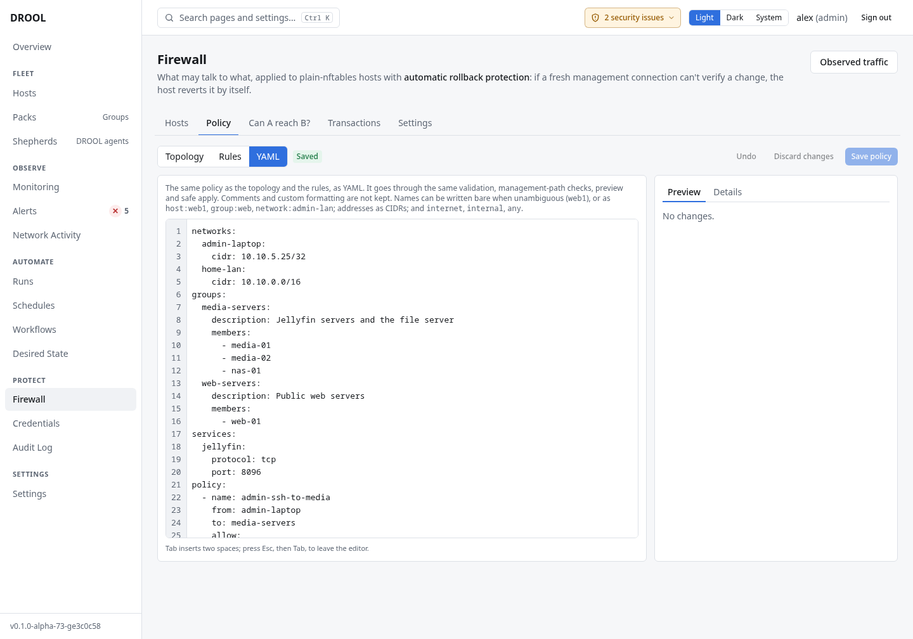

# YAML view

**Firewall → Policy → YAML** shows the whole [firewall policy](Firewall-Policy.md) as text. It's the
quickest way to write many rules at once, copy a policy to another installation, or keep a copy of it.

*It goes through the same validation, management-path checks, preview and safe apply.* Mistakes are
shown with their line number, and **YAML has errors** appears until they're fixed.



## The format

This is the policy from the examples:

```yaml
networks:
  admin-laptop:
    cidr: 10.10.5.25/32
  home-lan:
    cidr: 10.10.0.0/16
groups:
  media-servers:
    description: Jellyfin servers and the file server
    members:
      - media-01
      - media-02
      - nas-01
  web-servers:
    description: Public web servers
    members:
      - web-01
services:
  jellyfin:
    protocol: tcp
    port: 8096
policy:
  - name: admin-ssh-to-media
    from: admin-laptop
    to: media-servers
    allow: [ssh]
  - name: lan-to-jellyfin
    from: home-lan
    to: media-servers
    allow: [jellyfin]
  - name: internet-to-web
    from: internet
    to: web-servers
    allow: [http, https]
  - name: web-to-database
    from: web-servers
    to: database-01
    allow: [postgres]
```

| Section | What goes in it |
|---|---|
| `networks` | Named address ranges: `cidr: 10.10.0.0/16`, or several with `cidrs: [10.10.0.0/16, fd00:10::/64]`, and an optional `description` |
| `groups` | Packs and their `members` (host names). **Changing members here changes the Pack everywhere in DROOL.** Removing a group from the YAML doesn't delete the Pack |
| `services` | Your own services: `protocol` (`tcp` or `udp`) and `port` (a port `8096`, a range `"8000-8010"`, or a list `"80,443"`) |
| `policy` | The rules, each with `name`, `from`, `to`, and `allow:` or `deny:` with a list of services; optionally `description` and `enabled: false` |

**Names in `from` and `to`:**

- a host, Pack or network by its name (`web-01`, `media-servers`, `home-lan`), when that name is
  unambiguous; otherwise with a prefix: `host:web-01`, `group:media-servers`, `network:home-lan`;
- an address or range: `10.10.5.25/32`, `2001:db8::/32`;
- the keywords `internet` (everything outside the internal ranges), `internal` (the internal ranges)
  and `any` (anywhere);
- a list: `from: [admin-laptop, home-lan]`.

## Good to know

- **Comments and formatting are not kept.** DROOL rewrites the text in a standard form when you leave
  the YAML view or save.
- **Tab** inserts two spaces; press **Esc**, then **Tab**, to leave the editor with the keyboard.
- If someone else saved the policy since you opened it, your save is refused: copy your text, discard,
  and paste it again.

## Related

[Rules View](Rules-View.md) · [Topology View](Topology-View.md) · [Networks and CIDRs](Networks-and-CIDRs.md) ·
[Services and Ports](Services-and-Ports.md)
