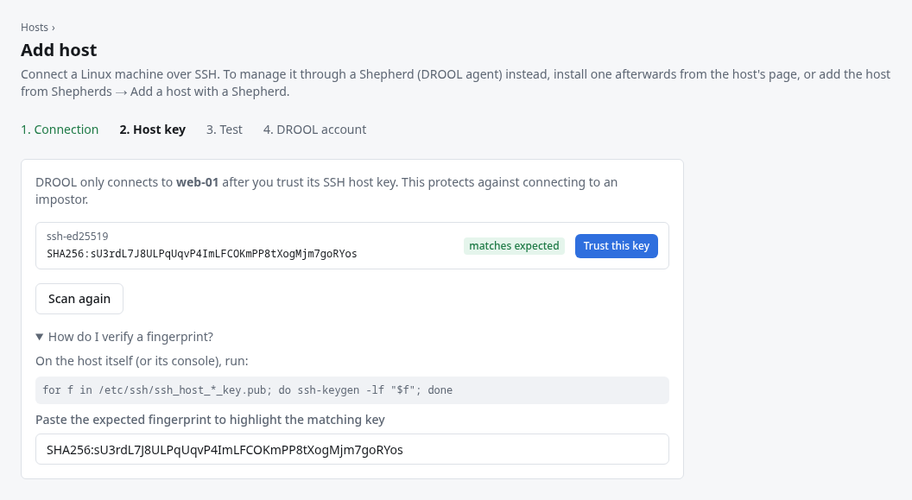
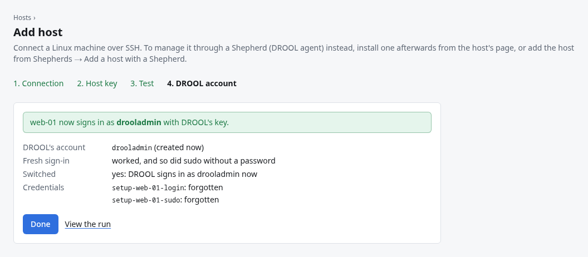

# Your first host

This page connects your first Linux machine to DROOL over SSH, from start to finish. It follows the
example of `web-01`, an Ubuntu 24.04 server at 10.10.40.21 (see [About the Examples](About-the-Examples.md)).
Use your own machine's name and address.

It takes about ten minutes, and you don't prepare anything on the host first. You add the host in
DROOL with an account you already have on it, confirm the host is really the machine you think it
is, and test the connection. Then DROOL creates its own account on the host, checks that it works,
switches to it, and forgets the password you typed. Then you run your first command on the host and
see it in Monitoring.

## Before you start

- You've [installed DROOL](Installing-DROOL.md) and [signed in](First-Login.md) as an
  **administrator** (only administrators can add hosts and trust their keys).
- The host runs a [supported distribution](Supported-Platforms.md#hosts-drool-manages) (Debian, Ubuntu, Rocky
  Linux, AlmaLinux, RHEL, Fedora). Others may work for commands but not for packages and updates.
- **You know the host's address.** If you don't, run `hostname -I` on the host: it prints its IP
  addresses (the first one is usually the one you want). A name works too, if it resolves on the
  controller.
- **The controller can reach the host's SSH port.** From the machine DROOL runs on,
  `nc -vz 10.10.40.21 22` (with your host's address) should say the connection succeeded. (No `nc`?
  Try `ssh 10.10.40.21`: any answer from SSH, even a password prompt or *Permission denied*, proves
  the port is reachable; a timeout doesn't.) If DROOL
  can't reach the host directly, you need a [jump host](Jump-Hosts.md) or a
  [Shepherd](Installing-a-Shepherd.md) instead.
- **You have an account on the host that can sign in over SSH and use `sudo`** (or `root`), with a
  password or an SSH key. In the examples it's Alex's own account, `alex`, which signs in with a
  password; sudo asks for the same password. DROOL uses it only to set itself up.
- **`sudo` is installed** on the host (it is on almost every server install), because DROOL's own
  account uses it.
- **systemd** runs on the host (it does on every normal server install). Without it, commands,
  scripts and packages still work, but service management and reboots don't.

## Step 1: Add the host in DROOL

Open **Hosts → Add host**. The page has four steps: **1. Connection**, **2. Host key**, **3. Test**
and **4. DROOL account**.


| Field | Example | What it means |
|---|---|---|
| **Name** | `web-01` | How the host appears everywhere in DROOL. Letters, digits, `.`, `_` and `-` only, up to 63 characters. It doesn't have to match the machine's own hostname. |
| **Address** | `10.10.40.21` | Where the controller connects: an IP address or a DNS name that resolves *on the controller*. |
| **SSH port** | `22` | Change it if the host's SSH server listens elsewhere. |
| **Connect through** | `Direct connection` | Choose a [jump host](Jump-Hosts.md) if the controller can't reach this host directly. |
| **How DROOL signs in to this host from now on** | **Create a dedicated DROOL SSH account** (Recommended) | DROOL uses the account you enter only to set itself up, then signs in with an account of its own. The other choice, **Use this SSH account**, keeps the account you enter for good ([below](#prefer-to-keep-using-your-own-account)). |
| **Existing SSH account** | `alex` | An account you already have on the host, which can use `sudo` (or is `root`). Used only for the setup. |
| **DROOL's account name** | `drooladmin` | The account DROOL creates on the host. DROOL suggests `drool`; the examples use `drooladmin`. |
| **For the setup, sign in with** | **The account's password** | Or **A private key** (paste it, with its passphrase if it has one), or **A stored credential or DROOL's key** (one you added under [Credentials](SSH-Credentials.md)). |
| **Password** | (Alex's password) | The existing account's password. |
| **Sudo password** | (Alex's password) | What sudo asks this account for. Leave it empty if sudo doesn't ask (or the account is `root`). |
| **Tags** | `web, ubuntu` | Optional labels, separated by commas, used for filtering and targeting. See [Tags](Tags.md). |
| **Description** | `nginx reverse proxy and web apps` | Optional, free text. |

**What it means for the host:** the box under the form says it plainly: *Full management gives this
DROOL account passwordless sudo and therefore root-equivalent administrative capability.* Anyone who
controls DROOL can run anything as root on this host. That's what DROOL needs to manage it, and it's
the same with any account DROOL uses for full management.

**What happens to what you type:** the password, key and sudo password are stored encrypted, as
*setup* credentials. DROOL uses them only until its own account works, then forgets them (unless you
use the same stored credential for another host, which keeps it). DROOL never deletes or changes the
account you use for the setup: `alex` keeps its password and everything else.

Under **Advanced** are two checkboxes most hosts don't need: **Jump host only** (DROOL uses this
host only to reach others and doesn't manage it, so it keeps signing in with the account you enter)
and **Requires a terminal for sudo** (for hosts whose sudo configuration contains `requiretty`).

Click **Continue**. DROOL saves the host now, and then asks the host for its SSH keys.

## Step 2: Trust the host's key

Every SSH server has a *host key* that identifies it. DROOL connects to a host only after you have
trusted its key, and from then on refuses to connect if the key ever changes. That protects you
from connecting (and sending a password) to an impostor that took over the address.



To check that the key really belongs to your host, run this **on the host** (in a terminal there, or
its console):

```sh
for f in /etc/ssh/ssh_host_*_key.pub; do ssh-keygen -lf "$f"; done
```

Find the line ending in `(ED25519)` and compare its `SHA256:…` fingerprint with the one DROOL shows.
To make that easier, paste it into **Paste the expected fingerprint to highlight the matching key**:
the matching key is marked **matches expected**. Then click **Trust this key** next to it.

If the fingerprints don't match, **don't trust the key**. Something else answered at that address:
check the address, and find out why before going on.

If no keys appear, DROOL couldn't reach the host's SSH port. Check the address and port, then click
**Scan again**. [Host Won't Connect](Host-Wont-Connect.md) goes through the usual causes.

## Step 3: Test the connection

As soon as you trust the key, DROOL tests the connection with the account you entered, step by
step:


| Check | What DROOL tried | If it fails |
|---|---|---|
| **Reachable** | Open a network connection to the SSH port | [Host Won't Connect](Host-Wont-Connect.md) |
| **Host Key** | The host presented the key you trusted | [SSH Host Key Changed](SSH-Host-Key-Changed.md) |
| **Authentication** | Log in as the existing account with what you entered | [Authentication Failed](Authentication-Failed.md) |
| **Privilege Escalation** | Run a harmless command through sudo | [Sudo Failed](Sudo-Failed.md) |
| **Operating System** | Read the distribution and kernel | Usually follows from an earlier failure |
| **Init System** | Find systemd | Without systemd: works for commands, scripts and packages; services and reboots don't |

When the checks pass, DROOL says it's **ready to set up its own account**. Click **Continue**.

If something failed, DROOL explains why under the check. Fix the cause on the host (or the host's
settings with **Actions → Edit host details**, on its page) and click **Test again**. You don't lose
anything by leaving the page: the host stays in DROOL, and its page offers the next step.

## Step 4: Let DROOL create its own account

Before anything changes on the host, DROOL asks the host what's there (read-only, as root through
`alex`) and shows you exactly what it will do:


Click **Create drooladmin and switch**, and confirm your DROOL password if DROOL asks for it (it does
for every high-impact change). DROOL then:

1. creates the account `drooladmin` on the host: a system account with a home folder and a shell,
   and **no password**, so nobody can sign in as it with one;
2. lets DROOL's own SSH key sign in as it (`~drooladmin/.ssh/authorized_keys`, only DROOL's key);
3. gives it passwordless sudo in a file of its own, `/etc/sudoers.d/drool-account-drooladmin`, which
   `visudo` checks before sudo ever reads it;
4. records that DROOL created the account, in `/var/lib/drool/ssh-accounts/drooladmin` (readable by
   root only), so it never mistakes someone else's account for its own;
5. **opens a brand-new connection** (checking the host's key again), signs in as `drooladmin` with
   DROOL's key, and runs sudo without a password;
6. **only if that worked**, switches `web-01` to `drooladmin`, and in the same step forgets the
   password and sudo password you typed.



Click **Done**: DROOL opens `web-01`'s page. (Later, **Hosts** in the sidebar lists every host;
click one to open its page.)

**If something goes wrong,** nothing is switched: `web-01` keeps signing in as `alex`, with the
password you typed. DROOL says which step failed and why. If it had already created `drooladmin`,
the account stays on the host, and **Try again** (or **Set up a dedicated DROOL SSH account…** in the
host's **Management** section) continues with it once you've fixed the cause.
[DROOL's Own SSH Account](Dedicated-SSH-Account.md#when-the-setup-stops) lists the usual causes.

**Not now?** Click **Not now**. DROOL keeps signing in as `alex` with what you typed, and the
host's **Management** section offers **Set up a dedicated DROOL SSH account…** whenever you're ready.

### Prefer to keep using your own account?

Choose **Use this SSH account** in step 1 instead. DROOL then signs in with the account and
credential you enter, for good, and the wizard ends after the test: there's no step 4. The account
needs to accept DROOL's key (or a stored password) and, for full management, passwordless sudo or a
stored sudo password. [SSH Credentials](SSH-Credentials.md#using-an-account-you-set-up-yourself)
shows how to prepare one by hand.

## Step 5: Run your first command

Now ask `web-01` something harmless: how full its disks are.

1. On `web-01`'s page, click **Run command**. A new run opens with `web-01` already ticked as the
   target.
2. Under **What to do**, keep **Command** and type:

   ```sh
   df -h
   ```

   `df -h` lists every filesystem on the host with its size, how much is used and how much is free.
   It only reads; it changes nothing.
3. Open **Advanced options** and tick **Read-only** (this command changes nothing, so DROOL may run
   it alongside other work). Leave **Run as root (sudo)** unticked: `df` doesn't need root.
4. Click **Review: run on 1 host…**. DROOL's review, *Start this run on 1 host?*, sums up what runs
   where; click **Start run on 1 host**.

DROOL opens the run and shows `web-01`'s output as it arrives: the same table `df -h` prints in a
terminal. **succeeded** with exit code 0 means it worked. If it failed instead, the run says why
([Understanding Run Results](Understanding-Run-Results.md)); [Running a Command](Running-a-Command.md)
explains every option of the form.

## Step 6: See it in Monitoring

Click **Monitoring** in the sidebar. `web-01` has a row there, with *SSH · polled* under
**Monitoring** and its CPU, memory, fullest disk and services. DROOL collects them over SSH every
5 minutes, without installing anything.

Click `web-01` to open its monitoring page: tiles for CPU, memory, storage, network and services,
history charts, and any health issues it found ([Host Monitoring](Host-Monitoring.md)). It's the
host's **Monitoring** section: from the host's page, click **Monitoring**. If it says *No monitoring
data yet*, DROOL hasn't polled the host yet: click **Collect now** at the top, or wait up to 5
minutes.

## What DROOL does from now on

![A host's page right after adding it (here backup-01, added the same way): Debian 12, managed via SSH; Connection Ready, Last check online, Health Healthy; Run command, Install updates and Actions; the sections Overview, Monitoring, Files, Network, Firewall, Desired State, Management and Activity; "Nothing needs attention on this host right now"; Health now with its first monitoring data; the Desired State, Firewall, Network and Files summaries; the run that set up DROOL's own SSH account; and the System card](images/first-host-page.png)

Apart from its own account, DROOL installs nothing on the host. Without you doing anything, DROOL:

- **takes an inventory**: distribution, kernel, CPU, memory, disks and filesystems, network
  interfaces, services and listening ports (on the host's **Overview**, **System** card; services
  under **Monitoring**, listening ports under **Network**);
- **checks the host's status every 5 minutes**: reachable or not, uptime, load, disk space, failed
  services, and whether a reboot is required;
- **checks for updates every 6 hours** (counts of pending and security updates);
- **polls monitoring every 5 minutes** over SSH: CPU, memory, disks, network, services
  ([Monitoring Through SSH vs Shepherd](Monitoring-Through-SSH-vs-Shepherd.md)).

The host's **Management** section shows how DROOL reaches the host, now as its own account
`drooladmin` with its own key:


## Next

**[Secure Your Installation](Secure-Your-Installation.md)**: go through DROOL's own security
checklist, at least two-factor sign-in, before you add many more machines.

Then, when you're ready:

- **Add your other machines** the same way, steps 1–4 for each. DROOL creates its account on every
  one; you only need an account of yours there for the setup. Hosts you already added another way
  can switch too: [DROOL's Own SSH Account](Dedicated-SSH-Account.md#hosts-you-already-added).
- **Group them:** [Packs](Packs.md) let you target "all media servers" in one go.
- **Get told when something breaks:** [Email Notifications](Email-Notifications.md),
  [Discord Notifications](Discord-Notifications.md) and the other destinations.
- **Decide SSH or Shepherd:** [Understanding SSH vs Shepherds](SSH-vs-Shepherds.md).
