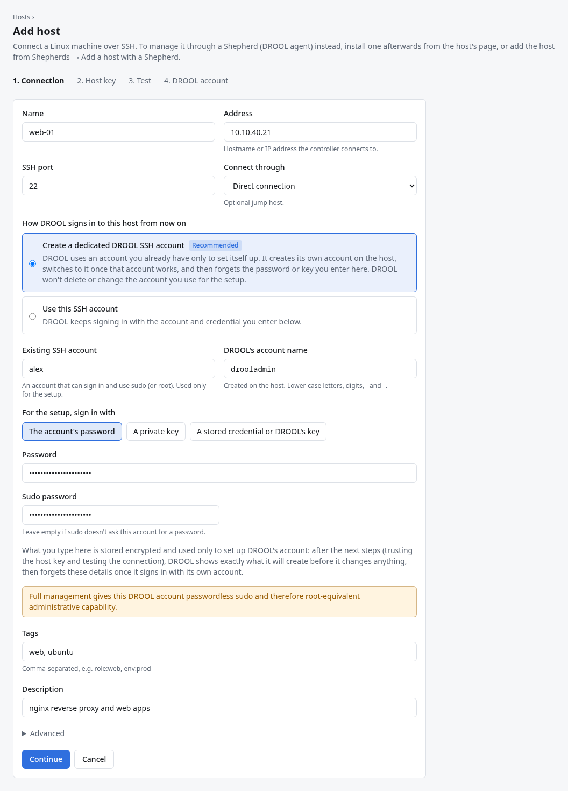
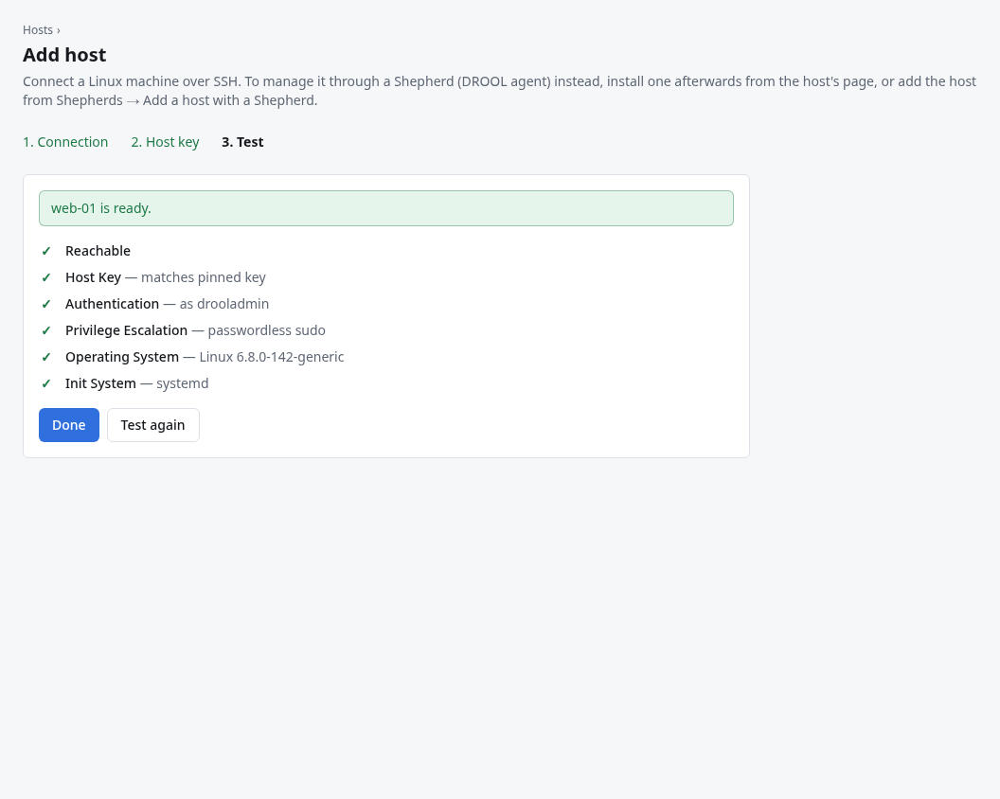
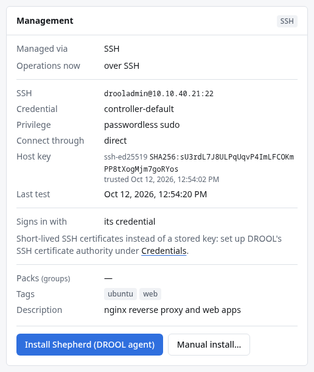

# Your first host

This page connects your first Linux machine to DROOL over SSH, from start to finish. It follows the
example of `web-01`, an Ubuntu 24.04 server at 10.10.40.21 (see [About the Examples](About-the-Examples.md)).
Use your own machine's name and address.

It takes about ten minutes: you create an account on the host for DROOL, let DROOL's key log in to
it, add the host in DROOL, confirm the host is really the machine you think it is, and test the
connection. Then you run your first command on it and see it in Monitoring.

## Before you start

- You've [installed DROOL](Installing-DROOL.md) and [signed in](First-Login.md) as an
  **administrator** (only administrators can add hosts and trust their keys).
- The host runs a [supported distribution](Glossary.md#supported-distributions) (Debian, Ubuntu, Rocky
  Linux, AlmaLinux, RHEL, Fedora). Others may work for commands but not for packages and updates.
- **You know the host's address.** If you don't, run `hostname -I` on the host: it prints its IP
  addresses (the first one is usually the one you want). A name works too, if it resolves on the
  controller.
- **The controller can reach the host's SSH port.** From the machine DROOL runs on,
  `nc -vz 10.10.40.21 22` (with your host's address) should say the connection succeeded. (No `nc`?
  Try `ssh 10.10.40.21`: any answer from SSH, even a password prompt or *Permission denied*, proves
  the port is reachable; a timeout doesn't.) If DROOL
  can't reach the host directly, you need a [jump host](Jump-Hosts.md) or a
  [Shepherd](Installing-a-Shepherd.md) instead.
- **You can log in to the host yourself and use `sudo`**, to create DROOL's account.
- **systemd** runs on the host (it does on every normal server install). Without it, commands,
  scripts and packages still work, but service management and reboots don't.

## Step 1: Create an account on the host for DROOL

DROOL logs in as an ordinary Linux user and uses `sudo` when something needs root (installing
packages, managing services, rebooting, editing system files). A dedicated account keeps DROOL's
actions easy to tell apart from yours in the host's logs. The examples call it `drooladmin`.

On the host, logged in as yourself:

```sh
sudo useradd --create-home --shell /bin/bash drooladmin
echo 'drooladmin ALL=(ALL) NOPASSWD:ALL' | sudo tee /etc/sudoers.d/drooladmin
sudo chmod 0440 /etc/sudoers.d/drooladmin
sudo visudo -cf /etc/sudoers.d/drooladmin
```

- The first line creates the account with a home folder (DROOL's key goes there).
- The second and third give it **passwordless sudo**, in a file of its own. The single quotes keep
  the shell from touching the text inside them; type them as shown.
- The last line checks the sudoers file; it should print `parsed OK`.

**What this means:** anyone who controls DROOL can run anything as root on this host. That's what
DROOL needs to manage it. If you'd rather have sudo ask for a password, leave out the second and
third lines, give the account a password (`sudo passwd drooladmin`), allow it to use sudo the way
your distribution does it (the `sudo` group on Debian and Ubuntu, `wheel` on Rocky, AlmaLinux and
Fedora), and store that password in DROOL as a *Sudo password* credential
([SSH Credentials](SSH-Credentials.md)). DROOL then sends it to sudo on standard input, never on
the command line, and removes it from any output.

## Step 2: Let DROOL's key log in

DROOL created its own SSH key pair when it was installed. The private half never leaves the
controller; the public half has to go into `drooladmin`'s `~/.ssh/authorized_keys` on the host.

1. In DROOL, open **Credentials**. The card **DROOL's SSH key** shows a one-line command.

   

2. Click **Copy** next to the command. It looks like this (your key is different):

   ```sh
   mkdir -p ~/.ssh && chmod 700 ~/.ssh && echo 'ssh-ed25519 AAAAC3NzaC1lZDI1NTE5AAAAIG7x8RkV4n3fTnYp5sM2rP9QeW1bLc6jK0dZxExample drool:controller-default' >> ~/.ssh/authorized_keys && chmod 600 ~/.ssh/authorized_keys
   ```

3. On the host, become `drooladmin` and paste the command:

   ```sh
   sudo -iu drooladmin
   ```

   Then paste what you copied, press Enter, and type `exit` to become yourself again.

The command must run **as `drooladmin`**, because `~` means the home folder of whoever runs it.
Paste it exactly as copied, including the single quotes around the key.

Prefer your own key, or a password? Both work; see [SSH Credentials](SSH-Credentials.md). For keys
that expire on their own, see [Short-Lived SSH Certificates](Short-Lived-SSH-Certificates.md).

## Step 3: Add the host in DROOL

Open **Hosts → Add host**. The page has three steps: **1. Connection**, **2. Host key**, **3. Test**.



| Field | Example | What it means |
|---|---|---|
| **Name** | `web-01` | How the host appears everywhere in DROOL. Letters, digits, `.`, `_` and `-` only, up to 63 characters. It doesn't have to match the machine's own hostname. |
| **Address** | `10.10.40.21` | Where the controller connects: an IP address or a DNS name that resolves *on the controller*. |
| **SSH user** | `drooladmin` | The account from step 1. |
| **SSH port** | `22` | Change it if the host's SSH server listens elsewhere. |
| **Credential** | `controller-default (SSH key)` | How DROOL proves who it is. `controller-default` is DROOL's own key from step 2. Other keys and passwords appear here once you've added them under Credentials. |
| **Connect through** | `Direct connection` | Choose a [jump host](Jump-Hosts.md) if the controller can't reach this host directly. |
| **Privilege escalation** | `sudo` | How DROOL becomes root. Choose `none (connect as root)` only if the SSH user *is* root. |
| **Sudo password** | `Not needed (passwordless sudo)` | Pick a stored *Sudo password* credential if sudo asks for one. |
| **Tags** | `web, ubuntu` | Optional labels, separated by commas, used for filtering and targeting. See [Tags](Tags.md). |
| **Description** | `nginx reverse proxy and web apps` | Optional, free text. |

Under **Advanced** are two checkboxes most hosts don't need: **Jump host only** (DROOL uses this
host only to reach others and doesn't manage it) and **Requires a terminal for sudo** (for hosts
whose sudo configuration contains `requiretty`).

The form also shows the same key-install command as the Credentials page, already set for the SSH
user you typed. Handy if you skipped step 2.

Click **Continue**. DROOL saves the host now, and then asks the host for its SSH keys.

## Step 4: Trust the host's key

Every SSH server has a *host key* that identifies it. DROOL connects to a host only after you have
trusted its key, and from then on refuses to connect if the key ever changes. That protects you
from connecting (and sending a password) to an impostor that took over the address.


To check that the key really belongs to your host, run this **on the host** (in a terminal there, or
its console):

```sh
for f in /etc/ssh/ssh_host_*_key.pub; do ssh-keygen -lf "$f"; done
```

Find the line ending in `(ED25519)` and compare its `SHA256:…` fingerprint with the one DROOL shows.
To make that easier, paste it into **Paste the expected fingerprint to highlight the matching key**:
the matching key is marked **matches expected**. Then click **Trust this key** next to it.

If the fingerprints don't match, **don't trust the key**. Something else answered at that address:
check the address, and find out why before going on.

If no keys appear, DROOL couldn't reach the host's SSH port. Check the address and port, then click
**Scan again**. [Host Won't Connect](Host-Wont-Connect.md) goes through the usual causes.

## Step 5: Test the connection

As soon as you trust the key, DROOL tests the connection, step by step:



| Check | What DROOL tried | If it fails |
|---|---|---|
| **Reachable** | Open a network connection to the SSH port | [Host Won't Connect](Host-Wont-Connect.md) |
| **Host Key** | The host presented the key you trusted | [SSH Host Key Changed](SSH-Host-Key-Changed.md) |
| **Authentication** | Log in as the SSH user with the credential | [Authentication Failed](Authentication-Failed.md) |
| **Privilege Escalation** | Run a harmless command through sudo | [Sudo Failed](Sudo-Failed.md) |
| **Operating System** | Read the distribution and kernel | Usually follows from an earlier failure |
| **Init System** | Find systemd | Without systemd: works for commands, scripts and packages; services and reboots don't |

When every check passes, DROOL says **web-01 is ready.** Click **Done**: DROOL opens `web-01`'s page.
(Later, **Hosts** in the sidebar lists every host; click one to open its page.)

If something failed, DROOL explains why under the check. Fix the cause on the host (or the host's
settings with **Edit**, on its page) and click **Test again**. You don't lose anything by leaving the
page: the host stays in DROOL, and **Test connection** on its page runs the same test.

## Step 6: Run your first command

Now ask `web-01` something harmless: how full its disks are.

1. On `web-01`'s page, click **Run command**. A new run opens with `web-01` already ticked as the
   target.
2. Under **What to do**, keep **Command** and type:

   ```sh
   df -h
   ```

   `df -h` lists every filesystem on the host with its size, how much is used and how much is free.
   It only reads; it changes nothing.
3. Tick **Read-only** (this command changes nothing, so DROOL may run it alongside other work). Leave
   **Run as root (sudo)** unticked: `df` doesn't need root.
4. Click **Run on 1 host**, and confirm.

DROOL opens the run and shows `web-01`'s output as it arrives: the same table `df -h` prints in a
terminal. **succeeded** with exit code 0 means it worked. If it failed instead, the run says why
([Understanding Run Results](Understanding-Run-Results.md)); [Running a Command](Running-a-Command.md)
explains every option of the form.

## Step 7: See it in Monitoring

Click **Monitoring** in the sidebar. `web-01` has a row there, with *SSH · polled* under
**Monitoring** and its CPU, memory, fullest disk and services. DROOL collects them over SSH every
5 minutes, without installing anything.

Click `web-01` to open its monitoring page: tiles for CPU, memory, storage, network and services,
history charts, and any health issues it found ([Host Monitoring](Host-Monitoring.md)). You can also
get there with **View monitoring** on the host's page. If it says *No monitoring data yet*, DROOL
hasn't polled the host yet: click **Collect now** at the top, or wait up to 5 minutes.

## What DROOL does from now on


Nothing is installed on the host. Without you doing anything, DROOL:

- **takes an inventory**: distribution, kernel, CPU, memory, disks and filesystems, network
  interfaces, services and listening ports (shown on the host page);
- **checks the host's status every 5 minutes**: reachable or not, uptime, load, disk space, failed
  services, and whether a reboot is required;
- **checks for updates every 6 hours** (counts of pending and security updates);
- **polls monitoring every 5 minutes** over SSH: CPU, memory, disks, network, services
  ([Monitoring Through SSH vs Shepherd](Monitoring-Through-SSH-vs-Shepherd.md)).

The **Management** card on the host page shows how DROOL reaches the host:



## Next

**[Secure Your Installation](Secure-Your-Installation.md)**: go through DROOL's own security
checklist, at least two-factor sign-in, before you add many more machines.

Then, when you're ready:

- **Add your other machines** the same way. Each needs steps 1–5; the key-install command is the
  same for every host that uses `drooladmin`.
- **Group them:** [Packs](Packs.md) let you target "all media servers" in one go.
- **Get told when something breaks:** [Email Notifications](Email-Notifications.md),
  [Discord Notifications](Discord-Notifications.md) and the other destinations.
- **Decide SSH or Shepherd:** [Understanding SSH vs Shepherds](SSH-vs-Shepherds.md).
